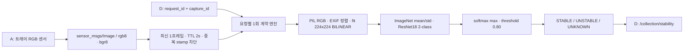

# SmartDish C — 식기 적재 안정성 모델 카드 v0.2 — 더미 격리 개발 단계

- 작성일: 2026-11-23 / 담당 C / 상태: **MOCK_ONLY_TRAINING_TESTED** / **REAL_TRAINING_NOT_RUN** / **ROS_IMAGE_LIVE_NOT_RUN**
- GitHub: `silverbjin/samsung_AXI`, 기반 `main@2dd7f968dd3d24e2afb48e0917ef8c9d054ac894`, C `feat/smartdish-c-stability` (코드 SHA는 PR의 최종 HEAD 확인)
- 소비자: D Mission Manager (`/collection/stability`), 입력 카메라: A `/smartdish/tray/image_raw` (선택).

## 1. 문제 정의와 정확한 라벨

`STABLE(0)`은 같은 트레이 배치의 물리 관측에서 지지·접촉 유지/전도·낙하 없음, `UNSTABLE(1)`은 낙하·전도·트레이 이탈 등 **물리 근거가 기록된 경우**입니다. 이는 DACON의 일반 구조물/10초 안정성 문제도, S7의 `STACKED/NOT_STACKED` 식기 존재 검출도 아닙니다. `UNKNOWN`은 클래스가 아닌 **운영 상태**(모델/영상 없음, 손상, 오래된 프레임, 낮은 confidence 또는 추론 예외)입니다. RGB 한 장은 접촉력·무게중심을 직접 관측하지 않으므로 물리 안전을 보증하지 않습니다.

## 2. 출처·설계 판단

- 공식 DACON 베이스라인 링크: https://dacon.io/competitions/official/236686/codeshare/13931 . 게시물 제목은 `[Baseline] Multi-View ResNet 기반 구조물 안정성 예측`. 공개 페이지의 코드 본문 및 파일은 인증 없이 확보하지 못했습니다. **원본 코드 재사용/원본 성능 재현 아님**. 멀티뷰 원리는 참고했지만 현재 A 계약은 **트레이 RGB 단일 카메라**이므로 1-view ResNet18만 구현했습니다.
- 데이터는 B `feat/smartdish-b-dataset@4c63d8a88297b7418efccb6e933c25275d9807ce`의 `split_manifest.csv` 스키마를 읽기 전용으로 사용합니다. 실제 이미지/라벨 현재 **0건**. B는 `STABLE=0/UNSTABLE=1`, PNG 224×224, `PHYSICS_OBSERVED` + 사용권 확인, stack_id 단위 누수 방지를 정의했습니다.
- 라이선스: torchvision ResNet18의 공식 pretrained weights 이용 권한/원래 배포 조건을 실제 학습 전 확인합니다. DACON 다운로드 원본·데이터·weights는 공개 저장소에 포함하지 않습니다. C가 학습시킨 weights의 공개 배포 허가는 **미확정**입니다.

## 3. 추론 파이프라인

- 모델: `torchvision.models.resnet18` 1종. 첫 실험: ImageNet pretrained backbone 동결, `fc` 학습; 두 번째 실험: 동일 baseline 체크포인트로부터 `layer4` + `fc`만 fine-tuning, 각 기본 3 epoch (실제 데이터 규모에 맞춰 설정).
- 입력: ROS encoding `rgb8/bgr8`, step padding 허용. 학습 PNG는 B 형식 224×224 RGB. PIL `ImageOps.exif_transpose` → `RGB` → `ImageOps.fit(224×224, BILINEAR)` → tensor `[0,1]` → mean `(0.485,0.456,0.406)` / std `(0.229,0.224,0.225)`.
- 출력 순서: `index 0=STABLE`, `index 1=UNSTABLE`. 설정 `confidence_min=0.80`은 **MVP 임시 검토값, 검증된 안전 임계치 아님**. 낮으면 `UNKNOWN`, `confidence:null`.
- 체크포인트: `resnet18_single_rgb`, `labels`, `image_size`, `mean`, `std`, `data_scope=PHYSICS_OBSERVED`, `split_manifest_sha256`, `model_state_dict` 포함. `model_version=resnet18-<checkpoint bytes SHA256 앞 12자리>`. 체크포인트가 없으면 `none`.
- 유효 프레임 규칙: 가장 최근 도착 후 2초 이내, 시퀀스별 1회만 소비, nonzero ROS timestamp 역행/중복 차단. ROS Clock/벽시계 혼용 방지를 위해 수신 시각은 monotonic으로 측정. 노드 재시작 후 중복 이벤트 영구 방지는 **비범위**.
- 오류 정책: 모든 유효 `request_id/capture_id` 요청에 JSON 1건; 중복 요청은 0건. 키가 누락된 깨진 JSON은 상관관계가 불가능하므로 로그 후 응답하지 않음. D가 timeout 경로로 처리.

## 4. 입출력/평가 (실측값만 기입)

| 항목 | 현재 상태 | 근거 |
|---|---|---|
| 실제 B 트레이 물리 검증 데이터 | 0건 / BLOCKED | B Dataset Card, PR #37 |
| frozen pretrained baseline 학습 | TRAINING_NOT_RUN | 없음 — 데이터 부재 |
| fine-tuning | TRAINING_NOT_RUN | 없음 — baseline 미완료 |
| independent test Accuracy / Macro F1 / confusion matrix | NOT_RUN | 숫자 임의 생성 금지 |
| fixture 계약 20개 pytest | L0 PASS (개발 환경) | `tests/test_c_stability.py`; GitHub Run 결과 별도 참조 |
| live ROS message / Gazebo tray RGB | ROS_IMAGE_LIVE_NOT_RUN | A 카메라 공급 확인 전 |
| WSL2 L3 AI ON | NOT_RUN | 시연 기준 AI OFF 우선 |

## 5. 사용/재현과 권리

실행 명령과 데이터 준비 후 절차는 [`MODEL_TRAINING_GUIDE_KO.md`](MODEL_TRAINING_GUIDE_KO.md)를 참조하십시오. 학습이 완료되더라도 **독립 test를 학습/튜닝에 사용하지 않으며**, 정확도는 해당 test에 대해서만 보고합니다. weights는 Git에 올리지 않고 외부 경로 및 SHA만 인계합니다. 일반 구조물 안정성 모델을 트레이 안정성으로 간주할 수 없습니다.

### 훈련생 확인 질문

1. 식기가 쌓여 있음을 분류했다고 물리적으로 안정하다고 할 수 없는 이유는 무엇입니까?
2. `UNKNOWN`을 세 번째 학습 클래스로 추가하지 않은 이유는 무엇입니까?
3. 왜 이미지 SHA, stack_id 누수, 모델 version SHA를 각기 기록합니까?
4. 테스트 accuracy가 100%여도 ROS 화면 시연 PASS가 아닌 이유는 무엇입니까?

## 6. 2026-11-23 C04/C05 — 더미 기반 경로 추가 및 실데이터 전환

- B 원본 pinned SHA: `4c63d8a88297b7418efccb6e933c25275d9807ce`; 원본 Data Card의 `manifest.csv`/`split_manifest.csv`는 여전히 **실물 0건**입니다. GitHub CI는 B 코드를 별도 checkout하여 합성 fixture 원본 경로를 검증합니다.
- 로컬 6장 mock dataset 실험: Python + torch/torchvision CPU, frozen 1 epoch, finetune 1 epoch, 독립 *더미* test 2장. `MOCK_ONLY_SANITY_CHECK`, 정확도/F1 수치는 실제 모델 성능으로 사용 금지. 로컬은 **B 생성기 규격을 복제한 shim으로 실행**했으며 원본 B 직접 실행 증거와 구별합니다.
- 체크포인트 `data_scope=MOCK_ONLY`, `weight_init=RANDOM_DEMO_ONLY` (초기 단계)이며 운영 ROS loader는 `data_scope=PHYSICS_OBSERVED` 이외 모델을 `C_MODEL_CONTRACT_MISMATCH`로 거부합니다. 이 checkpoint는 GitHub에 업로드하지 않습니다.
- `--demo-fixtures`는 B `CONTRACT_FIXTURE/MOCK_ONLY`를 명시적으로 받는 실습 모드입니다. 플래그 없는 기본 운영 학습/평가 경로는 과거처럼 mock을 거부합니다. 실물 검증 데이터 준비 후 코드를 변경하지 않고 정상 실학습 CLI를 실행합니다.
- 물리 관측/사용 권한의 실제 검토 책임은 B/평가 담당에 있으며 CSV에 `PHYSICS_OBSERVED`라고 적었다는 이유만으로 실제 물리 검증이 된 것은 아닙니다.
- 후속 검사: 실제 이미지·ground truth/권한 확보, pretrained 학습, 독립 test, A tray RGB, D 상태 머신 AI ON, Jazzy rclpy는 모두 **NOT_RUN**입니다.
