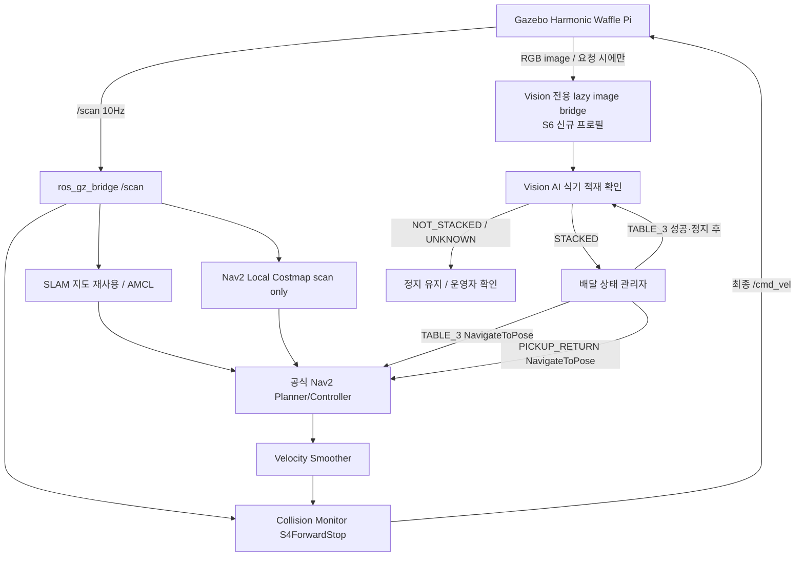

# SAMSUNGAXI 서비스 로봇 — 검증된 S5와 S6 요청형 Vision 목표 아키텍처

> S5 기능 경로는 WSL2에서 배달·복귀·LiDAR STOP이 검증되었습니다. 아래 Vision 분기는 **S6 개발계획**이며 아직 구현/인수되지 않았습니다.

## 핵심 계약

1. **주행 안전:** Nav2 Local Costmap은 공식 LiDAR `scan` 단독이며, Collision Monitor 역시 `scan` 독립 소스입니다. RGB-D PointCloud2를 주행 안전 입력으로 요구하지 않습니다.
2. **기존 실행 보존:** 현재 5Hz/2Hz S5 기능 경로 및 `src/restaurant_bringup/config/bridge.yaml`의 원본 기능은 이전 성공 증거대로 유지합니다.
3. **S6 계획:** 새 opt-in `bridge_vision_on_demand.yaml`에서 RGB `image` + `camera_info`만 `lazy:true`로 구독합니다. `depth_image`와 `points` 브리지는 신규 Vision 프로필에서 제외합니다. 다른 학습/진단 모드까지 삭제하지 않습니다.
4. **Vision 안전:** 첫 Goal 성공+Odom 정지 후에만 이미지 캡처/AI 판별. `STACKED`에서만 복귀 Goal; 판단 실패나 미검출은 HOLD. Vision AI는 `/cmd_vel` 발행 금지.
5. **성능 주장 제한:** ROS 구독 비활성은 Gazebo 센서 렌더링 완전 정지의 직접 증거가 아닙니다. 실제 Harmonic 구독 및 렌더링 상태는 S6-CAMERA-01에서 별도 확인하며 RTF 90%는 HOLD입니다.
6. **월드 준비:** 현재 TABLE_3은 책상 box뿐이며 식기 적재 fixture가 없습니다. 시점과 접시 더미/빈 테이블 대비를 우선 구현·검증합니다.

상세 계획: [S6-VISION-ON-DEMAND MVP](S6_VISION_ON_DEMAND_MVP_PLAN_KO.md).
