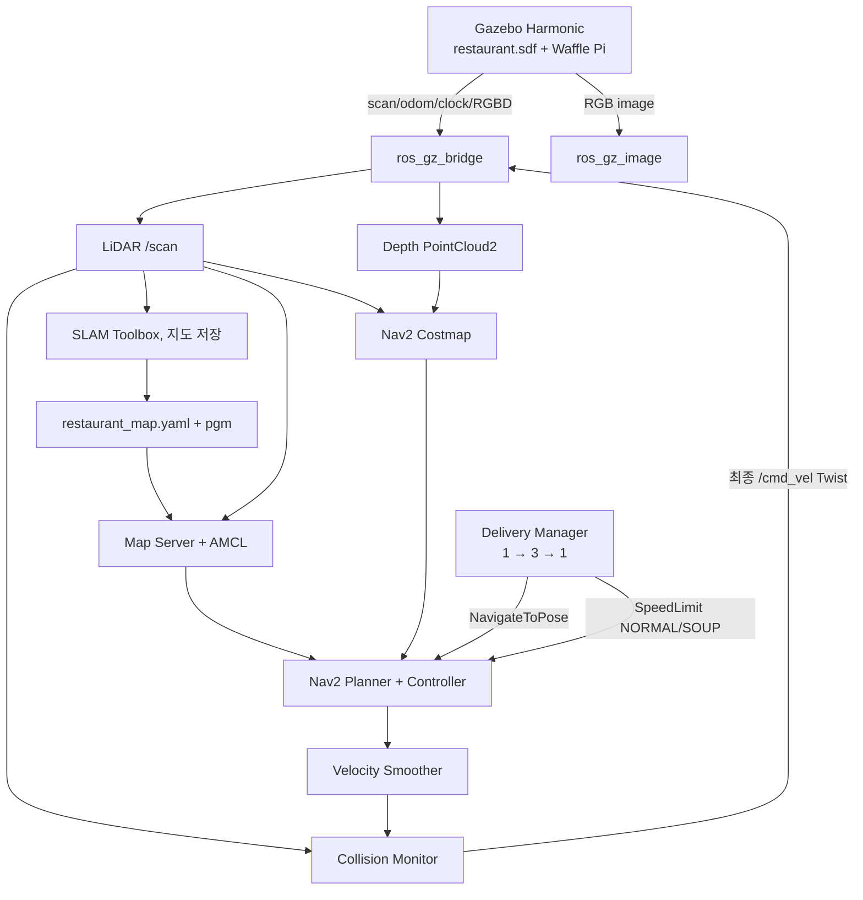

# 독립 MVP 아키텍처 (동작 후보, 현장 인수 전)

공식 Nav2 Jazzy `navigation_launch.py`에 이미 포함된 `/cmd_vel_nav` → `velocity_smoother` → `/cmd_vel_smoothed` → `collision_monitor` → `/cmd_vel` 체인을 재사용합니다. **최종 `/cmd_vel`에는 별도 AI, 텔레옵 또는 임시 퍼블리셔를 동시에 연결하지 않습니다.** S1과 S2 초기 개발에서는 Nav2가 기동되지 않으므로 동일 수준의 안전 체인을 보장하지 않습니다.

S2 후보 RGB-D overlay는 독립 사본에만 `rgbd_camera`를 장착하며 원본 Waffle Pi는 그대로 사용합니다. 실시간 Depth가 Gazebo→ROS로 브리지되고 같은 optical TF와 타임스탬프를 유지하는지는 강사 WSL2에서 검증해야 합니다. D05 거리 관측이 성공했던 AXIA 증거를 이 새 레스토랑의 안전 통합 증거로 대신할 수 없습니다.
