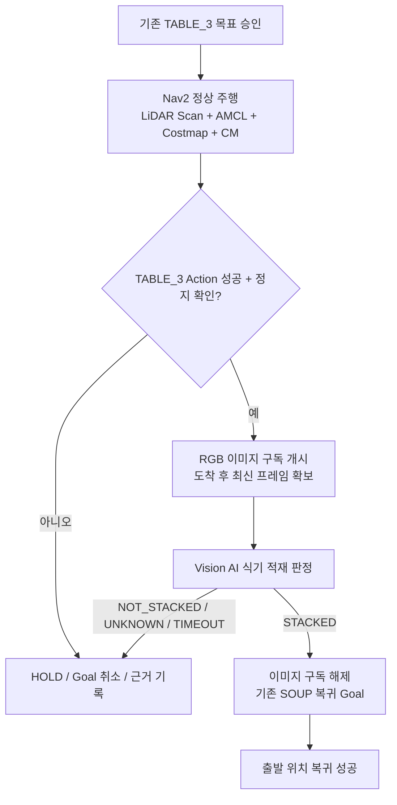

# S6-VISION-ON-DEMAND — 테이블 식기 적재 확인 후 자동 복귀 MVP 개발계획 (2026-11-23)

> **분류: 설계 확정/구현 전.** 이 문서는 기존 S5 성공을 수정하지 않으며 S6 코드 구현·CI·WSL2 인수를 수행했다고 주장하지 않는다. RTF 90% 목표는 사용자 요청으로 HOLD.

## 1. 목표와 원본 증거

**목표 시나리오:** 출발점에서 TABLE_3으로 자율주행 → 실제 도착·정지 확인 → 테이블의 쌓인 식기를 RGB 이미지로 Vision AI 판별 → `STACKED` 확인 시에만 기존 Nav2로 픽업 위치 복귀.

- 기존 `main` 기준 SHA: `06af2ccf460728548ad553128cf3a6c336ba57d6`. S5 Costmap LiDAR 단독 PR #25, 2Hz STOP PR #26, WSL2 원샷 PR #27은 이미 병합됐다.
- 검증한 기존 WSL2 NO_GOAL ZIP `samsungaxi_gui_20261123T011747Z-3508.zip` 및 LIVE `samsungaxi_gui_20261123T011748Z-3545.zip`: 배달/복귀 Action SUCCEEDED, NORMAL/SOUP p75=0.23/0.11m/s, LiDAR STOP 29점, 필터링 `/cmd_vel` 0, 물리 Odom 0, 첫 오류 마커 NONE.
- 이전 5Hz 대비 신규 2Hz 주행 RTF 중앙값 `0.6251 → 0.7955` (+27.3%, 서로 다른 설정 및 표본 구성). **관측값이지 RGB 주파수 단독의 인과 효과가 아니며 RTF 인수 PASS가 아니다.**
- 현재 `prepare_nav2_params.py`의 Local Costmap `voxel_layer.observation_sources=scan`, Collision Monitor `observation_sources=['scan']`; 주행·안전에 RGB/Depth/PointCloud2를 사용하지 않는다.
- `prepare_waffle_rgbd.py`는 단일 `rgbd_camera`를 320×240, 2Hz 후보/5Hz 기본, `always_on=true`로 생성한다. `bridge.yaml`은 `/restaurant/rgbd/image`, `depth_image`, `points`, `camera_info`를 모두 GZ→ROS로 브리지한다.
- **현재 `restaurant.sdf`에는 TABLE_3의 식기 더미, 식기 이미지 또는 시각 인식 정답 모델이 없다.** 기존 S5의 도착 직후 복귀는 Vision AI 판단을 포함하지 않는다.

## 2. MVP 변경 후 기능 경계

### 상태 및 데이터 계약 (새 경로만 적용)

| 상태 | 입력·조건 | 출력 및 다음 행동 | 실패 시 |
|---|---|---|---|
| `NAV_TO_TABLE` | 기존 Nav2 `NavigateToPose` 및 LiDAR 10Hz | TABLE_3 Action SUCCEEDED | 기존 안전 실패/NO_GOAL 정책 유지 |
| `ARRIVAL_SETTLED` | SUCCEEDED + 실제 Odom 정지, 충분히 신선한 Scan/Odom | `VISION_REQUESTED` | HOLD, 카메라 요청 없음 |
| `VISION_REQUESTED` | `/restaurant/rgbd/image`에 **이때만** 임시 구독, 도착 이후 캡처된 프레임, 가능하면 2~3프레임 | `VISION_RESULT` 및 이미지 시각·판정 근거 | 10초 이내 프레임이 없거나 오래된 프레임이면 UNKNOWN |
| `VISION_RESULT` | AI가 `STACKED`, `NOT_STACKED`, `UNKNOWN` + confidence 반환 | STACKED인 경우에만 구독 종료 후 `NAV_RETURN` | NOT_STACKED/UNKNOWN은 정지 및 운영자 재확인, 자동 복귀 금지 |
| `NAV_RETURN` | 기존 Nav2 복귀 Goal, SOUP=0.11 m/s | Action+Odom 성공 시 RETURNED | 기존 Nav2 실패 처리, Goal 중복 발행 금지 |

최소 이미지 수·confidence 임계값은 **실제 장면/모델 검증 후 설정**한다. 임의로 높은 AI 정확도를 주장하지 않는다. 장면 부족/가림/광량 문제는 `UNKNOWN`이다. 실물 식기 이동·집기·적재 장치, SLAM 재생성, 새 Planner 및 실시간 RGB 추적은 MVP 범위 밖이다.

## 3. 대안 분석과 최종 권고

| 대안 | 구현 변경 | 카메라 연산 절감 | MVP 판단 |
|---|---|---|---|
| A. 현행 2Hz 연속 RGB-D 유지, AI 노드만 TABLE_3에서 구독 | 서비스/상태 머신만 변경 | **보장 안 됨**: Gazebo와 4개 기존 브리지의 구독은 상시 유지 | 최저 위험 **기능 fallback** |
| **B. Vision 전용 브리지 프로필 + 일시 구독** | 새 opt-in bridge YAML: `image`, `camera_info`만 `lazy: true`; `depth_image`, `points`는 이 프로필에서 제외. 도착 후 Vision 노드가 잠깐 구독 | Gazebo RGB-D 렌더링이 유휴 시 중단될 **가능성이 있음**; Harmonic 실측으로 확인 필요 | **1순위 권고** |
| C. RGB와 Depth 센서 완전 분리, 센서 시작·종료 플러그인/서비스 | SDF·센서 제어 노드·수명주기 추가 | 이론상 명확하나 복잡·회귀 위험 높음 | MVP 제외 |
| D. `always_on=false`만 변경 또는 ROS 이미지 구독자만 제거 | SDF/노드 한 군데만 변경 | RGB-D PointCloud2/Depth 연결이 남으면 유휴 렌더링 절감이 증명되지 않음 | **단독 해법으로 금지** |

**B 구현 조건:** 기본 `bridge.yaml`·기존 5Hz/2Hz S5 실행기는 그대로 둔다. `--vision-on-demand`와 같은 명시적 opt-in 경로에서만 `bridge_vision_on_demand.yaml`을 사용한다. `/scan`, `/clock`, `/odom`, `/tf`, `/cmd_vel`, IMU 브리지 등 기존 안전 토픽은 원본과 동일하다. PointCloud2·Depth는 **Vision 전용 프로필에서만** 브리지하지 않으며, 다른 교육 실습·기존 RGB-D 모드는 보존한다.

Gazebo `rgbd_camera`는 RGB와 Depth를 하나의 센서로 생성하므로 **RGB만 개별적으로 물리적 OFF**하는 설계가 아니다. Lazy 브리지의 구독 조절과 Gazebo `HasConnections()` 기반 렌더링 유휴 동작을 활용할 후보이다. 외부 `gz topic -e`, RViz 이미지 구독, 다른 브리지 또는 카메라 정보 구독이 있으면 유휴 상태가 깨질 수 있다. **정말 센서가 렌더링을 쉬는지 검증되지 않으면 `SENSOR_IDLE=NOT_VERIFIED`; 앱의 이미지 미구독만으로 `CAMERA_OFF=PASS`를 주장하지 않는다.**

공식 출처:
- [Gazebo Harmonic ros_gz_bridge lazy 설정](https://gazebosim.org/docs/harmonic/ros2_integration/)
- [Gazebo Harmonic 센서 SDF update_rate/always_on](https://gazebosim.org/docs/harmonic/sensors/)
- [Gazebo RGB-D 구독 연결 API](https://gazebosim.org/api/sensors/7/classgz_1_1sensors_1_1RgbdCameraSensor.html)
- [Gazebo Sensor System 구독 없는 렌더링 스킵 구현 참고](https://github.com/gazebosim/gz-sim/blob/main/src/systems/sensors/Sensors.cc)

## 4. 구현 순서와 변경 대상

| 작업 ID | 개발 대상 | 최소 변경·기존 자산 | 완료 조건·증거 |
|---|---|---|---|
| **S6-00 — 식기/시점 확보** | `restaurant.sdf` 원본 유지. 별도 Vision 실습용 fixture에 쌓인 접시와 빈 테이블 조건을 표현 | TABLE_3에서 실제 Waffle Pi RGB 시야에 접시가 들어오는 **새 Gazebo 이미지** 및 비어 있는 반례 1개. 카메라 높이·방향·가림 확인. 식기 미존재 현행 월드는 Vision PASS 불가 |
| **S6-CAMERA-01 — 요청형 이미지** | `bridge_vision_on_demand.yaml` 신설. `world.launch.py`/상위 launch에 **opt-in bridge 설정 경로만 추가**, RGB·CameraInfo `lazy:true`. 기존 `bridge.yaml` 변경 금지 | 주행 중 Vision 구독 0, 테이블 도착 후 fresh image ≥1, 판정 직후 구독 해제. ROS 쪽 Depth/PointCloud2 비생성. Gazebo 렌더링 유휴는 별도 증거로 판정 |
| **S6-VISION-01 — 최소 AI 판정** | Python Vision AI 어댑터, 기존 `/restaurant/rgbd/image`만 사용. 학습 모델은 학생 2명 담당 가능; 외부 학습 추론 파이프라인과 ROS 상태 계약 분리 | 실제 카메라 프레임에 대해 STACKED/NOT_STACKED/UNKNOWN; confidence·stamp·frame_id 및 경량 증거 저장. 임의/모의 추론을 실제 AI PASS로 승격하지 않음 |
| **S6-FLOW-01 — 도착-판정-복귀** | 기존 S5 Goal 경로에 **옵션 분기 한 곳** 삽입: 첫 Goal SUCCEEDED 뒤 Vision, STACKED일 때만 기존 복귀 Goal | TABLE_3 → Vision → PICKUP_RETURN 동일 세션. 비어 있음/실패/타임아웃에서 **복귀 Goal 미전송** 증거. 기존 `--s5-live` 및 `--perf-rgbd2` 동작 그대로 |
| **S6-ACCEPT — 최소 통합 인수** | L0 상태/데이터 계약 → CI 실제 Gazebo Vision 이미지+두 Nav2 Goal 한 번 → 강사 WSL2 단일 원샷 | **실제** 이미지·AI STACKED·배달·복귀·LiDAR STOP 모두 PASS 시에만 `S6_VISION_MVP=ACCEPTED`. WSL2 GUI가 별도 미확인이면 GUI PASS 미승격 |

**선행 의존성:** S6-00 시점 증거 없이는 모델 학습·통합 인수를 착수하지 않는다. S6-CAMERA-01의 구독 지연 특성 때문에 첫 최신 프레임 대기 상한(예: 10초)을 갖되, 실패는 NO_RETURN/HOLD. `/cmd_vel`에 Vision이 직접 쓰지 않는다.

**팀 분담(4명 기준):** 로봇/통합 1명은 브리지·카메라·시점, 로봇/통합 1명은 Nav2 상태/증거 게이트, AI 2명은 식기 이미지 데이터·모델 판별·평가를 담당한다. 공통 인터페이스: `request_id`, `arrival_time`, `image_stamp`, `table_id=TABLE_3`, `result`, `confidence`, `reason`. Vision은 `/cmd_vel` 또는 Nav2의 속도 정책을 소유하지 않는다.

## 5. 기존 성공 증거 보존 및 검수 정책

- S2-MAP-03 지도, S3 AMCL·Nav2, S4 메뉴 속도·LiDAR STOP, S5 기능 인수와 해당 5Hz·2Hz ZIP·SHA **보존**. 재매핑, 반복 5Hz A/B, 신규 알고리즘 개발 금지.
- 기존 `S5_RGBD2_FUNCTION_L3=PASS`는 유지한다. **S6 요구사항을 S5 기능 PASS에 소급 적용하지 않는다.**
- 새 통합 경로는 기존 S5 기본 모드를 덮지 않는 opt-in. S6 기능을 검증하지 않았다면 `S6_VISION_MVP=NOT_RUN`.
- **RTF 중앙값 0.90 목표, GPU 추가 최적화, 정교한 실제 센서 ON/OFF 제어는 HOLD**; 기능 인수 차단 게이트로 사용하지 않는다.
- 증거 ZIP에 최소한 정상배달/도착, 첫 영상 수신 시점, STACKED 근거, 복귀 결과, 안전 STOP, 첫 실패 경계를 기록한다. 저장 이미지는 원본 추출 경로 및 해시를 기록하고 과도한 풀로깅 금지.
- Vision 호출 실패, 이미지 stale, 검출 불확실, 비어 있는 테이블, Nav2 실패 시 **안전 정지·자동 복귀 금지**. 실제 사용자의 결정을 가장하는 자동 재시도 금지.
- 종료 정리 `S5-SHUTDOWN-01` 및 WSLg GUI 육안 확인은 독립 OPEN/HOLD. 신규 S6는 기존 종료 인수 상태를 임의 수정하지 않는다.

## 6. 다음 개발의 시작점

**첫 구현 단위는 `S6-00 + S6-CAMERA-01`이다.** 실제 TABLE_3 시야와 식기 실물 장면을 먼저 확보한 후, 기존 S5 소스·인수 SHA를 변경하지 않은 새 opt-in 모드에서 영상이 테이블 도착 후에만 전달되는지 확인한다. 그 뒤에 Vision AI 및 복귀 게이트를 연결한다.

작업 종료 보고 시에는 `요구사항 → 실제 입력 → 기대 결과 → 실제 증거 → PASS/HOLD/NOT_RUN`을 연결하고, 다른 범위의 기능 성공을 본 항목의 PASS로 대체하지 않는다.
