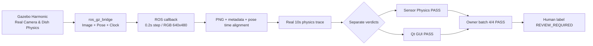
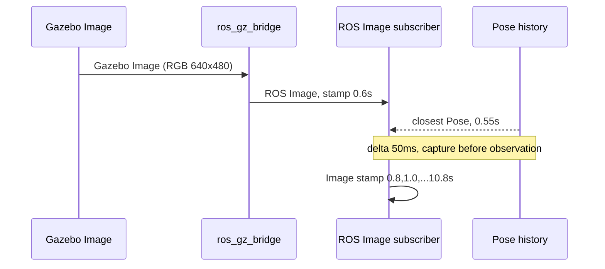
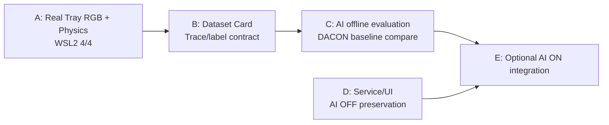

# SmartDish A-13 — 주니어 실습 워크북: CI PASS와 WSL2 인수 PASS의 차이

**대상:** ROS 2 Jazzy·Gazebo Harmonic·Python을 처음 통합하는 교육생  
**실습 목표:** 실제 실패·성공 원본으로 RGB 센서, 식기 물리, Gazebo GUI, SHA 출고 증거의 차이를 설명한다.  
**실습 원본:** `smartdish_a_tray_evidence.tar(5).gz` (사용자 2026-11-25 제공, 원본 파일명 유지)  
**실행 코드 SHA:** `6cb5b6bfc69687ded0b565b1a3ed6b0cf34b36df`  
**주의:** 이 실습의 결과를 B 담당의 학습 정답 라벨로 자동 전환하면 안 된다.

## 1. 최종 정답을 먼저 보세요



최종 A 인수는 ST-01/02: HELD_OBSERVED, UN-01/02: FALL_OBSERVED, 실제 Image·Pose·GUI 모두 PASS를 의미합니다.
학습 정답(ground truth)을 만들었다는 뜻은 아닙니다.

## 2. 왜 이런 프롬프트·검증 항목을 넣는가?

### 실습 1 — 실패 지점부터 찾기

**완성 프롬프트**

> 제공한 WSL2 evidence TAR 안의 summary.json, failure_context.json, SHA256SUMS를 먼저 검사한다. source_sha, mode, 최초 실패 단계, simulation/wall-clock 시각, GZ/ROS Image 개수와 GUI exit code를 분리해 표로 제시한다. 추론으로 root cause를 단정하지 말고 원본이 직접 증명하는 사실과 가설을 구분한다.

**설계 이유:** 애플리케이션이 실패했다고 카메라가 실패한 것은 아닙니다. 초기의 warmup no-two-images는 Image 수신 문제였지만, 네 번째 원본의 -6은 Qt OpenGL GUI 초기화 실패였습니다.

**확인 질문:** Gazebo 서비스가 계속 시뮬레이션 중이면서 Qt GUI만 종료되는 것이 왜 가능한가?

### 실습 2 — SHA256 데이터 무결성 검사

```bash
ARCHIVE='smartdish_a_tray_evidence.tar(5).gz'
sha256sum "$ARCHIVE"
tar -tzf "$ARCHIVE" | sed -n '1,15p'
```

기대 SHA256: `bfc3465448dd34f0cb113fc73b7d07e9ae5c0028c844fd1d3c75f94c6a2f8e6e`.

**완성 Python 검증 스크립트** (실습 디렉터리에서 실행, 추출 없이 읽음):

```python
import hashlib, tarfile, json
from pathlib import Path
p=Path("smartdish_a_tray_evidence.tar(5).gz")
with tarfile.open(p,"r:gz") as t:
    names=set(t.getnames())
    manifest=t.extractfile("SHA256SUMS").read().decode().splitlines()
    for line in manifest:
        expected,name=line.split("  ",1)
        assert name in names
        actual=hashlib.sha256(t.extractfile(name).read()).hexdigest()
        assert actual==expected, name
    summary=json.load(t.extractfile("summary.json"))
    print("SHA256 verified:",len(manifest))
    print("Mode:",summary["mode"],"Overall:",summary["verdict"])
    for row in summary["trials"]:
        stamps=row["image_stamp_samples"]
        assert all(b>a>0 for a,b in zip(stamps,stamps[1:]))
        print(row["scene_id"],len(stamps),row["sensor_physics_verdict"],
              row["gui_verdict"],row["motion"]["observation"])
```

**기대 결과:** `SHA256 verified: 88`, `batch`, `GAZEBO_TRAY_L2_PHYSICS_AND_CAMERA_PASS`, 4장면 각각 52개의 엄격 증가 timestamp. 실제 원본이 다르다면 PASS를 출력해서는 안 됩니다.

**응답 검토:** 업로드 압축파일 해시와 내부 SHA256SUMS는 서로 다른 검증임을 설명해 보십시오.

### 실습 3 — Image, Pose, Clock은 같은 데이터가 아닙니다



**완성 프롬프트**

> 두 개의 양수·증가 ROS Image timestamp, 50ms Pose 동기화, 식기 생성 이후 GZ Image probe 두 샘플이 각각 무엇을 증명하는지 설명한다. GZ topic이 존재한다는 사실 하나만으로 ROS 수신 성공이라고 표현하지 않는다.

**기대 해설:** Cloud Xvfb GUI 성공은 NVIDIA D3D12 WSLg Qt/OpenGL 생존과 다릅니다. 실제 GUI preflight가 필요한 이유를 설명할 수 있어야 합니다.

### 실습 4 — 물리 결과를 사실과 라벨로 분리하기

| scene | dish count | outcome | drop examples |
|---|---:|---|---|
| ST-01 | 2 | HELD_OBSERVED | 0.0000m, -0.0002m |
| ST-02 | 3 | HELD_OBSERVED | 0.0000m, -0.0001m, -0.0002m |
| UN-01 | 2 | FALL_OBSERVED | 0.7595m, 0.7745m |
| UN-02 | 2 | FALL_OBSERVED | 0.7495m, 0.8045m |

위의 값은 `final_state.json`과 `trial_summary.json`의 물리 관측입니다.
`label=REVIEW_REQUIRED` / `ground_truth=NOT_OPERATOR_APPROVED`는 주관적 수작업 라벨이 아직 확정되지 않았다는 뜻입니다.

**완성 프롬프트**

> ST와 UN의 물리 관측 차이를 drop_m, Pose 데이터, 관측 10초의 관점에서 설명하되, 이를 B 담당의 확정 ground truth로 부르지 않는다. Human review가 필요한 이유와 다음 B 데이터 파이프라인의 입력 계약을 정리한다.

### 실습 5 — 센서 성공인데 GUI는 실패라면?

- 사용자 네 번째 원본: ROS Image 54건, clock 10.789s, GUI Qt/GLX -6 → **전체 GUI 인수 FAIL**.
- 사용자 다섯 번째 원본: Image 52건×4, GUI PASS×4, 각 물리 10초 이상 → **실제 4-scene batch PASS**.
- 마지막 실행의 각 Gazebo 서버는 cleanup 이후 `-11` 기록. 시험 중 GUI -6과 혼동하지 않아야 하며, 종료 경로의 비차단 후속 조사 대상입니다.

**완성 프롬프트**

> 과거 GUI 초기화 -6과 최종 성공의 사후 Gazebo 서버 -11을 구분한다. 최초 장애의 시점, 관련 프로세스, 센서 데이터 생존 여부를 표로 비교하고 어떤 경우에 자동 인수 게이트를 HOLD 해야 하는지 설명한다.

## 3. 최종 스스로 채점하기

| 평가 기준 | 배점 | 증거 |
|---|---:|---|
| 원본 SHA와 88/88 무결성 검사 | 20 | SHA256SUMS |
| GZ/ROS/Clock/Pose 계층 구분 | 25 | warmup + Image stamp + Pose |
| ST/UN 물리 결과와 라벨 승인 구분 | 20 | final_state + capture_metadata |
| Qt/OpenGL GUI 실패와 센서 오류 구분 | 20 | GUI 로그·독립 verdict |
| CI / WSLg / PR/main 코드 SHA 구분 | 15 | Gate manifest + GitHub history |
| **총점** | **100** | 답을 외우지 말고 파일을 근거로 제시 |

## 4. 후속 A→B→C→E 통합 인계



다음 단계에서 B는 각 trial의 `scene_id`·`seed`·`image_sha256`·`physics_sha256`·pose trace·pre-fall capture 의미를 확인하고 데이터셋 카드를 업데이트합니다. C는 **B 사람 승인 라벨이 없으면** 미승인·가상 fixture와 실제 검증 데이터를 구분해야 합니다. E는 AI OFF 기본 주행을 유지한 상태에서 AI ON 선택 흐름을 통합합니다.

**불필요한 재실행 금지:** 센서/물리 원본을 변경하지 않은 문서 병합을 이유로 동일 GUI 배치 15회 재시험하지 않습니다. 테스트 SHA `6cb5b6...`은 원본에 기록하고 문서 추가 이후의 main 병합 SHA와 구분합니다.
