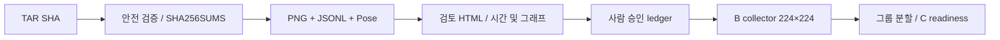

# SmartDish B 실습 워크북 — A-13 원본부터 승인된 학습 이미지까지

**대상:** ROS 2·Python 입문자 / **실습 목표:** SHA·시간·원본·라벨을 구별합니다. A 원본이 없어도 보안/형식 테스트는 할 수 있으나, 실제 그래프나 승인 결과는 얻을 수 없습니다.

## 먼저 완성된 사용 흐름



## 실습 1 — SHA가 세 가지인 이유

**입력:** A 실행 Git SHA, archive SHA, 내부 `SHA256SUMS`는 역할이 다릅니다. 입력 데이터가 없다면 `A13_ARCHIVE_BYTES_NOT_AVAILABLE`이 정답입니다.

```bash
sha256sum '/path/to/smartdish_a_tray_evidence.tar(5).gz'
# 보고서 기대값과 같을 때만 안전한 B 전용 인수기 실행
```

**해설:** Git SHA는 실행 코드의 버전, Archive SHA는 운송된 바이트, 내부 SHA는 개별 파일 변경 탐지입니다. 일치가 사람 라벨 승인까지 증명하지 않습니다.

## 실습 2 — 실제 B 원샷 (코드 SHA 고정)

WSL2에 **B 브랜치를 별도 clone**하고 변경사항을 보존합니다. 예시는 새 브랜치를 인수하지 않은 상태에서 실행하는 명령이 아니며, `--sha`에 실제 PR HEAD 값을 정확히 넣어야 합니다.

```bash
cd ~/samsung_AXI_B_REAL
# git fetch origin feat/smartdish-b-real-dataset
# git checkout feat/smartdish-b-real-dataset
SHA="$(git rev-parse HEAD)"
bash scripts/smartdish_b_real_data_one_shot.sh \
  --archive '/path/to/smartdish_a_tray_evidence.tar(5).gz' \
  --sha "$SHA" --mode review
```

성공 시 출력될 보고서 경로: `ai/data/private/b_a13_review_*/review/review.html`. `--mode review`는 실제 학습 manifest를 생성하지 않습니다. 원본이 없으면 상태 `A13_ARCHIVE_BYTES_NOT_AVAILABLE` 및 비정상 종료로 끝나야 정상입니다.

## 실습 3 — 이미지는 물리 결과보다 먼저인가?

검토 HTML에서 실제 PNG를 보고 SVG 세 개를 읽습니다. z-position, tilt_deg, XY는 `physics_observations.jsonl`을 직접 이용하며, RGB 캡처 시각과 관측 시작·종료는 별도로 표시됩니다. 예: 캡처 0.60초 / 최근접 Pose 0.55초라는 50ms는 기존 A 보고 수치이며, 원본 TAR에서 **실제로 재계산**해 확인할 값입니다. 처음 시점에 이미 낙하한 경우 `TEMPORAL_REVIEW_REQUIRED`입니다.

## 실습 4 — 왜 라벨을 사람이 결정할까요?

A 원본은 `HELD_OBSERVED`, `FALL_OBSERVED`일 수 있지만, 해당 결과가 **RGB 한 장으로 예측 가능한지**와 진짜 물리 증거인지를 사람이 확인해야 합니다.

```bash
python3 ai/scripts/review_a13_labels.py \
  --review-dir "$WORK/review" --raw-dir "$WORK/raw" \
  --candidate-id 'B13-실제출력ID' \
  --reviewer-id '실제_운영자_ID' \
  --decision DEFERRED --reason '동기화 재검 필요' \
  --license-status UNVERIFIED
```

승인하려면 `--decision APPROVED --approved-label STABLE|UNSTABLE --license-status OWNED|AUTHORIZED`를 명시해야 합니다. 이 문서는 교육용 예시이며 사용자가 승인하지 않은 상태에서 실제 데이터 승인 명령을 대리 실행하지 않습니다.

## 실습 5 — 승인한 후 기존 B와 C 연결

```bash
python3 ai/scripts/register_a13_approved.py \
  --raw-dir "$WORK/raw" --review-dir "$WORK/review" \
  --release-root "$WORK/release" --b-ref "$(git rev-parse HEAD)"
```

여기서 `manifest.csv`의 원본 샘플 수와 `quality_report.json`의 독립 그룹 수를 확인합니다. 클래스별 그룹이 3개보다 적으면 `B_DATASET_SPLIT_BLOCKED`가 정상입니다. `MOCK_ONLY`로 데이터 부족을 우회하면 학습 평가가 무의미해집니다.

## 자기 점검

1. callback 52×4=208회와 대표 RGB PNG 4장이 다른 이유를 설명하세요.
2. Image와 Pose 50ms 차이는 어떤 센서 계층 계약을 검사하나요?
3. NaN, timestamp 역행, 해시 불일치를 왜 별도 오류코드로 기록하나요?
4. 원본 640×480 SHA와 학습 224×224 SHA가 달라야 하는 이유를 설명하세요.
5. 같은 초기 배치 반복을 독립 train/test에 넣으면 왜 데이터 누수인가요?
6. `CONTRACT_READY_HUMAN_REVIEW_REQUIRED`가 모델 학습 승인과 다른 이유는 무엇인가요?

**강사용 검수:** GitHub CI/계약 fixture는 실물 TAR과 사람 승인 없이도 PASS 가능합니다. 학생이 이 경계를 말로 구분할 수 있어야 합니다.
