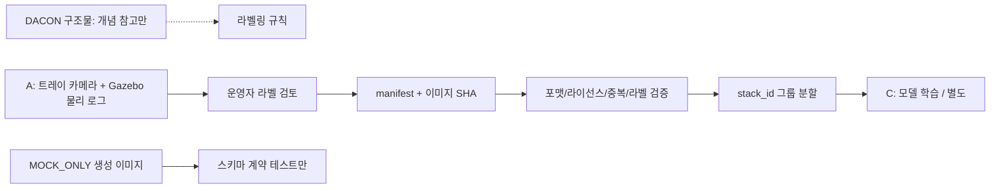

# 주니어 교육 — SmartDish B 데이터 파이프라인 개발 의사결정

## 1. 무엇이 진짜 문제였는가

기존 S7은 식기 `STACKED` 감지만 검증되었습니다. 이번 과제에서 중요한 것은 **식기가 놓여 있는가?**가 아닌 **트레이 위 식기가 무너지지 않는가?**입니다. 같은 이미지라도 라벨의 뜻이 다르면 기존 모델 성능은 새 문제에 대한 증거가 될 수 없습니다. DACON 구조물과 트레이 식기도 도메인이 달라 원본 점수를 재사용할 수 없습니다.

## 2. 설계 흐름

**왜 이 순서인가:** 모델을 먼저 만들면 S7의 존재 여부를 잘못된 정답으로 학습할 위험이 있습니다. 그래서 실제 센서 확보 전에는 표본·저작권·검증 계약을 먼저 고정합니다. 원본 이미지와 외부 데이터의 공개 배포를 회피함으로써 학습용 소스만 GitHub에 안전하게 남깁니다.

## 3. 코드 매칭

| 파일/함수 | 역할 | 중요 방어 경계 |
|---|---|---|
| `collect_tableware.collect()` | 관찰 증거가 있는 운영자 라벨과 RGB 입력을 수집 | 입력 존재/출처/권리/중복 SHA |
| `prepare_dataset.load_manifest()` | 10열 CSV 규격 확인 | 컬럼 순서 차이로 묵시적 오독 방지 |
| `prepare_dataset.validate()` | 라벨, 물리 관찰 여부, 이미지, 배치 충돌 | S7 `STACKED` 및 MOCK_ONLY 무단 학습 거절 |
| `prepare_dataset.make_splits()` | 같은 stack의 연속 영상 프레임을 같은 split에 배치 | 시험 데이터 누수 방지 |
| `tests/test_b_dataset.py` | fixture로 계약만 검증 | 모델 안정성 정확도 증거 아님 |

## 4. 실제 디버깅 기록

`test_group_conflict_rejected`의 기대 오류는 `B_STACK_LABEL_CONFLICT`였습니다. `scene_id` 교차 검사 로직이 앞에 배치되면서 같은 입력에서 `B_SCENE_SPANS_STACKS`가 먼저 발생했습니다. 오류 코드를 임의로 완화하지 않고 **라벨 모순을 먼저 판정한 뒤 scene 배치 오류를 판정**하도록 순서를 국소 조정하여 재검했습니다. 자세한 원본/결과는 [`B-DEBUG-01`](../reports/issues/2026-11-23_B-DEBUG-01_validation_error_priority.md)에 남겼습니다.

## 5. 결과 해석/학습 질문

- 로컬 `pytest`가 GREEN이라도 **실제 RGB 트레이 이미지 수는 0**이며, 학습/추론 정확도는 `NOT_RUN`입니다.
- `STABLE=0`, `UNSTABLE=1`은 C 학습 로더와 동일해야 하며, `UNKNOWN`을 세 번째 클래스 취급하지 않습니다.
- `class_imbalance`는 데이터가 실제 들어온 뒤 의미가 있습니다. fixture의 1:1은 인위적인 수치입니다.
- 왜 임의의 이미지 한 장만으로 낙하 여부를 알 수 없습니까? `scene_id`와 `stack_id`를 함께 쓰는 이유는 무엇입니까? 테스트 PASS와 업무 성능 PASS는 어떻게 다릅니까?

## 6. 실제 운영에서 남은 일

A가 트레이 전용 RGB와 실제 물리 변화 증거를 제공한 뒤 사람 검수 라벨 1건부터 접수합니다. 독립 적재 그룹을 여러 개 확보해 분할하고 C와 샘플을 같이 검토합니다. AI OFF 필수 시연을 이 단계 때문에 막지 않습니다.
