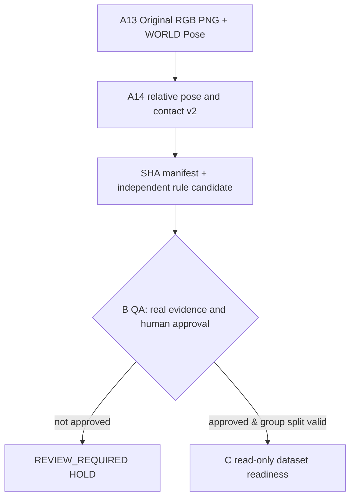

# SmartDish A14 → B DATA — 물리 증거 v2 인계·마이그레이션 계약

## 1. B 기존 데이터 계약과 연결

B 기준 커밋 `7048f7f01b6c9d03cae2c082a93af01dfc9a5531`의 B-Q03/04 부족 항목을 채우기 위한 A-only 파일입니다. A 담당은 B 소스를 직접 수정하지 않습니다.

| B 기존 필드 | A14 근거 | 비고 |
|---|---|---|
| `candidate_id` | B가 scene/trial 기반 결정 | A는 미생성, 중복 방지 |
| `scene_id` | `a14_gt_candidate.json.scene_id` | ST-02/UN-01 |
| `stack_id` | `scenario.scenario.json.stack_id` | 시드와 구분 |
| `trial_id` / `seed` | 두 metadata 파일 | WSL2 실제 실험 |
| `source_image_sha256` | A13 PNG hash/`a14_gt_candidate.json` | 원본 640×480 보존 |
| `physics_sha256` | `original_a13_physics_sha256` | 기존 B-10 원본 참조 호환 |
| `physics_v2_sha256` | `evidence_sha256.physics_observations_v2` | 신규 상대 pose, DERIVED velocity |
| `contact_sha256` | `evidence_sha256.contact_events` | event가 0개여도 상태 JSON 필수 |
| `source_git_sha` | `source_sha` | 40 hex, 현재 수집 실행 코드 |
| `capture_stamp_ns` | `rgb_t0_sim_time_ns` | 원본 Image 헤더 |
| `pose_at_capture_ns` | `trial_summary.json` | A13 legacy approximate, A14 header stamp 함께 조회 |
| `observation_start_ns/end_ns` | `a14_gt_candidate.json` | 실제 sim time |
| `label_status` | `REVIEW_REQUIRED` | 사람 승인과 구별 |
| `ground_truth` | `NOT_OPERATOR_APPROVED` | 학습 입력에 사용 금지 |

새 `geometry_layout.json`의 `physical_layout_id`·`geometry_family_id`는 P0 STATIC 기준에 없음(null)으로 기록합니다. 같은 형상의 seed 변경을 독립 데이터로 세면 안 됩니다.

## 2. 실제 데이터 계층

`physics_observations_v2.jsonl`은 GT 검토 때만 사용하고 C의 RGB(t0) 모델 입력으로 외란 이후 궤적을 넣지 않습니다. 이는 미래 레이블 누출(leakage)을 막기 위한 금지사항입니다.

## 3. B 어댑터 요구

B는 원본 TAR SHA 및 내부 SHA256SUMS를 검증한 후 v2 JSONL을 읽고 **원본 파일을 읽기 전용** 유지해야 합니다. 시간 역행, quaternion invalid, contact topic 미수신, SVG/PNG 해시 불일치, t0 이후 frame 입력은 HOLD.

후보 `STABLE` 또는 `UNSTABLE`은 `rule_candidate`의 **기계적 리뷰 힌트**이며, B 담당 사람 승인 전에 `manifest.csv label=0/1`이나 `approval_ledger.jsonl`로 승격 금지.

## 4. ROBOT_MOTION 프로파일 (P1 별도 계약)

- `T_world_tray(t)`를 로봇의 진짜 움직임으로부터 header time에 맞춰 수집.
- 속도/각속도 및 외란 가감속의 측정 출처·frame 명시.
- STATIC_GRAVITY 파일을 ROBOT_MOTION으로 이름 변경해 재사용 금지.
- 주행 안전제어 Nav2/Collision Monitor, A13 기존 GUI·AI OFF 경로 변경 금지.

## 5. 완료 시 인계 패키지

B QA에 전달할 파일: `scenario.scenario.json`, `geometry_layout.json`, `camera_pose_metadata.json`, `capture_metadata.json`, `tray_pose_timeline.jsonl`, `physics_observations_v2.jsonl`, `contact_events.jsonl`, `contact_sensor_status.json`, `a14_gt_candidate.json`, `SHA256SUMS` 및 해당 원본 RGB/physics. Owner 진단용 `smartdish_a14_diagnostics.tar.gz`의 명시적 allowlist를 확인하고, 사람 라벨 승인 0인 상태를 유지합니다.

## 6. A14-07 독립 Contact 양성 교정 결과의 수용 범위

A14에서 새로 출고하는 `a14_contact_calibration_evidence.tar.gz`는 `calibration_result.json`의 `source_sha`, `world_sha256`, `bridge_sha256`, `sim_clock_max_ns`, `sensors.tray/floor.positive_collision_observed`, `sample_collision_ids` 및 아카이브 무결성을 통해 **센서의 독립적인 양성 충돌 감지 능력**만 확인합니다.

B에서 기존 A14 `contact_sensor_status.json`의 `topic_unobserved` 항목을 자동 삭제하거나 `CONTACT_DATA_INCOMPLETE`를 `NO_CONTACT_OBSERVED`로 교체하는 것은 금지합니다. 별도 교정 월드에서 건강했다고 생산 월드의 정확한 시각에도 건강했다는 뜻이 아닙니다.

- **허용되는 신규 메타데이터:** `independent_positive_calibration_sha256`, `calibration_source_sha`, `calibration_wall/sim_run_id`, `calibrated_sensor_types`, `calibration_scope=POSITIVE_CONTROL_ONLY`.
- **금지:** `human_approved=true`, `approval_ledger.jsonl` 자동 생성, `label=0/1` 확정, `STATIC_GRAVITY`→`ROBOT_MOTION` 바꿔 표기.
- **원본 품질 유지:** `rule_candidate=UNKNOWN`, `label_status=REVIEW_REQUIRED`, `ground_truth=NOT_OPERATOR_APPROVED`.
- **다음 B QA 계약:** 생산 world에서 센서가 실제 관측 기간 중 동작하고 있었음을 독립 증명할 상태/heartbeat 자료가 확보되기 전 B-Q03/04 및 학습 GT HOLD.

교육 보고서: `docs/reports/issues/SMARTDISH_A14_07_SILENT_CONTACT_POSITIVE_CALIBRATION_KO.md`.
