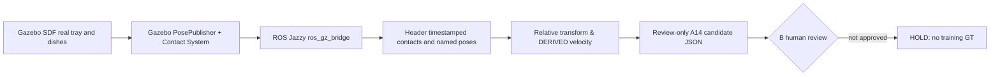

# A14-01~06 — P0 실제 물리 증거 설계·인터페이스

- 기준 `main`: 63e147289e307e0b9900ca365e9c4557c5921804
- B QA 기준: `7048f7f01b6c9d03cae2c082a93af01dfc9a5531`, B-Q01 PASS / B-Q02~07 HOLD
- 개발 브랜치: `feat/smartdish-a14-physics-evidence`
- 기본 AI OFF 및 기존 A13 실물 GUI 4/4 PASS는 변경하지 않습니다.

## 왜 이 기능이 필요합니까?

A13은 실제 식기 WORLD Pose와 RGB 640×480을 수집했지만, WORLD 움직임은 트레이 위 상대 움직임이 아닙니다. 또한 물리 낙하 관측은 승인된 학습 GT가 아닙니다. B가 독립적으로 재계산할 수 있도록 같은 simulation time축에서 상대 Pose, 유도 속도, Contact Sensor 이벤트, 시간 정합 및 품질 판정을 전달합니다.

## 소유권과 실행 범위

기존 `scripts/smartdish_a_tray_live.py`에서 **명시적** `--a14-static`일 때만 생성 월드 복사본에 Contact System을 추가합니다. 정상 A13 실행 및 AI OFF HOME→T03→DISH_RETURN→HOME에는 추가하지 않습니다. 테스트는 `STATIC_GRAVITY` 독립 트레이 2장면(ST-02, UN-01)이며 `ROBOT_MOTION`은 **인터페이스만** 설계합니다. 주행 중 상대 Pose를 정적으로 고정해 위조하는 경로는 제공하지 않습니다.

## 원본→v2 증거 파일

| 파일 | 생성 주체 | 내용 |
|---|---|---|
| `scenario.sdf` / `scenario.scenario.json` | A13 + A14 opt-in | Contact 활성화 SDF, 실제 모델·seed·시뮬레이션 프로파일, SDF SHA |
| `geometry_layout.json` | A14 | 플랫폼/식기 지름·질량·환경, 정적 고정 Tray 선언 |
| `tray_rgb.png` / `capture_metadata.json` | 기존 A13 | 640×480 RGB(t0), 원본 해시 |
| `camera_pose_metadata.json` | A14 | 기존 SDF 카메라 설정값·소스 SHA, 동적 TF 미검증 표시 |
| `tray_pose_timeline.jsonl` | A14 | t별 T_world_tray, STATIC_TRAY provenance |
| `physics_observations_v2.jsonl` | A14 | t별 world→tray→dish, quaternion, DERIVED velocity, 원본 Pose |
| `contact_events.jsonl` | A14 | 실제 Contact header timestamp, collision1/2, source/topic |
| `contact_sensor_status.json` | A14 | 센서 수신/누락·유효성 구분 |
| `a14_gt_candidate.json` | A14 | 규칙 후보/품질/미승인 GT, 모든 파일 SHA |
| `smartdish_a_tray_evidence.tar.gz` | A13 | 새로운 파일 포함 원본 TAR/SHA256SUMS |
| `smartdish_a14_diagnostics.tar.gz` | A14 owner script | 명시적 allowlist+외부 .sha256 자동 저장 |

`approval_ledger.jsonl`은 A가 만들지 않습니다.

## QA의 독립성

오프라인 합성 fixture에서 테스트 PASS → 수학/계약만 PASS. ROS Jazzy 실환경에서 `Contacts` 메시지와 Gazebo Contact 플러그인 확인 → L1 PASS. 실제 Gazebo 모델 2개 장면에서 contact callback/TF header stamp/observed physics 확인 → L2 PASS. WSL2 GPU/XCB GUI 실제 사용자 원샷은 Owner L3 PASS를 별도로 기록합니다.

`0.015m`는 DACON 비교용 **비승인 후보**입니다. 제품 합격 임계치나 사람 GT로 승격하지 않습니다.