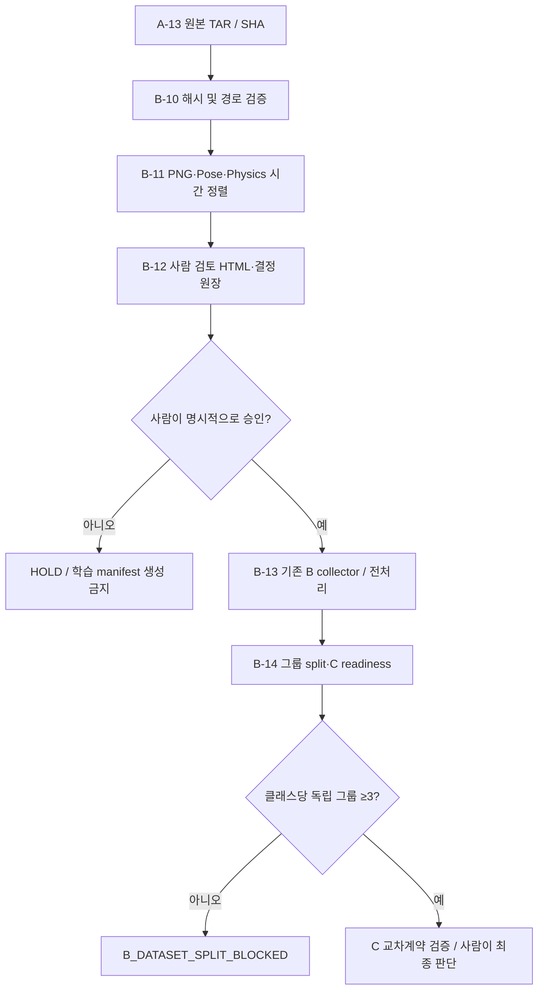

# SmartDish B-10~B-14 — A-13 실물리 증거 인수·사람 승인·C 데이터 출고 계획 및 조사 원장

- 작성: 2026-11-25 / 담당 B / 대상 저장소: `silverbjin/samsung_AXI`
- **main** `63e147289e307e0b9900ca365e9c4557c5921804`, **A 실행 코드** `6cb5b6bfc69687ded0b565b1a3ed6b0cf34b36df`.
- GitHub PR #45 A-13 병합, B 기존 PR #37 병합, 기존 B B-01~B-09/08R와 C readiness가 `main`에 있는 것을 실제 조회하여 확인.
- 신규 `feat/smartdish-b-real-dataset`은 위 main에서 분기. 기존 B PR #37을 다시 병합하지 않음.

## 데이터 상태는 세 단계로 나누기

1. **A 기록 출처 확인:** 2026-11-25 A 최종 인수 문서의 4/4 PASS, SHA256SUMS 88/88, Image 52 callbacks/scene, ST 유지 / UN 낙하. 이는 **A 기존 검수 보고**이지 이번 B의 원본 바이트 재검 PASS가 아님.
2. **B 원본 바이트:** 작업 환경에 `smartdish_a_tray_evidence.tar(5).gz` 없음. 기대 SHA `bfc3465448dd34f0cb113fc73b7d07e9ae5c0028c844fd1d3c75f94c6a2f8e6e`; `A13_ARCHIVE_BYTES_NOT_AVAILABLE` → `B_EVIDENCE_IMPORT_BLOCKED`.
3. **B 인간 승인:** 확인 가능한 실제 승인 원장 0건. 원본의 `REVIEW_REQUIRED`, `NOT_OPERATOR_APPROVED`, `NOT_OBSERVED` 유지. AI가 자동 승인하지 않음.

## 개발 단위와 완료 경계

| 단위 | 코드·테스트 | CI 기준 | 실제 TAR / 사람 승인 |
|---|---|---|---|
| B-10 | `import_a13_evidence.py`: 경로·링크·크기·SHA·trial 출처 | 가짜 작은 TAR fail-closed 계약 테스트 | 원본 부재 `BLOCKED` |
| B-11 | `extract_a13_candidates.py`: Trace/시계열 SVG/후보 manifest/HTML | 타임스탬프·Entity·NaN·포맷 테스트 | 원본 그래프 미생성 |
| B-12 | `review_a13_labels.py`: 수동 승인, 해시 결속, 보류·제외 | 미승인 차단·SHA 변경 거부 | 승인 0건 |
| B-13 | `register_a13_approved.py` + 기존 `collect_tableware.py` 선택형 provenance | 기존 CSV/PNG/근거 계약·원본과 SHA 구별 | 실제 B 등록 0건 |
| B-14 | 원샷·Dataset Card·릴리스 매니페스트·C readiness·인계 | 계약 fixture만 CI | 독립 그룹 미확보 `BLOCKED` |

## A/C 경계와 변경 금지

- A의 스키마: `summary.json`, `source_manifest.json`, `deployment_gate_manifest.json`, `SHA256SUMS`, 4개 `trial_000N/*`; Image 640×480 RGB, 원본 Pose `sim_ns/entity/pose` 및 원본 observation 유지.
- A 본래 `verify_timing` 허용 image–pose ≤250ms / 물리 관측 ≥9초, 실제 A 보고는 50ms 및 >10초. B 학습 후보는 10초 미만이면 `TEMPORAL_REVIEW_REQUIRED`.
- B의 PNG 전처리 `ImageOps.exif_transpose`→RGB→224×224 `ImageOps.fit` BILINEAR와 `STABLE=0`, `UNSTABLE=1` 불변.
- C `ai/train/check_real_data_readiness.py`는 read-only. `CONTRACT_READY_HUMAN_REVIEW_REQUIRED`를 학습 승인이나 실물 성능 PASS로 격상하지 않음.
- DACON 원본과 실제 로봇 카메라는 이번 데이터 도메인에 포함하지 않음. A/Gazebo/ROS/Navigation/CM 및 D/E 로직 수정 금지.

## 다음 실제 인수

1. 사용자 원본을 `~/.../smartdish_a_tray_evidence.tar(5).gz`로 제공, 해시 기대값과 실제 대조.
2. 원샷 review 실행 → `review.html`, `candidate_manifest.csv`, 각 식기 z/tilt/xy SVG 생성.
3. 운영자가 원본 이미지·Pose·물리 궤적·권리를 직접 검토하고 후보마다 별도 수동 결정.
4. 승인된 샘플만 B 수집기에 제출. 최대 예상 pilot 4장으로는 분할 불충분. 실제 독립 배치 추가로 수집하여 C readiness 재검.

**검증 원칙:** CI 계약 fixture의 PNG/JSONL은 일부러 생성한 인공물입니다. 실제 A WSL2 원본으로 표현하지 마십시오.
