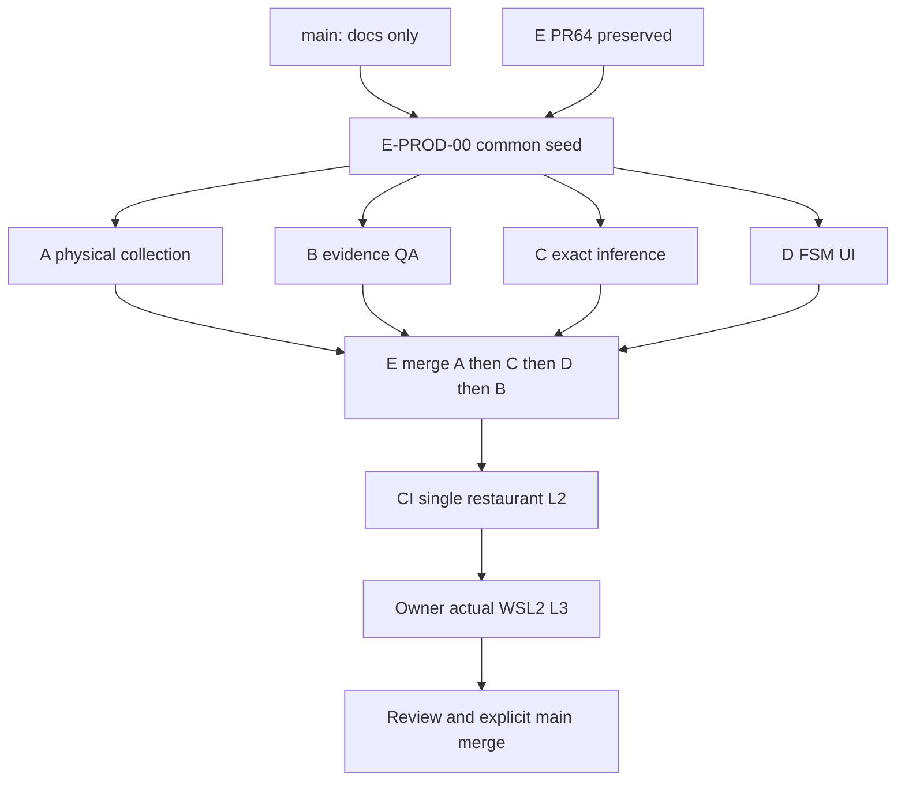

# SmartDish 제품 복구 — 개발 브랜치 및 통합 실행 절차

## 0. 문서 배포와 코드 배포 구분
이번 main에는 이 폴더의 Markdown 명세만 병합한다. 기존 E Draft #64 및 실패한 Owner L3는 보존. 신규 구현/검증 PASS 아님. 공통 계약 변경은 E 리뷰 후 docs PR로 버전 관리한다.

## 1. E가 먼저 수행할 작업
1. main 최신 SHA, E PR #64 head(753cbb24…), 실제 검증 PIN(77a1ae25…), A PR #35/#45 및 C17/D #63을 읽기 전용 재감사. docs-only merge가 아닌 새 코드 변경이 발견되면 비교 후 충돌 해결 계획 작성. 
2. E PR #64 head에서 integration/smartdish-product-recovery 생성, 최신 main의 문서 커밋을 일반 merge(두 부모), force push/reset 금지. 기존 E branch 그대로. diff에는 검증된 E 코드 및 명세만 존재하는지 확인. E-PROD-00 교육 보고서/계약 revision/실제 seed SHA 기록. seed SHA가 확정되기 전 A/B/C/D는 read-only audit/계획만. 
3. E가 동일 seed SHA를 네 담당에게 공지. 각 담당은 정확히 그 SHA에서 새 branch를 생성하고 Draft PR base를 integration/smartdish-product-recovery로 설정. main 대상 PR 금지. 이전 연구 브랜치에 작업 덧씌우기 금지. 필요 시 검증된 최소 커밋 cherry-pick with -x + diff/test + E 승인.
4. 역할별 공통/개별 명세를 읽고 최초 작업에서 파일 소유권 확정. A=smartdish_robot, generated SDF/bridge, A tests; B=ai evidence validator/QA tests; C=smartdish_ai, C tests; D=smartdish_service, D tests; E=integration runner/witness/workflow/common contract. 공통 파일 충돌은 E 조정. 모든 branch 이름은 아래 고정.

| 역할 | branch | PR base |
|---|---|---|
| E | integration/smartdish-product-recovery | main (최종 Draft) |
| A | feat/smartdish-a-product-collection | E integration |
| B | feat/smartdish-b-product-evidence-qa | E integration |
| C | feat/smartdish-c-product-inference | E integration |
| D | feat/smartdish-d-product-fsm | E integration |

## 2. 개발 사이클
공통 계약 v1.1.1 사용 (wire schema 2 불변). A physical & C/D fixtures & B QA 병렬 개발. 먼저 실패 재현(RED), 최초 오류/원본 로그 분석, 최소 수정, L0/L1 GREEN, 실제 Gazebo L2 필요한 경계만, review, 교육용 MD와 결과 동시 커밋. 보고서 위치 docs/reports/smartdish/{a,b,c,d,e}/<ID>_EDU_KO.md. 각 report: WHAT/WHY/HOW, architecture, RED run ID/error, root cause vs hypothesis, change/diff, test conditions/results, source SHA, CI run/artifact hash, limitations/next step. 실패 cycle도 기록; 동일 SHA 무근거 재시도 금지; 인프라 오류는 분리. 
CI 실행 중/취소는 PASS 아님. CI에서 가능한 개발/검수 모두 끝나기 전 사용자 WSL2 재검 요청 금지. 사용자 최종 L3만 실제 private model/GUI 수동 승인. 가중치/데이터/Test4 공개 금지. 이미 성공한 AI OFF 및 R1/R2 증거는 재사용. 변화가 생긴 경계에만 회귀.

## 3. 개발 완료 및 통합 PR
담당별 PR 본문: base seed, head SHA, changed files, implemented units, contract revision, tests/CI artifact SHA, evidence scope, failure cases, education report, remaining blockers. E 승인 전 merge 금지. A→C→D→B 순( B는 먼저 검수할 수 있으나 actual A/E evidence 최종 QA는 통합 후). 각 PR merge 직전 최신 E head를 일반 merge해 conflict 해결 및 영향 L0/L1; 실제 코드가 변한 경우 해당 L2 재검. E는 매 merge 후 compare/check 및 ledger. 신규 main 대상 E PR은 Draft, #64는 superseded-but-preserved로 표시하되 이 문서 배포 시에는 수정/close하지 않는다.

## 4. CI 통합 Gate
- G0: common seed/source ownership & legacy protected paths.
- G1: A actual single-world startup/tray camera/physical LOAD+UNLOAD, entity & hash receipts, motion-following relative pose. C/D/B L0/L1.
- G2: actual A+C+D/E DDS 3-leg, one request/capture/inference, 10/5 wait, exact IDs, stop dwell, 3 UUID SUCCEEDED, CM sole graph start/end, B QA, clean exit. CI test double clearly identified, no independent station; no fake nav.
- G3 fault injection: empty table, stop failure, load service failure, camera bridge loss, stale/wrong frame, model/AI timeout, duplicate AI, staff timeout, staff ABORT, unload failure, threshold 0/1 and invalid -0.1/1.1/NaN, child crash/user interruption. All hard failure no subsequent Goal, active Goal cancellation exact UUID/terminal/zero evidence; verify no duplicate effect. Most failure scenarios L0/L1, actual Gazebo representative empty/load/camera/unload/abort and process cleanup; record coverage by layer, don't claim all physical if not.
- G4: release provenance exact runner blob/checkout/build/ROS installed bytes; per-PIN build and real upstream PIN, no torch reinstall, final archive SHA. Existing L3 AI OFF evidence preserved. Only changed paths regression; required PR checks complete before merge.
- G5: Owner final WSL2 one-shot with real private v1, actual TTY/GUI manual approval, T03 dishes present, actual robot top-view, load/unload, final HOME, tar+sha256. E audits archive before PASS/merge. If fail keep Draft and return first-failure cycle to CI. Never declare actual model performance approved.

## 5. 각 대화창 재개용 공통 지시
다음 문장을 담당별로 사용한다 (ROLE=A/B/C/D/E, 담당 문서는 index에서 링크). 
> silverbjin/samsung_AXI의 main에서 docs/plans/product_recovery/README.md, 00_COMMON_CONTRACT_KO.md, 해당 ROLE 명세, 06_INTEGRATION_RUNBOOK_KO.md를 읽어라. 최신 main 및 E가 공지한 immutable common seed SHA를 검증하라. ROLE 범위만 독립 브랜치에서 개발하고 기존 PASS/권리/AI OFF를 보존한다. CI 우선 RED→GREEN, 각 사이클 주니어 교육 MD와 결과 커밋. E integration 대상 Draft PR 및 인계 원장까지 작성하되 main에 병합하지 마라. E는 E-PROD-00으로 seed를 먼저 발행하고 다른 담당 PR을 받아 검증·통합한다.
## 6. 인수 판정 원장
기존 R1/R2, R3a/b/c, independent station R4 PASS 보존. 신규 single-world physical workflow NOT_RUN. Owner product L3 HOLD. Product AI ON admission DENIED (C17). 문서 PR 성공 ≠ 구현 승인. 최종 합병은 owner 검수 결과와 권한 검토 후 별도 결정.

B-QA-06 raw dwell gate: A 기존 full-rate 원본 존재 시 재출고, 없으면 E 동일 실제 단일세션에서 수집. 기존 A 전체 주행과 집중 종료는 별개 scope; 재실행 기본 금지. CI double과 실제 Owner checkpoint를 분리한다.
