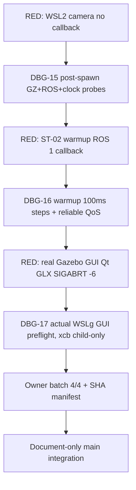

# SmartDish A-11/A-12/A-13 — WSL2 Owner 최종 인수 및 DBG-17 통합 회고

- 최종 원본 검토 일자: 2026-11-25 (KST)
- 저장소: `silverbjin/samsung_AXI`
- 검증된 **실행 코드** SHA: `6cb5b6bfc69687ded0b565b1a3ed6b0cf34b36df`
- 사용자 첨부 원본: `smartdish_a_tray_evidence.tar(5).gz`
- 원본 SHA256: `bfc3465448dd34f0cb113fc73b7d07e9ae5c0028c844fd1d3c75f94c6a2f8e6e`
- 내부 `SHA256SUMS`: 88/88 모두 일치, 누락·추가 항목 없음
- 실행: WSL2 Ubuntu 24.04 / Gazebo Harmonic / ROS 2 Jazzy / NVIDIA D3D12 / GUI 프로파일 `xcb`
- 업무 경계: A-11 RGB 센서, A-12 실제 식기 물리, A-13 수집 및 배포 인수. 기존 AI-OFF S7 주행·Nav2/Collision Monitor는 변경하지 않음.

## 1. 평가위원용 결론

**WSL2 실환경 A-11/A-12/A-13 GUI·실센서·물리 통합 배치 4/4 PASS.**
`summary.json` = `mode=batch`, `gui=true`, `verdict=GAZEBO_TRAY_L2_PHYSICS_AND_CAMERA_PASS`.
네 trial 각각 `sensor_physics_verdict=PASS`, `gui_verdict=PASS`, `gui_active_during_physics=true`.
기존 현장 실패 유형(카메라 warmup, UN-01 post-spawn RGB, Qt/GLX GUI SIGABRT -6)은 이번 전체 batch에서 재발하지 않았다.

**해석 경계:** 별도의 GUI preflight 및 2-scene smoke 압축파일은 이 업로드에 포함되지 않았다. 대신 해시가 맞는 `deployment_gate_manifest.json`에 각 별도 단계의 SHA256과 PASS 판정이 봉인돼 있다. 이 보고서가 직접 해시 검증한 대상은 첨부된 최종 batch 원본(88/88)이다. 독립 압축파일을 첨부한 것과 동일하게 취급하거나 전체 GUI 픽셀 품질 검수까지 자동 승인해서는 안 된다.

## 2. 증거 원장

| 단계 | 실측 관측 | 판정 |
|---|---|---|
| 배포 출처 | 원본 `source_sha`와 네 trial이 `6cb5b6...`로 일치 | PASS |
| Cloud CI | 같은 SHA의 Tray #45544462994, Navigation #45544472067, Restaurant #45544472028 | manifest PASS, GitHub 완료 success 별도 확인 |
| 실제 WSLg renderer | `D3D12 (NVIDIA GeForce RTX 3060)` / accelerated true / software false | PASS |
| 실제 GUI preflight | 격리 GUI 9.012초, `GAZEBO_GUI_PROCESS_STABLE_NO_GLX_ERROR`, GUI profile xcb | **manifest-bound PASS** |
| ST-02→UN-01 GUI smoke | 장면 순서·출력 PASS, smoke evidence SHA256 = `1c0332fb30e99eb9d55b94499e17809cee1d06a807af5bdc9d530fe1edad611e` | **manifest-bound PASS** |
| 실제 4-scene GUI batch | ST-01→ST-02→UN-01→UN-02 | **직접 검증 PASS 4/4** |
| 이미지 5 Hz | 장면마다 ROS RGB 52개, stamp 0.6→10.8초 0.2초 간격으로 엄격 증가 | PASS |
| GZ 식기 생성 이후 | 장면마다 GZ Image 후속 2개, 원본 protobuf 파일·SHA256 기록 | PASS |
| /clock / Pose / Image | 장면별 캡처 0.6초, Pose 0.55초, 50ms 차이 | PASS |
| 실제 물리 | 10.227~10.286 sim seconds 관측, ST 유지·UN 낙하 | PASS |
| 소유 프로세스 정리 | 4/4 `all_owned_processes_stopped=true` | PASS |
| 인위적 라벨 | `REVIEW_REQUIRED` / `NOT_OPERATOR_APPROVED` | **승인 아님 — B 사람 검토 필수** |
| GUI 화면 내용의 사람 시각 검수 | 사용자 수행·자동 게이트 제외 정책 | 별도 |

### 네 장면의 실측 데이터

| 장면 | 식기 수 | ROS RGB callback | Pose samples | 관측 sim seconds | 결과 | GUI |
|---|---:|---:|---:|---:|---|---|
| ST-01 | 2 | 52 | 407 | 10.286 | HELD_OBSERVED | PASS |
| ST-02 | 3 | 52 | 609 | 10.229 | HELD_OBSERVED | PASS |
| UN-01 | 2 | 52 | 407 | 10.227 | FALL_OBSERVED | PASS |
| UN-02 | 2 | 52 | 407 | 10.232 | FALL_OBSERVED | PASS |

- ST-01 개별 식기 낙하량: 0.0000m, -0.0002m.
- ST-02 개별 식기 낙하량: 0.0000m, -0.0001m, -0.0002m.
- UN-01 낙하량: 0.7595m, 0.7745m.
- UN-02 낙하량: 0.7495m, 0.8045m.
- 각 trial 빈 트레이 warmup의 실제 ROS 유효 stamp는 0.2초, 0.4초.
- 캡처 PNG 및 physics JSONL SHA256은 `trial_summary.json`과 실제 압축파일 내용 및 `SHA256SUMS`로 묶였다.
- trial wall-clock: 21.941s / 22.213s / 21.701s / 21.533s.

## 3. 반복 실패를 통한 개발 회고

**핵심 학습:**
1. `GitHub CI PASS`는 Xvfb/llvmpipe 환경에서 기능이 동작했다는 뜻이다. 사용자 WSLg의 D3D12 및 Qt 컨텍스트까지 동일하다는 뜻이 아니다.
2. Gazebo 서버가 Image 토픽을 광고하는 사실, GZ Image 메시지 샘플 수, ROS callback 수, 이미지 양수·증가 stamp, PNG 및 Image/Pose 동기화는 다른 증거이다.
3. `glxinfo -B`의 GPU 가속 성공은 Qt Quick GUI 컨텍스트 생존을 보장하지 않는다. 최소 실제 Gazebo GUI를 먼저 기동해야 비싼 물리 배치 비용을 절약한다.
4. 센서·물리 관측이 성공했는데 GUI만 죽으면 두 verdict를 분리해 원본 관측은 보존하되 전체 GUI 인수는 HOLD로 유지한다.
5. Linux/WSLg 프로세스 자원 정리와 초기 장애 원인을 구분한다. 이번에 서버의 `returncode_after_cleanup=-11`이 네 번 나타났지만 실제 관측이 모두 끝난 뒤 정리 중 기록됐다. **비차단 후속 조사 항목**으로 보존하며 초기 GUI 장애가 해결됐다는 사실을 가리지 않는다.

## 4. 교육용 재현·검수 절차

1. `source_manifest.json`과 `deployment_gate_manifest.json`의 SHA가 같고 Cloud 3 CI가 그 SHA에서 성공했는지 확인.
2. `SHA256SUMS`의 88개 파일을 원본 그대로 SHA256으로 재계산.
3. `summary.json`에서 `mode=batch`, `gui=true`, 장면 4개 순서, 전체 PASS 확인.
4. 각 `trial_*/trial_summary.json`에서 Image/GUI/physics 독립 verdict, 캡처 시각, stamp 단조증가, pose 차이, 정지·낙하 결과 확인.
5. `trial_*/process_cleanup.json`을 확인하고, `-11`은 초기 실패·사후 정리 중 어느 시점인지 구분.
6. `capture_metadata.json`의 학습 라벨을 임의로 승인하지 않음.
7. 별도 preflight와 smoke TAR를 추후 확보하면 봉인된 SHA256과 대조하며, 최종 batch TAR 안에 없다는 점을 명시.
8. 배포/문서 SHA와 실 인수 실행 SHA는 구분. 문서만 변경한 이후의 main SHA를 **추가 WSL2 실물 검증 SHA인 것처럼 표현하지 않음**.

## 5. 승인 범위와 후속 작업

- A-11/A-12/A-13 **WSL2 GUI 실물 batch 인수 완료**. 사용자 정책에 따라 시각 QA는 자동 게이트에서 제외.
- 해당 최종 batch 원본이 `B_DATA` 파이프라인의 입력 후보이다. 이미지·물리 궤적·scene_id·stack_id·seed·time 관계를 추출하고 보존해야 하며 `REVIEW_REQUIRED` 라벨은 B 사람이 승인한 ground truth가 아니다.
- B의 실제 데이터 계약 검증 → C 모델 입력 및 baseline 평가 → D Service/UI의 AI OFF 보존하에 AI ON 선택적 통합 → E 통합 CI/Owner 승인 순서.
- A-13 종료 시 서버 `-11`은 별도 성능·종료 진단 등록, 교육용 debugging material로 활용하되 MVP를 불필요하게 반복하지 않음.
- main 병합 시 해당 문서는 **결과의 설명 자료**이며 실제 소스 인수 SHA `6cb5b6...`은 불변 증거로 계속 표기.

### 재현 참조

- GitHub A Tray: https://github.com/silverbjin/samsung_AXI/actions/runs/45544462994
- Navigation: https://github.com/silverbjin/samsung_AXI/actions/runs/45544472067
- Restaurant MVP: https://github.com/silverbjin/samsung_AXI/actions/runs/45544472028
- 교육용 DBG-17: docs/reports/issues/SMARTDISH_A13_DBG_17_WSLG_GUI_CONTEXT_GATE_KO.md
