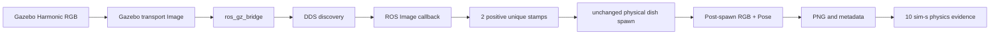

# SmartDish A-13 DBG-13 — WSL2 GUI Batch 전환 실패·출고 검증 경계

**작성 기준:** 2026-11-25 / A-11·A-12·A-13 / 작업 브랜치 feat/smartdish-a-tray-camera / Draft PR #45

## 1. RED — 사용자 원본과 보존 정책

- 사용자 첨부: `smartdish_a_tray_evidence.tar(1).gz`
- 압축 원본 SHA256: `0072916e07a0760ba5985e575cfebf4bc6a7e77629183a467d62e7a84c90d874`
- 압축 내 `SHA256SUMS` 기록 30개 전부 원본과 일치
- 사용자 실행 소스 `603171dc04e2aa7840e7516856e823e37c92e67e`, `mode=batch`, `gui=true`, `summary.verdict=FAIL`
- AI OFF main `cc66b66a16ffc8020498d973ebe31a5c4ca439e0` 불변; PR #45 Draft / main 미병합
- E AI OFF 3구간 성공·종료 예외는 본 A 카메라 문제와 무관

### ST-01 개별 PASS

`trial_0001/tray_rgb.png` 실제 640×480 RGB, stamp 600000000 ns, Image stamp 43개, pose 377행, GUI 활성 중 10.236 simulation-seconds 관측. `HELD_OBSERVED` 및 원본 PNG/JSONL SHA 검증 통과. 인위적인 `STABLE` 학습 라벨 승격은 금지하며 `REVIEW_REQUIRED` 유지.

### ST-02 배치 전환 FAIL

- 최초 오류: `A13_REAL_CAMERA_BRIDGE_WARMUP_NO_TWO_IMAGES`
- 로그: `logs/trial_0002_gazebo.log`, `logs/trial_0002_bridge.log`, `logs/trial_0002_gz_image_probe_data.txt`
- Gazebo Image probe 3,672,011 bytes, 첫 ST-01 probe와 동일한 SHA `a80f1ec4f28880c2d50144ab8f4ebd355f692a1a1a9faf90518ba3bb93ab7b0f`. 이미지 proto 텍스트 첫 `header.stamp {}` 공란, `seq=0`, width 640 / height 480.
- 이는 Gazebo의 첫 샘플 존재를 입증하지만 **후속 프레임의 증가나 ROS callback 수를 입증하지 못함**.
- ST-02 원본에 총 callback 횟수·마지막 sim time·DDS domain·partition·소유 프로세스 정리 결과 없음. 따라서 **ROS callback=0, DDS 버그, 렌더러 결함, rclpy shutdown 문제를 단독 확정하지 않음**.
- ST-02 식기 spawn 이전 중단. PNG/physics JSONL 없음. UN-01, UN-02 미실행. **전체 L3 FAIL 보존**.

## 2. 아키텍처와 기존 CI 누락

이전 [CI #45338297444](https://github.com/silverbjin/samsung_AXI/actions/runs/45338297444)는 L0 30 PASS, ROS Jazzy L1, 실제 headless 배치 4/4, 실제 Xvfb GUI **ST-01 단독 cold start 2/2**를 통과했습니다. 동일 **Python 프로세스**에서 ST-01→ST-02→UN-01→UN-02를 연속 실행하는 production GUI batch 경로는 CI 검증하지 않았습니다.

**Cold start 2회 성공 ≠ 동일 프로세스의 batch transition 성공.**

## 3. GREEN 목표 — 최소 수정과 진단 기록

`scripts/smartdish_a_tray_live.py`의 이미지→식기→Pose→PNG→10초 물리 계약은 변경하지 않습니다. 우선 관측 가능한 근거를 추가합니다.

- `failure_snapshot()` (ROS 초기화 실패 상황도 견디는 순수 진단 함수)을 도입해 첫 실패의 phase, callback/positive/zero/repeat stamp, GZ sample, wall/sim time, ROS domain/partition, QoS, WSLg renderer 설정, 실행 중인 소유 PID를 캡처합니다.
- `trial_<id>/failure_diagnostics.json`을 **cleanup 이전**에 저장합니다. 이전처럼 stderr/stdout만 보고 원인을 추측하지 않습니다.
- 진단용 `gz topic -e -n 2` 출력에서 실제 Image protobuf `width:` 블록 수를 기록합니다. 이 수치는 성공 판정 조건이 아니며 **두 샘플이 시간상 증가한다고 보장하지도 않습니다**.
- `trial_<id>/process_cleanup.json`에 owned process 종료 상태 기록. 각 성공 trial summary에 domain/partition 기록.
- 기존 물리 모델의 질량·마찰·관성, prewarm→dynamic spawn, `A13_CAPTURE_AFTER_MATERIAL_FALL_REJECTED`, Image/Pose timestamp guard, B `REVIEW_REQUIRED` 보존.
- 근본 원인을 특정하는 WSL2 경계 증거를 확보하기 전까지 별도 subprocess 분리 및 timeout 증가 같은 추정성 수정은 보류합니다.

## 4. 신규 배포 사전 검증

기존 `.github/workflows/smartdish-a-tray-ci.yml`에 **`tray-l2-gui-batch`** 를 추가합니다.

- **L0:** 정적 계약과 `tests/test_smartdish_a_tray_batch_diagnostics.py`로 진단 schema, 한 Gazebo 샘플을 두 이미지로 오인하지 않는 회귀, 신규 GUI batch 게이트 존재 확인.
- **L1:** Jazzy Image/TF 브리지 확인.
- **L2-H:** 실제 Gazebo headless 4개 물리 시나리오.
- **L2-G/L2-COLD:** 기존 ST-01 GUI 콜드스타트 2회.
- **L2-G-BATCH:** production 동일 command `smartdish_a_tray_live.py batch --gui`에서 ST-01/ST-02/UN-01/UN-02 모두 실제 ROS 이미지/PNG/물리 Pose/GUI 활성 중 후속 RGB, JSONL와 이미지 SHA, 각 trial domain/partition 고유성, 종료 프로세스 확인. **가짜 Image/Pose 및 시나리오 이름을 정답으로 승격하는 방식 금지**.
- **L3:** 실제 사용자 Ubuntu24.04 WSL2 + WSLg GUI batch. Xvfb/llvmpipe CI는 WSLg 전용 드라이버 차이를 완전히 재현하지 못함.

## 5. 검증 상태와 교육 포인트

**최초 작성 기준:** 이전 L0/L1/L2-H/L2-G/L2-COLD 성공 증거만 존재. 신규 변경 SHA의 CI 결과는 GitHub Actions 실제 실행을 확인하여 PR #45에 기록하기 전까지 **NOT_RUN**. 이전 사용자 L3는 **FAIL**. 새 코드의 사용자 L3는 **NOT_RUN**. 승인 전 main 병합 금지.

주니어 실습 순서: (1) 기존 실행기의 `run_trial()`과 `finally` 정리 순서를 읽습니다. (2) ST-01과 ST-02의 원본 bridge/GZ Image 데이터를 비교합니다. (3) GZ 토픽 광고, 최초 프레임 샘플, DDS graph, ROS callback, PNG의 증거 수준을 각각 구분합니다. (4) `failure_diagnostics.json`의 phase별 정보와 `process_cleanup.json`을 대조합니다. (5) L0 unit test PASS와 L2 실 Gazebo PASS, L3 현장 인수 PASS가 서로 다른 것을 확인합니다.

**RED → GREEN → REFACTOR → REVIEW → COMMIT**: 이번 RED는 실제 WSL2 ST-02 실패. GREEN은 새 diagnostic contract 및 production GUI batch CI의 실제 결과로만 판정합니다. 리팩터링은 불필요한 코드 재작성 대신 최소 차이와 Fail-Closed 보존을 우선합니다. 신규 CI가 FAIL이면 첫 원본을 보존하고 수정 가능성 있는 경계만 교정합니다.
