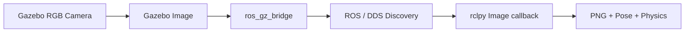

# SmartDish A-13 DBG-14 — WSL2/WSLg RGB 수신 증거 수집 보강·진단 계약

작성일: 2026-11-25 · 브랜치: `feat/smartdish-a-tray-camera` · Draft PR #45

## 1. 범위와 출처 — 이번 실행 원본 미첨부

이번 사용자 요청에는 **새로운** `smartdish_a_tray_evidence.tar.gz` 원본 파일이 포함되지 않았습니다. 현재 확인 가능한 원본은 앞선 실행의 `smartdish_a_tray_evidence.tar(1).gz`이며 SHA256 `0072916e07a0760ba5985e575cfebf4bc6a7e77629183a467d62e7a84c90d874` 입니다. 이 원본은 **이전 코드 `603171dc...`** 의 WSL2 GUI `batch` 실행입니다. 최신 A HEAD `257a84b...`의 실제 사용자 WSL2 실행에 새로운 오류가 있다고 단정하지 마십시오.

- 이전 원본: `SHA256SUMS` 30/30 일치; 전체 `summary.verdict=FAIL`.
- `ST-01`: 실제 `tray_rgb.png` 640×480, ROS Image timestamp 43개, Pose 377개, 실제 `HELD_OBSERVED`, 개별 성공 증거 보존.
- `ST-02`: `A13_REAL_CAMERA_BRIDGE_WARMUP_NO_TWO_IMAGES`. 최초 Gazebo `Image` 텍스트 3,672,011 bytes; header stamp 비어 있고 `seq=0`. **이 한 샘플만으로 후속 GZ 메시지의 시간 증가를 증명할 수 없음**. 식기 spawn/PNG/물리 기록 전에 종료.
- 이전 원본에는 ST-02의 ROS callback 전체 횟수, `/clock` callback 진행 상태, DDS domain, transport topic 실측 및 프로세스 정리 증거가 없음. GZ 센서 내부·브리지·DDS·WSLg renderer의 단독 최초 원인은 **미확정**.
- `main@cc66b66a16ffc8020498d973ebe31a5c4ca439e0`, 기존 AI OFF 및 성공/실패 원본 보존. E AI OFF 종료 예외는 별개.

## 2. 증거가 부족한 이유

토픽 광고나 GZ CLI의 exit code 0은 Image callback 증명이 아닙니다. 수신 콜백 2개 미만이라는 실패 판정은 있으나, 원본의 callback 총 수와 sim time 정지 여부가 누락되면 **센서 생성 중단 / ROS 변환 누락 / DDS 지연**을 분리할 수 없습니다.

## 3. 최소 변경: 수집 진단만 추가

현재 코드의 실제 카메라·물리·낙하 후 RGB 거부·`verify_timing`·B `REVIEW_REQUIRED`·기존 WSL2 Fail-Fast 실행기를 변경하지 않습니다.

- ROS `Image` callback마다 **wall monotonic ns, 해당 callback의 sim_ns, image stamp, payload bytes, encoding, frame_id, width/height, phase**를 bounded list에 저장합니다.
- `/clock` 전체 callback 수, 실제 clock advance 수, nonadvancing 수, 최종 진전 시각 및 bounded clock trace를 추가합니다.
- 예외 시 **프로세스 종료 전에** 기존 `trial_XXXX/failure_diagnostics.json`에 위 항목을 기록합니다.
- 읽기 전용 `gz topic -i -t /smartdish/tray/image_raw`, `ros2 topic info -v`, `ros2 topic list -t`를 각 최대 4초로 실행하고, 출력과 timeout/returncode를 `trial_XXXX/transport_boundary_probes.json`에 기록합니다. 화면 환경에서 `glxinfo -B`가 설치되어 있을 때만 GPU 렌더러 진단을 수행합니다.
- 최상위 `failure_context.json`에 전체 오류 traceback, 소스 SHA, mode, gui, 이미 성공한 trial 개수를 남깁니다.
- 기존 `trial_XXXX/process_cleanup.json`, GZ Image 원본 2샘플(`logs/*gz_image_probe_data.txt`), Gazebo/bridge/gui 로그는 그대로 보존합니다.
- `manifest(dest)`와 `dest.rglob("*")` tar 생성 과정이 신규 JSON도 자동 포함하며, `SHA256SUMS`에 추가되어 위변조를 검출합니다.
- 실패 경계 조회는 진단용입니다. `gz topic` 또는 `ros2 topic` 조회 성공 자체를 인수 PASS로 승격하지 않습니다.

## 4. 다음 실행의 실제 원인 판별 절차

1. `summary.json`의 `source_sha`와 `first_error`, 마지막 성공 trial을 확인합니다.
2. `failure_context.json`에서 traceback 위치를 확인합니다.
3. 실패 trial의 `failure_diagnostics.json`에서 `stage`, ROS image callback 이력, positive stamp, `/clock` 증가 이력을 비교합니다.
4. `transport_boundary_probes.json`의 Gazebo image transport 정보와 ROS endpoint QoS·topic 정보 및 명령 timeout을 교차 확인합니다.
5. `gz_image_probe_data.txt` 실제 메시지 본문, Gazebo·bridge 로그, `process_cleanup.json`을 비교합니다.
6. 증거가 일치할 때만 **Gazebo 생성**, **GZ→Bridge**, **DDS/ROS 수신**, **PNG 변환**, **프로세스 재초기화** 중 최초 단절 경계를 확정합니다. 모호하면 `미검증`으로 남깁니다.

## 5. 검증 및 출고 조건

- L0: 신규 `tests/test_smartdish_a_tray_boundary_probes.py`의 순수 진단·bounded trace·4초 read-only timeout·새 파일 SHA manifest 테스트.
- L1: ROS 2 Jazzy 및 Image/QoS 인터페이스.
- L2-H: 실제 Gazebo 4개 physical scenarios.
- L2-G/L2-COLD: GUI 독립 2회.
- L2-G-BATCH: 동일 Python 프로세스의 4개 GUI 연속 시나리오.
- L3: **사용자 WSL2 WSLg 4개 GUI batch**, 실제 새 `smartdish_a_tray_evidence.tar.gz` 제출 후 판단. 이전 실패를 새 PASS로 덮어쓰지 않음.

새 SHA의 CI는 GitHub 실제 완료 결과를 확인하기 전까지 **NOT_RUN/IN_PROGRESS**이며 사용자 L3는 **NOT_RUN**입니다. GitHub Actions가 PASS해도 WSLg 전체 인수가 PASS인 것은 아닙니다. PR #45 Draft·main 미병합 유지.

## 6. 주니어 학습 포인트

RED: 기존 ST-02의 시뮬레이션 카메라 준비 실패를 실제 원본으로 확인합니다.  
GREEN: 모의 timeout·콜백 타임라인·manifest L0로 **증거를 생성하는 기능**을 검증합니다.  
REFACTOR/REVIEW: 실센서/물리 원본과 성공 게이트를 변경하지 않고 실패 경계에 관측성만 더합니다.  
COMMIT: 코드·테스트·교육 디버깅 보고서를 함께 게시하고 동일 SHA CI의 RUN/Artifact 링크를 PR #45에 남깁니다.

**본 변경은 새 WSL2 오류의 단독 근본 해결이 아니라 진단을 위한 최소 보강입니다. 실제 원인은 사용자 신규 원본을 받아 확인해야 합니다.**
