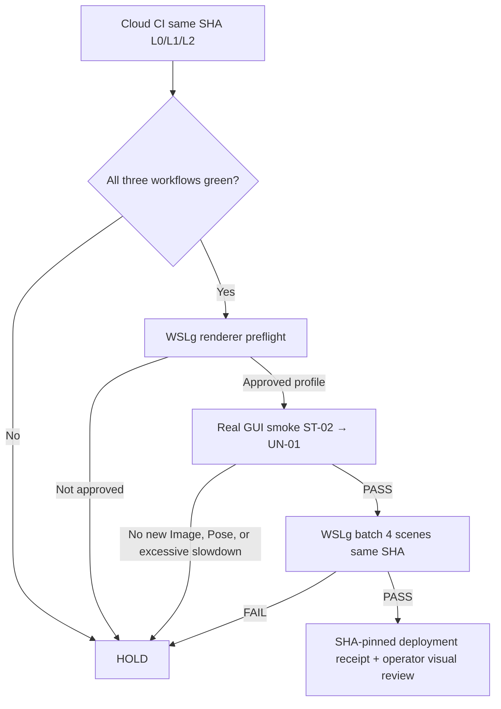

# SmartDish A-13 DBG-15 — Post-Spawn GZ↔ROS 영상 연속성 및 WSLg 2단계 배포 검수

작성 기준: 2026-11-25 / 브랜치 feat/smartdish-a-tray-camera / Draft PR #45 / 기존 main 변경 금지.

## 1. RED: 실제 WSL2 실패 원본

사용자 원본 `smartdish_a_tray_evidence.tar(2).gz` SHA256:
`d7f6e822a564ad5e539a358ef1045001ab2e6a3231ca6e0ac9bc889392a8a278`.
Archive 내부 53개 SHA256SUMS 전부 일치. 실행 SHA `5578e6be11d2a9302a331c1a02046edbd868b3bd`.

- `ST-01`: 37 Image stamp, 372 Pose, PNG/physics, HELD_OBSERVED, GUI 실제 관측, 개별 PASS.
- `ST-02`: 34 Image stamp, 566 Pose, PNG/physics, HELD_OBSERVED, GUI 실제 관측, 개별 PASS.
- `UN-01`: `A13_PRE_EVENT_GAZEBO_CAMERA_NO_IMAGE` → 전체 `summary.verdict=FAIL`.
  - `failure_diagnostics.json`: `stage=post_spawn_camera_pose`, `sim_ns=1305000000`; /clock callback은 계속 증가. ROS Image callback 전체 2회, 모두 빈 트레이 단계, stamp 0.4s·0.8s. 식기 생성 후 ROS Image callback **0회**, 식기 Pose 2개 정상 존재.
  - `transport_boundary_probes.json`: GZ image publisher/subscriber는 존재, ROS image publisher 1 / subscription 1, QoS RELIABLE→BEST_EFFORT, WSLg GL renderer `llvmpipe` (`Accelerated: no`).
  - 원래 `gz_image_probe_data.txt` 2샘플은 **식기 생성 전 수집**. 새 이미지가 GZ에서 없었는지, GZ는 계속 발행했지만 bridge/DDS 전달이 막혔는지 원본만으로 확정 불가.
  - `trial_0003/process_cleanup.json`: 소유 프로세스 모두 정리. 프로세스 종료가 최초 장애였다고 주장할 수 없음.
- `UN-02`: NOT_RUN. ST-01/ST-02 PASS는 보존하고 이전과 이번 사용자 L3는 FAIL.
- 기존 GitHub CI #45526656531 L0/L1/L2-H/L2-G/L2-G-BATCH PASS는 Xvfb/llvmpipe의 성공. WSLg 동일 환경 재현·현장 L3 PASS 증거가 아님.

## 2. 진단 → 대응 경계

## 3. 구현 범위 및 보호

### P0: 전·후 GZ Image 경계

- 기존 빈 트레이 시점의 실제 `gz topic -e -n 2` (최대 2 protobuf Image 전체) 기록 유지.
- 동적 식기 EntityFactory 성공 직후 **별도 신규 GZ Image probe** (`-n 2`) 실행. GZ 후속 샘플과 ROS 후속 frame stamp를 분리해서 기록.
- RGB 미수신 시 `A13_PRE_EVENT_GAZEBO_CAMERA_NO_IMAGE`를 유지하면서 boundary 진단 `A13_POST_SPAWN_GZ_IMAGE_NOT_OBSERVED` vs `A13_POST_SPAWN_GZ_TO_ROS_NOT_OBSERVED` 기록.
- *중요한 한계*: Gazebo CLI 프로브는 전체 프레임 지속 모니터가 아니라 **식기 전/후의 제한된 2샘플 관측**. 특히 CLI 헤더 stamp가 없는 메시지는 Gazebo frame timestamp를 확정할 수 없음. 이 진단 값만으로 드라이버/DDS 근본 원인을 단정하면 안 됨.
- 원본 ROS Image callback 시계열, /clock 진행, named Pose, Image/Pose timestamp ±250ms, 낙하 후 이미지 수집 거부 계약은 유지. 510ms simulation capture cutoff와 `A13_CAPTURE_AFTER_MATERIAL_FALL_REJECTED`를 늘리거나 삭제하지 않음.

### P1: WSLg 렌더러 + 스모크

- 새로운 `scripts/smartdish_a_tray_release_gate.py`: GitHub public API에서 **현재 source_sha와 정확히 동일한 CI SHA**로 *A Tray*, *Navigation Adapter*, *Restaurant MVP* 세 워크플로가 완료 / success인지 확인. 네트워크 조회 실패 시 PASS 생성 금지.
- 실제 WSL2 + GUI + `glxinfo -B` 필요. `llvmpipe`/소프트웨어 렌더러 기본 배포 차단. 기존 사용자의 llvmpipe 환경에서 시험을 진행하려면 환경변수 `SMARTDISH_A_TRAY_ALLOW_SOFTWARE_RENDERER=1`로 **명시적으로 승인**해야 하며, 이 승인만으로 PASS가 되는 것은 아님.
- 자동화된 동일 프로세스 `ST-02→UN-01` 실제 WSLg smoke를 1회 실행. 각각 real RGB/PNG, valid ROS timestamp, real physics Pose 10 sim seconds, 소유 프로세스 종료를 검증하고 wall/simulation ratio가 15 이하인지 확인. 그 후에만 4시나리오 batch 진행.
- 추가 smoke는 **실제 WSLg에서만** 실행; cloud CI에서는 기존 4시나리오 batch를 재활용하며 불필요한 15회 실행 금지.
- 사용자 직접 실행은 `scripts/smartdish_a_tray_bootstrap.sh --gui qualify`; 기본 `--gui batch` 동작 유지. 실패 시 완료된 원본 archive 보존, 다음 단계 진행 금지.

### P2: SHA 고정 인수 증거

- `qualification_<SHA>-<PID>.json`에 same-SHA Cloud CI, renderer 승인/환경, operator opt-in, 실제 smoke tar SHA256, 성능 프로파일을 기록.
- 승인된 `qualification` JSON은 4시나리오 batch 생성 시 `deployment_gate_manifest.json`으로 들어가며 tar.gz 전체 manifest SHA 검사 대상.
- Batch 성공 뒤 `deployment_receipt.json`을 별도로 기록: source SHA, 실제 evidence archive SHA256, CI run URLs, smoke archive SHA256. 순환 해시 방지를 위해 receipt는 tar 바깥에 보존.
- **사용자 시각 검수는 별도**: receipt verdict는 `READY_FOR_OWNER_VISUAL_REVIEW`이며, 자동화만으로 사람의 시각 검수·라벨 권리 승인·최종 main 병합을 진행하지 않음.
- 모든 새 코드는 A 센서/수집·테스트·CI·교육 문서만 변경. S7 Nav2/AMCL/Collision Monitor, AI OFF main, B/C/D 및 라벨 REVIEW_REQUIRED는 불변.

## 4. Junior developer 교육

- `GZ topic advertised`와 `GZ protobuf first frame`, `GZ post-spawn frame`, `ROS actual callback`, `PNG+Pose`는 각각 증거의 강도가 다릅니다.
- `clock`은 1.305s 진행했지만 Image는 0.8s에서 멈춘 이유를 시각화합니다. 시뮬레이션 시간과 WSLg 렌더러 wall-clock 시간은 서로 다릅니다.
- `smoke`와 `batch`는 개별 SUCCESS가 아니라 각각 순서/경로를 검증해야 합니다. Cloud CI의 Xvfb 모방은 실제 WSLg L3를 대신하지 못합니다.
- RED→GREEN→REFACTOR→REVIEW→COMMIT: RED 실사용 UN-01; GREEN 본 커밋의 해당 CI PASS 여부 확인; REFACTOR 검증 원본 보호; REVIEW 동일 SHA + 소유 프로세스/label/증거 경계 확인; COMMIT 독립 브랜치와 Draft PR 유지.

## 5. 인수와 미검증 경계

새로운 변경은 **WSLg 실제 실사용 UN-01 최초 실패 원인의 단독 확정이 아닙니다**. 새 GZ 후속 샘플을 포함한 실제 현장 증거가 확보되면 Gazebo 서버 카메라 쪽인지 bridge/DDS 전송 쪽인지를 더 좁힐 수 있습니다. CI PASS이더라도 사용자 WSLg L3는 해당 SHA 원본을 받아 확인하기 전까지 NOT_RUN입니다.

명령은 GitHub 동일 SHA L0/L1/L2 전체 PASS 후에만 안내합니다. 자가 호스팅 runner를 공개 PR에 직접 연결하지 않고, 사용자 소유 WSL2에서 **승인된 커밋만 로컬 qualification**합니다.
