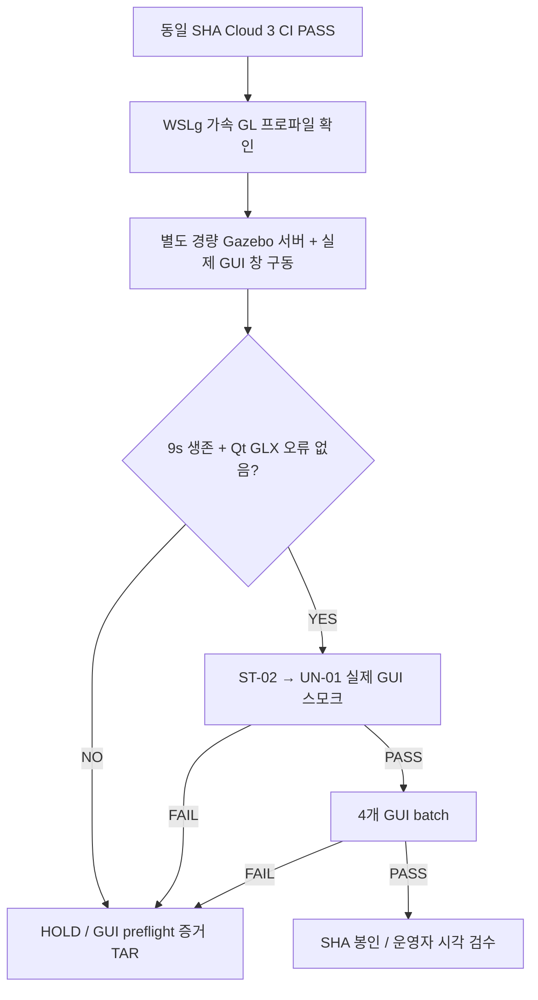

# SmartDish A13-DBG-17 — WSLg GUI 사전검증 및 센서·GUI 독립 게이트

일자: 2026-11-25  
저장소: silverbjin/samsung_AXI  
작업 브랜치: feat/smartdish-a-tray-camera / Draft PR #45  
보호된 AI-OFF main: cc66b66a16ffc8020498d973ebe31a5c4ca439e0

## 1. 실제 현장 RED 기록

사용자 네 번째 업로드 smartdish_a_tray_evidence.tar(4).gz SHA256:
02fc82567392b603aa512e89446f82a9faccf4f11ba2dc562167008a56720106.
내부 SHA256SUMS 24/24 PASS. 실행 SHA d0658a32c7bc5b88ce56dfbb6d5a7025164f6634.

- ST-02 sensor warmup: ROS stamp 0.2s·0.4s, 1.75s wall, 양수 증가 이미지 PASS.
- 식기 생성 후 0.6s Image, 0.55s Pose 및 실 PNG: PASS.
- /clock 10.789s 진행, ROS image 54 callbacks, Gazebo server + bridge 실행 중.
- GUI 로그: D3D12: Removing Device / glx failed to create drisw screen / QGLXContext dummy context 실패 / Failed to create OpenGL context / QSGRenderLoop 컨텍스트 오류 / SIGABRT -6. ST-02 최종 trial 미검증, UN-01 NOT_RUN.
- glxinfo: D3D12 NVIDIA GeForce RTX 3060 accelerated yes. 이는 Qt GUI 성공과 다르다.
- server 사후 정리 종료 코드 -11은 GUI -6 최초 장애와 분리해 기록.
- 동일 SHA Cloud Xvfb/llvmpipe PASS는 사용자 D3D12 WSLg PASS 증거가 아니다.

사용자 ~/.bashrc 환경 보존:
`unset LIBGL_ALWAYS_SOFTWARE`, `unset LIBGL_ALWAYS_INDIRECT`, `unset MESA_LOADER_DRIVER_OVERRIDE`, `GALLIUM_DRIVER=d3d12`, `MESA_D3D12_DEFAULT_ADAPTER_NAME=NVIDIA`.
GPU 및 adapter 선택을 변경하지 않으며 강제 llvmpipe를 적용하지 않는다.

## 2. 원인과 배포 결함

문제는 Gazebo Image/ROS QoS가 아니라 Qt/XCB OpenGL 컨텍스트 생성 실패다.
종전 release preflight는 `glxinfo -B`, GitHub 동일 SHA CI만 검사해 실제 Gazebo GUI의 창 초기화와 조기 종료를 확인하지 못했다.

Gazebo Harmonic 공식 문서 https://gazebosim.org/docs/harmonic/troubleshooting/ 는 Wayland 관련 문제에 XWayland/XCB (`QT_QPA_PLATFORM=xcb`)를 제안한다. 이것은 증거 기반 시도이지 사용자 WSLg GPU의 해결 완료를 보장하지 않는다.

## 3. 새 아키텍처

### P0 GUI 사전검증

새로운 `scripts/smartdish_a_tray_gui_preflight.py`는 고립된 GZ_PARTITION과 3D 박스 한 개를 가진 최소 월드를 만든 뒤 실제 `gz sim -s`와 `gz sim -g`를 기동한다. Gazebo 서버 서비스 준비 및 GUI 실행 생존 9초를 측정하고 Qt/GLX fatal 로그 또는 조기 종료가 있으면 즉시 FAIL. 기존 ROS/Gazebo 프로세스를 전역 kill하지 않고 자기 자식 프로세스만 정리한다.

기본 `SMARTDISH_A_TRAY_GUI_PROFILE=xcb`는 GUI **자식 프로세스**에만 `QT_QPA_PLATFORM=xcb`와 WAYLAND_DISPLAY 제거를 적용한다. NVIDIA D3D12 환경은 보존한다. 명시적 `native` 프로파일도 제공하되 무단 자동 fallback/재시도는 없다.
출력: `gui_preflight_result.json`, `gazebo_gui.log`, `gazebo_server.log`, `SHA256SUMS`, `gui_preflight_evidence.tar.gz`.

**한계:** 9초 실제 GUI 생존·컨텍스트 오류 부재는 초기화 실패를 저렴하게 선별한다. GUI 전체 픽셀, 10초 이상 안정성 또는 사용자의 시각 품질을 대신 증명하지는 않는다. 그래서 실제 GUI 스모크와 batch, 사용자 시각 검수는 별도 유지한다.

### P0 센서·GUI 독립 판정

`scripts/smartdish_a_tray_live.py`는 실제 10-sim-s 관측 중 GUI가 종료돼도 RGB·Pose·물리 데이터를 계속 수집한다. 완료 후 기존 `verify_trial`을 실제 통과했을 때만 `sensor_physics_verdict=PASS`를 기록한다. GUI는 별도 `gui_verdict=FAIL`과 원본 프로세스 종료 코드/시뮬레이션 시점을 기록한다. 최종 GUI-required qualify는 FAIL로 유지한다. 이전의 GUI 예외로 센서·물리 증거 전체가 폐기되는 현상을 막는다.

### P2 SHA 매니페스트

`scripts/smartdish_a_tray_release_gate.py`는 GUI 결과의 source SHA, 승인한 GUI 프로파일, 9초 이상 생존, 고립된 서버 정상 준비, tar/SHA256SUMS 무결성을 검사하고 `WSLG_GUI_PREFLIGHT_PASS`를 기록한다. 이 단계 PASS 없이는 스모크 진입 불가. 스모크와 batch는 각각 모든 trial의 `sensor_physics_verdict=PASS` 및 `gui_verdict=PASS`와 GUI 프로파일 일치까지 요구한다. 최종 receipt에 GUI preflight tar SHA256 바인딩.

### CI 교육 검증과 보호

1. 재현 오류 fixture: QGLXContext, GLX drisw screen, Qt failed OpenGL context, -6는 모두 FAIL.
2. 9초 생존 미달, SHA 또는 GUI profile 불일치, tar 해시 위변조는 FAIL.
3. GUI 자식만 XCB; 사용자의 D3D12·NVIDIA 환경 보존.
4. 기존 pre-fall RGB Pose sync, 실제 10초 physics, B REVIEW_REQUIRED, Nav2/CM 및 AI OFF main 보호.
5. Cloud GUI 콜드스타트 전 1회 경량 실제 GUI preflight 테스트. WSLg 현장 L3는 **별도 미검증**.

## 4. 현장 운영과 교육

검증된 새 SHA로 `SMARTDISH_A_TRAY_SOURCE_SHA=<SHA> bash ~/smartdish_a_tray_bootstrap.sh --gui qualify`를 실행한다. GUI 사전검사가 실패하면 4개 물리 장면을 반복 실행하지 않고 별도 gui_preflight_evidence.tar.gz를 반환한다.

### 상태 원장

- 사용자 네 번째 현장 ST-02 GUI: FAIL, 새 배포 전까지 그대로 보존
- DBG-17 코드: Cloud CI 통과 시 코드 검증만 승인
- WSLg GUI 초기화·물리 통합: 실제 사용자 증거 없으면 NOT_RUN
- main 병합: 승인 전 HOLD
