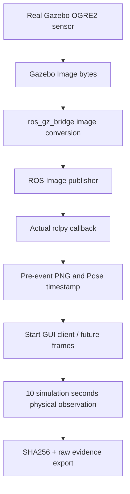

# SmartDish A-13 — WSL2 GUI RGB 콜백 0회 장애: 원본 증거·RCA·CI 대응 보고서 (2026-11-24)

## 원본 사건과 범위

사용자가 제공한 `smartdish_a_tray_evidence.tar.gz` (SHA256 `0a8acc1001c3524400a96af72306bc81d0061f39838059b7c694a58a2d179507`), 내부 9개 파일 모두 SHA256SUMS 일치.

- 당시 코드 SHA: `6a4c2f2fc77d72b607608c0a3c1a4edaac0eb38f`.
- `summary.json`: `mode=batch`, `gui=true`, `verdict=FAIL`, `trials=[]`.
- 최초 오류: `A13_PRE_EVENT_GAZEBO_CAMERA_NO_IMAGE`, `sim_ns=315000000`, `gz_image_topic_advertised=true`, `gz_image_frame_probe_exit=0`, `ros_image_publishers=1`, **`ros_image_callbacks=0`**, 식기 Pose `dish_01,dish_02`.
- `logs/trial_0001_gz_image_probe.log`: **0 bytes**, 하지만 해당 파일은 프로브 stderr이고 실제 GZ Image의 stdout은 기존 코드에서 `subprocess.DEVNULL`로 버렸음. 따라서 `gz_image_frame_probe_exit=0`만으로 프레임 내용/형식은 **확증 불가**.
- `logs/trial_0001_bridge.log`: Image, CameraInfo, /clock, Pose_V 다수 `Creating GZ->ROS Bridge` 출력. 연결 생성과 실제 메시지 수신은 다름.
- `logs/trial_0001_gazebo.log`: SDF `gz_frame_id` 경고, Ogre2 mask 경고; **단독 근본 원인으로 확정 불가**.
- `logs/trial_0001_gui.log`: QML Binding loop/FSAA 경고; **단독 원인으로 확정 불가**.
- PNG·Pose 물리 JSONL은 없음, 현장 L3 **FAIL**.

## 기존 CI와의 차이

- CI [#45326495651](https://github.com/silverbjin/samsung_AXI/actions/runs/45326495651)에서 headless + Xvfb + llvmpipe 실제 Gazebo 4/4 PASS.
- 사용자의 WSLg GUI에서는 Gazebo server+bridge와 GUI를 *동시에* 시작했고 기존 Python 코드는 `LIBGL_ALWAYS_SOFTWARE=1,GALLIUM_DRIVER=llvmpipe`를 프로세스 env에 자동 주입함.
- 이미지 callback 0회가 Gazebo Sensor/Transport/bridge/DDS/GUI 렌더링 중 **어느 하나의 단독 결함**인지 원본 증거만으로는 결론 불가. Python이 0.315 sim second까지만 스텝하고 종료하는 시각 경계는 확인된 코드 설계 취약점.

## 최소 수정 및 실험 구분

1. WSLg 실제 렌더러 기본 설정은 **사용자 설정을 상속**하고 llvmpipe는 CI 환경변수에서만 명시적으로 주입(기본 WSLg 소프트웨어 렌더러 강제 제거).
2. Gazebo server/bridge/ROS 구독자를 먼저 실행해 실제 **RGB PNG 최초 수신 및 t1 Pose 검증**을 완료하고 그 뒤 GUI client를 개시. GUI 기동 중 렌더링 지연이 첫 유효 학습 이미지를 오염시키지 않도록 순서 변경.
3. GUI가 유지된 실제 10 sim-second 물리 관측 동안 **후속 ROS Image timestamp 증가** 확인; GUI 종료/후속 RGB 0회 시 별도 FAIL.
4. GZ `gz topic -e -n 1` **stdout을 파일로 저장**해 bytes/SHA/width·height 문자열 포함 여부까지 계측. 프로브 출력 내용 없는 exit 0은 성공이 아님.
5. 기존 `pre_event_ready`, `verify_timing`, `A13_CAPTURE_AFTER_MATERIAL_FALL_REJECTED`, 4 scenarios, B `REVIEW_REQUIRED`, SHA 검사, 기존 AI OFF 코드는 변경하지 않음.

### 실제 검증 상태

- 이 문서 최초 작성 당시 기존 WSL2 L3는 **FAIL**. CI GUI·cold-start 추가 검증은 새 SHA에서 실행해 각각 기록해야 합니다.
- 정적 L0 계약은 GZ stdout 부재인데 exit 0인 상황도 데이터 존재 증명으로 오판하지 않도록 추가함.
- 새 GitHub CI L2-G가 Xvfb GUI client를 실제 가동해 성공해도 **WSLg 현장 성공으로 승격 금지**.
- 증거 보존 원칙: 실패 결과도 요약/원본을 배포 전 검토하고, user GUI 시야 및 B 라벨 승인 전까지 L3 NOT_RUN(신규 수정본)/B REVIEW_REQUIRED.

## 주니어 학습 포인트

메시지 **토픽 광고≠실제 프레임**, 프로브 **종료코드 0≠수신 바이트**, wall-clock ≠ simulation-time, GUI 성공≠WSLg 성공, 예상 ST/UN 시나리오≠사람 승인 정답 라벨임을 반드시 구분합니다.
