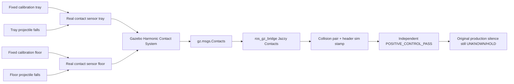

# SmartDish A14-07 — Contact 미관측 채널 독립 양성 교정 및 GT 승인 경계

**기준 main:** `63e147289e307e0b9900ca365e9c4557c5921804`  
**직전 검증된 A14 SHA:** `a99da4207bff358be8b2f228411b94524b2e1c8a`  
**PR:** #47, Draft/미병합. **A13 Owner 4/4 PASS 불변.**  
**실제 개발 목적:** A14-P0에서 미관측 Contact Sensor의 동작 가능성을 독립 양성 실험으로 확인. 미접촉 관측이나 사람 GT 승인으로 위장 금지.

## 1. 중단 원인 및 재실행 최소화

11월 25일 최종 A14 CI #45578437859는 4분 40초 만에 SUCCESS, 기존 Restaurant Robot CI #45578450373도 7분 41초 만에 SUCCESS였다. 4시간 이상 진행된 GitHub CI나 무한 루프 증거는 없다. 다만 작업자가 CI를 지나치게 자주 조회하고 수정 커밋마다 전체 물리 테스트를 재반복한 비효율이 있었다. 이번 교정은 별도 작은 월드·한 개의 전용 workflow만 사용하며 이미 성공한 A13 4/4·A14 ST-02/UN-01을 중복 실행하지 않는다.

## 2. 기존 RED와 실제 남은 문제

- ST-02: 트레이 접촉 이벤트 804건, 실제 Contact callback 21,470건. **바닥 센서는 callback 0건**.
- UN-01: 바닥 접촉 이벤트 391건, 실제 Contact callback 22,577건. **트레이 센서는 callback 0건**.
- 상대 Pose, 실제 헤더 timestamp, DERIVED Velocity 및 RGB/물리 정합은 실제 Gazebo L2에서 검증됨.
- 미수신 채널은 `CONTACT_DATA_INCOMPLETE`이며 `UNKNOWN/HOLD` 그대로. **무응답 = 미접촉 0건**이라고 결론 내릴 수 없음.

## 3. 독립 최소 월드 아키텍처

새 `scripts/a14_contact_calibration.py`가 자체 SDF를 생성하여 두 개의 **독립 실제 낙하 물체**를 각각 트레이와 바닥에 충돌시킨다. 원본 A13 카메라·식기·주행월드를 수정하지 않음. `GZ_PARTITION`·`ROS_DOMAIN_ID` 격리. 실제 SDF Contact System 및 `<contact><topic>`(기존 A14에서 수리한 위치)를 재사용. 각 토픽의 Gazebo publisher, ROS publisher, 실제 Contact collision pair, collision entity ID와 양수 ROS header stamp를 검사한다.

양성 대조군의 두 센서 모두 최소 1회 진짜 충돌이 있고 시뮬레이션 `/clock`이 1.5초 이상 진행한 경우에만 `POSITIVE_CONTROL_PASS`. 유효하지 않은 timestamp, 잘못된 collision pair, ROS 메시지 누락, /clock 정지, timeout, 소유 프로세스 잔존은 `POSITIVE_CONTROL_HOLD`.

### 원본 양성 증거와 미래 판단 경계

**실제 교정에서 성공한 것:** 동일한 방식의 트레이·바닥 Contact Sensor가 충돌 상황에서 ROS 2로 데이터를 내보낼 수 있음.

**아직 증명하지 못한 것:** 원본 ST-02/UN-01의 토픽이 정상적으로 무접촉 상태를 지속 검출한 사실, 10초 간 음성 접촉 증거, 실 tray-robot motion, human-approved GT.

따라서 별도 결과 필드는 다음과 같이 출고:
`production_contact_silence_resolved=false`,
`production_sensor_health=NOT_MEASURED_BY_THIS_CONTROL`,
`no_contact_inferred_from_silence=false`,
`rule_candidate=UNKNOWN`,
`label_status=REVIEW_REQUIRED`,
`human_approved=false`,
`ground_truth=NOT_OPERATOR_APPROVED`.

## 4. bounded 실행 및 무한 반복 방지

- 서버 준비 24초, ROS publisher discovery 16초, 실제 Contact 관측 38초.
- 전역 wall-clock 95초. Owner shell은 115초 timeout, GUI 사전검사는 65초 별도.
- 테스트 장면은 1개 작은 격리 월드이며 **반복 seed·4-scene batch·재귀 호출 없음**.
- 기존 Gazebo/ROS 프로세스 전역 kill/pkill 금지; 소유한 프로세스 그룹만 정리.
- 성공·실패 모두 `calibration_result.json`, `contact_events.jsonl`, 원본 세계 SDF, bridge YAML, 서버/브리지 로그, `SHA256SUMS` 및 `a14_contact_calibration_evidence.tar.gz`, 외부 `.sha256` 생성.
- Cloud workflow `smartdish-a14-contact-calibration.yml`은 신규 파일 변경만 트리거하며 기존 `smartdish-a14-physics-ci.yml`의 2장면 L2와 분리.

## 5. RED→GREEN 교육 체크

| 단계 | 음성 테스트 | 실제 양성 증거 |
|---|---|---|
| L0 | 바닥 positive 없음 → HOLD | SDF 센서 두 개·bridge 두 개·clock 구성 검사 |
| L0 | 0 stamp·wrong collision·wrong topic → HOLD | 두 개의 진짜 event fixture → 수학/계약 PASS |
| L0 | /clock 부족 → HOLD | 1.5 sim seconds time contract |
| L2 | Gazebo/ROS Contact가 0건이면 HOLD | 실제 두 충돌 쌍·ID·stamp·/clock 검증 |
| Owner | WSLg GPU GUI preflight 실패면 HOLD | 사용자 D3D12/XCB L3 결과 별도 |
| B GT | 교정 양성이라도 UNKNOWN/HOLD | Human 승인 레저는 B 소유 |

**L0 fixture는 실제 Gazebo L2 수신 증거가 아니다.** CI L2 성공 또는 현장 실측이 확보된 이후에만 실제 수신 PASS라고 기록한다.

## 6. 다음 단계 순서

1. Cloud L0 및 **독립 최소 Gazebo L2** 증거 확보.
2. Owner WSL2 GUI preflight + 동일 독립 양성 교정 원샷 1회 (Cloud PASS를 재활용).
3. B가 검수할 원본 Contact 채널의 **시계열 음성 상태 증명 방안** 설계. Gazebo Contact 이벤트 토픽이 침묵한다는 사실과 센서가 정상 운용 중임을 구분할 건강상태/heartbeat 계측이 필요. 검증 전에는 원본 GT를 UNKNOWN/HOLD로 유지.
4. 그 다음에만 B 실제 데이터 계약 재검수; 독립 Geometry Family(P1)는 P0 증거 품질 및 사용자 승인 후 시작.

**참고:** Gazebo Harmonic Sensors 및 ROS 2 연계 공식 문서: https://gazebosim.org/docs/harmonic/sensors/ / https://gazebosim.org/docs/harmonic/ros2_integration/.

## 7. CI RED — ROS CLI 확인 단계의 BrokenPipeError

- 최초 전용 CI: [Run #45649071682](https://github.com/silverbjin/samsung_AXI/actions/runs/45649071682). L0 **13/13 PASS**.
- L2는 **실제 Gazebo 실행 전** `ros2 interface show ros_gz_interfaces/msg/Contacts | grep -q contacts`에서 종료 코드 120으로 중단.
- 원인: `set -o pipefail` 환경에서 `grep -q`가 찾자마자 파이프 읽기를 닫자 ROS CLI 출력에 `BrokenPipeError` 발생. 이는 Contact 센서 결함이나 시뮬레이션 타임아웃이 아니다.
- 조치: `ros2 interface show ... > /tmp/a14_contacts_interface.txt`로 출력 전체를 먼저 파일에 저장한 후 `grep -q`를 파일 대상으로 실행. **센서/물리 코드는 수정하지 않음.**
- 기존 실패 Run은 그대로 보존하고 새 SHA 전용 CI 1회를 통해 실제 L2 진행을 확인한다. 이전 A14 2-scene CI는 재실행하지 않는다.
