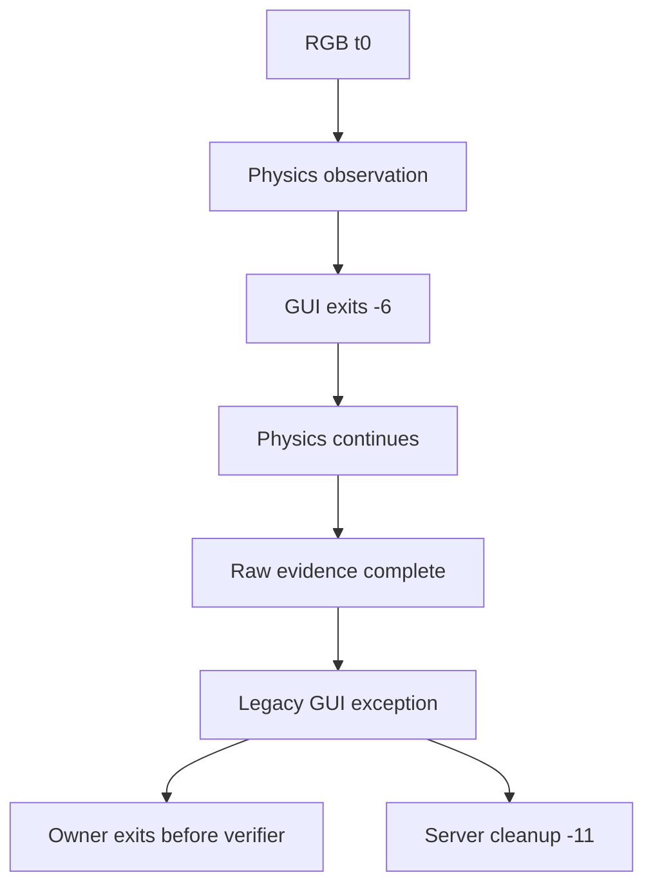

# R03 DBG01 — 최초 실패 경계와 기존 증거 (교육용)

## 사실
Owner SHA 194db1429899775174096e24cde2e785feecda6b, outer TAR SHA256 39c64fc10bdd1d2bd28477925829f879373042bd1af41b42f855657e53f40aa5, ST-02 raw TAR SHA256 4f4328e6d40ba2936467f4f462364869c2f5662a6d71565d05a9961d4ab4342f, GUI preflight TAR SHA256 61db293c3cf6b7b2ff25a4bae09dd0616ad9c222a02e626c8938f04506f1725b. 실제 제출 파일 외부 SHA 및 내부 9/9,41/41,4/4 확인, nested raw 동일. 원본에 개인 환경 경로가 있어 repository에는 복제하지 않음.

GUI preflight 9.013s PASS, 실제 생산 GUI SIGABRT(-6), D3D12 Removing Device / GLX dummy context / Failed to create OpenGL context. D3D12 원인은 미확정. RGB t0 0.600s; physics (0.605,10.797]s; GUI exit 2.709s; 51 RGB stamps, 17167 actual raw ROS callbacks, 5x10192 refresh steps. HELD_OBSERVED, GT UNKNOWN/HOLD. Failure snapshot phase evidence_verification; GUI final raise after build_v2; server alive at failure, later -11 during cleanup, all owned stopped. Legacy owner exits before verifier. UN-01 not run.

## Cloud 차이
R02-3 #45728116649 used software llvmpipe/Xvfb, headless production. Packaging #45728116690 PASS, MVP #45728122755 SUCCESS. Prior R02-2 #45727749943 PASS. Cloud cannot prove WSLg GPU behavior. No old PASS rerun solely for diagnosis.

## 흐름

교훈: 동일 run의 서로 다른 검수 경계를 구분하고 실제 evidence를 재검증한다. 데이터 증거의 성공은 GUI나 clean exit를 증명하지 않는다. 원인 가설은 별도 렌더러/종료 계측으로 검증한다. R03 전체 HOLD.
