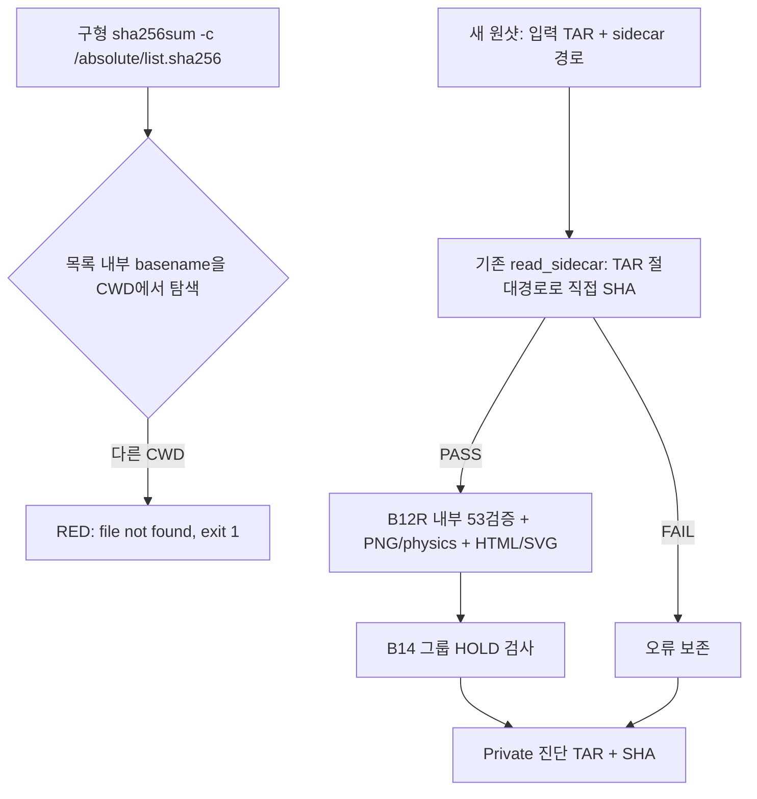

# SmartDish B12R DBG-02 — 체크섬 상대경로와 대화형 셸 종료 사고

**상태:** RED 실제 재현 → GREEN 로컬 계약 검수, 원격 동일 SHA CI 증거는 PR 원장에 추가. 2026-11-25.

## 1. 사용자 실제 실패

- B 원본 진단: `smartdish_b_a13_20261125T055624Z_6624_diagnostics.tar.gz` (SHA256 `912bfbc759e3fde3f48e70316638bc86dd30c52461ecd19410281bd7edf1f515`).
- B-15 원본 인수: diagnostic 53/53, `RUN_SUCCESS`, 후보 4건, label 승인 0건.
- B12R 워크북의 `sha256sum -c "$ARCHIVE.sha256"`는 체크섬 **목록 파일 자체**의 경로만 절대로 주었고, 목록 **내부**의 파일명은 basename입니다.
- 사용자 실행 위치는 `~/samsung_AXI_B_REAL`; 실제 TAR는 `ai/data/private/b_a13_diagnostics/`에 존재합니다.
- `sha256sum -c`는 체크섬 목록 안의 *상대 파일명*을 호출 프로세스 CWD 기준으로 해석하여 파일을 못 찾았습니다.
- 쉘의 최상위 `|| exit 1`은 **사용자 대화형 셸**을 종료시켜 `logout` / Windows Terminal 코드 1을 발생시켰습니다. WSL, Gazebo나 ROS 프로세스 크래시가 아닙니다.

## 2. RED 실측 재현 (사용자 TAR 바이트 보존)

```
cd /tmp
sha256sum -c /mnt/data/smartdish_b_a13_20261125T055624Z_6624_diagnostics.tar.gz.sha256
# exit 1, "No such file or directory"
cd /mnt/data
sha256sum -c smartdish_b_a13_20261125T055624Z_6624_diagnostics.tar.gz.sha256
# OK
```

RED는 잘못된 명령의 실패를 실제 실행해 확인한 결과입니다. 단순 문서 예상 결과가 아닙니다.

## 3. GREEN 원리와 최소 수정

기존 `ai/scripts/receive_b15_diagnostics.py::read_sidecar()`는 사용자 CWD 대신 `archive.open('rb')`로 바이트 SHA를 직접 계산하고 `sidecar`를 열어 basename과 해시를 검사합니다. 함수를 재활용하여 다음 원샷으로 연결했습니다.

- `scripts/smartdish_b12r_one_shot.sh` → `ai/scripts/smartdish_b12r_cli.py` → **기존** `read_sidecar()` / `publish_workspace()` → `audit_a13_independent_groups.preview_candidates()`.
- 기존 `read_sidecar`의 입력 파일 존재 검사를 `B12R_ARCHIVE_NOT_FOUND` / `B12R_SIDECAR_MISSING`으로 명시했습니다.
- 파일 부재·체크섬 문법 오류·SHA 불일치·내부 SHA 오류·승인 원장 위조·TAR 경로 이탈·symlink·누락 SVG를 구분합니다.
- 성공과 실패 모두 개인 `ai/data/private/b12r_diagnostics/*_diagnostics.tar.gz` 및 `.sha256`을 자동 생성합니다. 실패 코드를 감추지 않고 반환하며 사용자가 실행한 셸을 `exit`하지 않습니다.
- 진단 패키지는 허용목록 파일만 포함합니다. 운영자 승인 원장, 원본 A-13 전체 TAR, 비인가 학습 결과는 넣지 않습니다.



## 4. 단위 테스트와 배포 명령 E2E의 차이

기존 B12R Python 유닛 테스트는 `read_sidecar`에 올바른 파일 객체 경로를 주므로 성공했습니다. 그러나 워크북에서 별도로 실행한 `sha256sum -c`와 Bash 대화형 셸 `exit 1`은 기존 테스트가 실행하지 않았습니다.

신규 `tests/test_b12r_release_cli.py`는 임시 clean Git checkout 후 `bash scripts/smartdish_b12r_one_shot.sh --sha <commit> --archive <file>`를 **별도 프로세스로 실행**하며 Git SHA 고정, `/tmp`·루트·TAR 폴더·공백 괄호 경로, 실제 명령의 리턴코드·작업 폴더·진단 TAR·소스 불변성을 검사합니다.

추가 RED→GREEN 과정에서 초기 fixture의 `seed` 필드가 누락되어 B14 감사기가 `KeyError`로 종료된 것도 실제로 확인했습니다. synthetic fixture를 현재 B14 전체 schema와 일치시켰고 CLI 예외는 진단 아카이브로 기록하도록 개선했습니다. **원본 소스의 `seed` 값은 바꾸지 않았습니다.**

## 5. 향후 배포 검사 원칙

1. 코드 pytest PASS와 별개로 **사용자가 복사할 최종 명령 그대로 실행**합니다.
2. 경로를 포함한 SHA 파일을 다른 CWD에서도 검증합니다.
3. 소스 아카이브, `.sha256` 파일은 읽기 전용으로만 사용합니다.
4. 정상 분할 차단 `B_DATASET_SPLIT_BLOCKED`는 **리뷰 준비 성공과 양립**합니다.
5. 운영자 승인 0건은 자동으로 STABLE/UNSTABLE 학습 라벨로 승격시키지 않습니다.
6. CI fixture PASS는 실물 WSL2 Owner 인수 PASS가 아닙니다.
