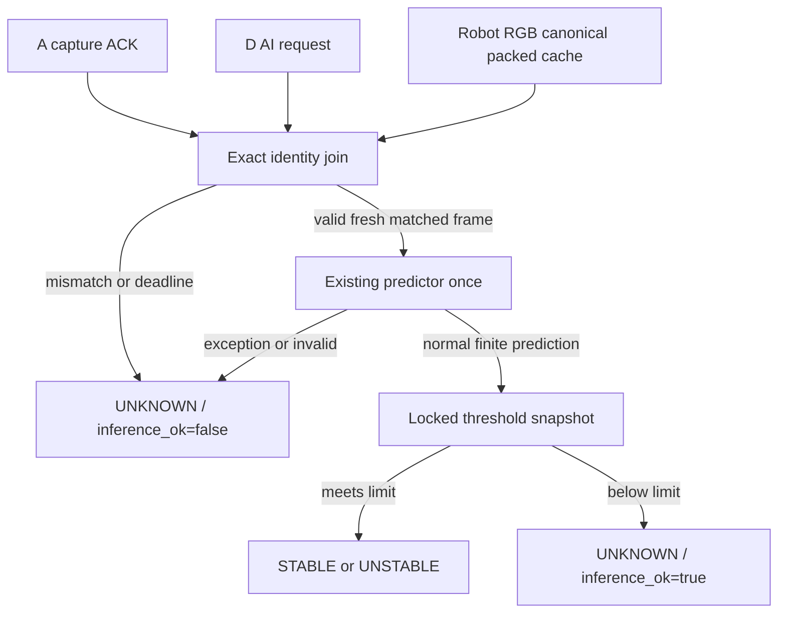

# C-PROD-01 — 장착 RGB exact-frame 추론 및 Owner threshold 교육 보고서
## 판정 및 이력
- C-PROD-00 감사 PASS. Seed `57c5f57b471a92ae11adf1d2432d44aa8640d2ad`, contract v1.1/schema 2/profile OWNER_PRODUCT_RECOVERY. E integration Draft #66, C Draft #69 (base integration/smartdish-product-recovery).
- C-PROD-01 독립 구현 및 L0/L1 PASS, 실제 A 장착 camera L2 / D/E 통합 / Owner actual private v1 L3 NOT_RUN/HOLD. 제품 AI ON admission DENIED. E 승인 전 merge 금지.
- 검증 코드 PIN `fcb766c720039c85ec75ef88c06b6a7574b81f34`. 이 보고서 커밋은 문서만 추가하며 코드 PIN과 구분한다.
## WHAT / WHY / HOW
기존 core는 최신 frame만 참조하고 정상 confidence 미달과 오류가 모두 UNKNOWN이었다. 새 경로는 A capture_result 및 D ai_check_request의 request/stack/transfer/capture/stamp/frame/hash를 전부 비교한다. 기존 model_runtime/legacy node/unpack RGB 재사용, 새로운 product core와 명시적 Owner-only ROS entrypoint 추가. Independent station 미사용; CI는 DDS fixture만.

- Bounded cache 16 frames, 2s monotonic receipt freshness, 5s steady join deadline. 640x480 rgb8/bgr8, frame_id smartdish_tray_optical, nonzero sim stamp; rewind invalidates epoch and requires restart. No latest-frame substitution. One request/one capture per mission; duplicate same IDs no extra call; conflicting payload while pending fail-closed. Mark frame used before predictor call. In-memory mission history only, restart requires fresh mission/run ID (E/D).
- Actual predictor synchronous; elapsed deadline checked after return. A hung predictor cannot be interrupted by the same single-thread executor: D independent deadline/no-next-goal and E process teardown are required, no hard real-time claim. L1 fixture does not prove hung-model recovery. C owns no motion topic.
- Owner-only entrypoint `product_stability_inference_node`, explicit `owner_gazebo_integration:=true`; separate from existing legacy node. ROS node name unchanged `smartdish_stability_inference` for parameter service. Launch exactly one C node. Threshold defaults 0.0/0.0, finite 0..1 only, bool/NaN/Inf/range reject. Atomic set/get; lock on D mission status or first capture/request until correlated terminal; SAFE_HOLD retains lock. D/E must establish C ready before mission start, D must not enable parameter changes mid-mission (DDS delivery race). Snapshot is returned for each inference. Legacy default 0.80 and existing legacy validation floor 0.50 unchanged; C17 admission remains deny.
- Result: status, confidence, model_version, request/capture/stack/transfer, image_stamp_ns, rgb_sha256, profile/schema, inference_ok, raw_status/raw_confidence, reason, two threshold snapshots. OK = valid and passes threshold; LOW_CONFIDENCE = valid but UNKNOWN, manual judgment only; MODEL_UNAVAILABLE/INFERENCE_FAILED/FRAME_INVALID/AI_TIMEOUT = UNKNOWN + inference_ok=false, never staff override. Missing invalid IDs cannot generate trustworthy correlation. D independently handles absent result/deadline. Actual result log marker C_PRODUCT_INFERENCE_RESULT. RGB SHA represents canonical bytes checked before predictor, not PNG hash; C does not verify physical receipt file content (A/B/E boundary).
## RED → GREEN
| Cycle | Source / run | Result |
|---|---|---|
| RED contract | e3a03521b0742b194b6ece88b6ee3205ecf0fdae / 45946861681 | Missing product_inference import, intentional RED; artifact 15174997688 sha256:70f10fd6a13ff56322edb0a325768875125321de45cf006df72fbee1451f4bea |
| Initial GREEN | bfac42869c58ddb3fae9a54078cbb93de94a6a15 / 45946904434 | core L0 success |
| Expanded L0 / first L1 RED | 98e1ceaeab94b3f8928f0099954ab3f72572be7f / 45947063912 | 8/8 L0, container Git dubious ownership, L1 not reached. See debug 01 |
| Second L1 RED | 16d7596e99270d584beb0cf6f2b01c0b6a0eb0d0 / 45947183289 | build/install passed; rclpy Node _parameters dict shadows callback. See debug 02 |
| GREEN | fcb766c720039c85ec75ef88c06b6a7574b81f34 / 45947310986 | actual PR L0 8/8, L1 real DDS 1/1, overall success |
- Both events verified: branch push 45947307591 (in progress at audit), integration-target PR 45947310986 success. Earlier exact same workflow push 45947179939 triggered and failed during RED. GitHub API confirms event/head_branch/head_sha; not assumed from YAML.
- Legacy C contract-only L0 45947310965 success at validated PIN; older E model-free CI 45947063911 success at 98e1ceae...; latest E model-free regression in progress at audit. Reuse E-PROD-00 prior AI OFF/R1/R2; no new actual Gazebo L2.
- L1 actual Jazzy build, installed code bytes match source. Installed SHA256 core 06d0688ba3292060fc278b8cc383aca87e49a560a930c0a5f1a9e9f75bb8e59c; adapter a7d6b1f22362c9aacca94eaf5cbad91cb4060dcd34dd64690ea3c43fc5b253a8.
- DDS fixture BGR padded step 1924 → canonical RGB digest 93f8271985dfca4b3f27a73933fecf4d25f79181cc329195ccded985ec854300; actual DDS request/ACK/frame reordered, predictor calls exactly one, duplicate no extra result/call. Atomic set 0/1 accepted, 1.1 rejected with get unchanged, midmission update rejected, after completion 0/0 accepted. Model ID CI_DOUBLE_PRODUCT_DDS, result raw UNSTABLE 0.506081, status UNKNOWN, inference_ok=true, reason LOW_CONFIDENCE. This is synthetic prediction, no model performance claim.
## Evidence
- [GREEN run 45947310986](https://github.com/silverbjin/samsung_AXI/actions/runs/45947310986).
- [L0 artifact 15175441067](https://github.com/silverbjin/samsung_AXI/actions/runs/45947310986/artifacts/15175441067) SHA256 97b880f00c4c6d942631bb73bca6e02bfabfc67238a3c648824df0c61cb17db6.
- [L1 artifact 15174738960](https://github.com/silverbjin/samsung_AXI/actions/runs/45947310986/artifacts/15174738960) SHA256 a70d348431eca9c50a3e2183ee810a1b4fce2ea98df1b01c077f63208e6b7112.
- SHA256 from GitHub artifact metadata, not independently downloaded/rehash; logs and checkout exact source reviewed. Artifact files expire; report preserves evidence identifiers and digests.
## REVIEW / E-D handoff
- Seed→code PIN compare merge-base exact seed, ahead 15, behind 0; only C package/setup/metadata/tests/role workflow/C reports changed. Legacy inference_core blob 9e7c34914800c789d658c1e115d5f23cb26d04ee, legacy stability node 9f3c88caecb00df99550228e6fa870d38c85940f, model_runtime 736ecd47f9b1e8179f7214fa9746953fb5340f83 and model.yaml f667abd60cd2111e87f3cbea3765118d0b184fa9 equal Seed. No private model/data/Test4, C20 or other-role paths touched.
- E: use existing Owner venv `~/.venvs/smartdish-c-v1-py312-cpu/bin/python` (torch 2.5.1+cpu/torchvision 0.20.1+cpu) after sourcing Jazzy and exact installed workspace; invoke `-m smartdish_ai.product_stability_inference_node --ros-args -p owner_gazebo_integration:=true -p model_path:=<existing-authorized-checkpoint> -p stable_confidence_min:=0.0 -p unstable_confidence_min:=0.0`. Example only for E integration, not user acceptance command. Do not use legacy entrypoint, reinstall torch, or use system-python shebang accidentally. Verify actual model load marker and model_available=True; model_available=False is a hard failure despite adapter READY marker. Existing exact Owner checkpoint SHA/metadata enforced by unmodified model_runtime. Product approval remains None.
- D: publish profile/schema 2 on status and request, correlate same stack/transfer/capture/stamp/hash. Use atomic parameter service at /smartdish_stability_inference, confirm returned get values before mission; prohibit midmission updates. Never permit staff approval when inference_ok=false. Match thresholds from result; ignore late result on D deadline or terminal.
- A/E: publisher sole actual robot-mounted RGB, RELIABLE VOLATILE depth10, same sim epoch; A verifies post-load selection and physical receipt, C uses exact ACK and frame. E/B must verify actual canonical hash and causal order, actual predictor provenance and no extra call in integrated scenario. L2 physical integration pending A→C→D→B; no independent station or private weight in CI. L3 Owner actual v1/TTY only after E CI.
- Remaining limitations: L0 model failure is injected, L1 only one DDS fixture; no physical/model performance claims; explicit Owner scope is experiment only. No main/E merge; E reviews final Draft #69 and remaining checks before integration.
