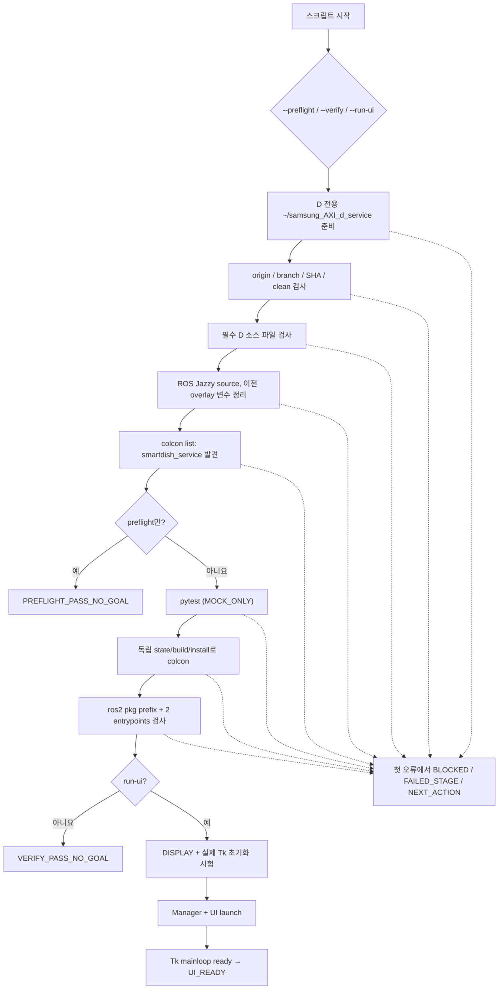

# D05 — WSL2 독립 작업공간·Fail-Fast 원샷 실행기 개발 보고서

- 담당: D DevOps/CI 개선
- 개발코드 SHA: `ffa8cc8ee0750ed540534566a8c4176e6376c049`
- 이전 검증된 FSM/ROS SHA: `541ceaeec68e38711d8b7dd0c31290591bbca9cd`
- Draft PR: https://github.com/silverbjin/samsung_AXI/pull/38
- 개발 목표: **작업 디렉터리 중복 충돌 없이 한 번의 명령으로 Git→소스→ROS 사전검사→pytest→colcon→GUI를 안전하게 수행**

## 1. 설계: 무엇을 재사용했나요?

- 기존 `src/smartdish_service` 및 pytest/ament 패키지를 그대로 재사용합니다.
- 신규 서버, ROS 메시지, Nav2 제어 코드는 만들지 않습니다.
- CI에서 기존 `restaurant-s7` 성공 판정을 신규 D 실제 주행 PASS로 복사하지 않습니다.

## 2. 실행기 구조



## 3. 핵심 구현 파일·책임

| 파일 | 기능 | 교육 관점 |
|---|---|---|
| `scripts/smartdish_d_wsl2_one_shot.sh` | Git 격리·fail-fast·3모드·로그·검증 | Bash 상태 검사, 오류 전파, 경계 확보 |
| `tests/test_smartdish_d_runner.py` | tmp Git+mock ROS CLI 12개 회귀 | 파괴적 연산 없이 실패 주입 |
| `.github/workflows/smartdish-d-ci.yml` | L0 fixture + ROS Jazzy L1·원샷 | GitHub Actions 분리 게이트 |
| `src/smartdish_service/smartdish_service/ui_app.py` | Tk 첫 idle callback의 실제 UI_READY | 시각 상태와 사전검사 구분 |

## 4. 실행 모드별 기대 결과

| 모드 | 허용 동작 | 성공 마커 |
|---|---|---|
| `--preflight` | Git 기준 SHA·소스·환경·패키지 탐색만 | `SMARTDISH_D_PREFLIGHT_PASS_NO_GOAL` |
| `--verify` (기본) | 위 + pytest + 독립 colcon + 패키지/엔트리포인트 검사 | `SMARTDISH_D_VERIFY_PASS_NO_GOAL` |
| `--run-ui` | verify + DISPLAY·Tk 검사 + 서비스 launch | GUI Tk mainloop에서 `SMARTDISH_D_UI_READY` |

검증 스크립트는 **A의 /dev/tty 승인이나 실제 Goals를 자동 실행하지 않습니다.** UI는 A가 준비되면 사용자가 별도로 T03을 눌렀을 때 요청을 보냅니다.

## 5. CI 검증/추적 표

| 증거 | 실행 | 해석 |
|---|---|---|
| Git fixture 12개 + 기존 27개 | https://github.com/silverbjin/samsung_AXI/actions/runs/45124460216 | L0 Python/가짜 ROS fixture (MOCK_ONLY) |
| ROS Jazzy real package/원샷 검증 | https://github.com/silverbjin/samsung_AXI/actions/runs/45124624797 | 실제 CI L1, 최종 결과는 Actions 로그 검증 필요 |
| 실제 WSL2 GUI 및 Gazebo 3-leg | NOT_RUN | 별도 현장 시연·E 통합 검증 필요 |

정적 테스트만 통과해도 GUI가 열린 것은 아닙니다. ROS 컨테이너에서 패키지 빌드가 성공해도 실제 Nav2 주행이 입증되지는 않습니다.

## 6. 표준 로그와 디버깅

```text
SMARTDISH_D_GIT_PASS
SMARTDISH_D_SOURCE_PASS
SMARTDISH_D_PREFLIGHT_PASS
SMARTDISH_D_PYTEST_PASS
SMARTDISH_D_BUILD_PASS
SMARTDISH_D_PACKAGE_PASS
SMARTDISH_D_VERIFY_PASS_NO_GOAL
```

실패 예시:

```text
SMARTDISH_D_BLOCKED=DIRTY_WORKTREE
FAILED_STAGE=GIT
SOURCE_SHA=<actual commit sha>
NEXT_ACTION=Keep local files; commit or stash manually, never reset/clean
```

로그는 기본적으로 `~/.local/state/smartdish-d/run_*.log`에 보관하며, colcon의 빌드·설치·로그는 같은 전용 state 폴더 아래에 격리합니다. 데이터와 logs를 모두 Git worktree 바깥에 둬 **두 번째 실행이 불필요한 dirty 상태가 되지 않도록** 합니다.

## 7. 학습자 실습 과제

1. 임시 원격 저장소를 만든 뒤 D05 fixture 12종을 실행하고 GREEN 결과를 표에 기록하세요.
2. 기존 저장소에 추적되지 않은 파일을 추가해 `DIRTY_WORKTREE`를 만들고 파일이 삭제되지 않는지 확인하세요.
3. 패키지 탐색 응답을 비워 `PACKAGE_NOT_DISCOVERED`가 나오도록 하고 colcon build 미실행을 확인하세요.
4. 컴파일 실패 조건을 만들어 GUI가 절대 시작되지 않는다는 것을 입증하세요.
5. `--preflight`와 `--verify`의 통과 근거가 다른 이유를 설명하세요.

## 8. 보류/미검증

- WSL2/WSLg DISPLAY 및 Tk 실제 화면은 강사 환경에서 별도 수행: `NOT_RUN`.
- A의 DISH_RETURN 좌표가 미확정이므로 A+D 실제 3구간 운행: `BLOCKED/NOT_RUN`.
- CI용 temp Git fixture는 사용자 홈 디렉터리를 실제로 수정하거나 ROS Goal을 전송하지 않습니다.
