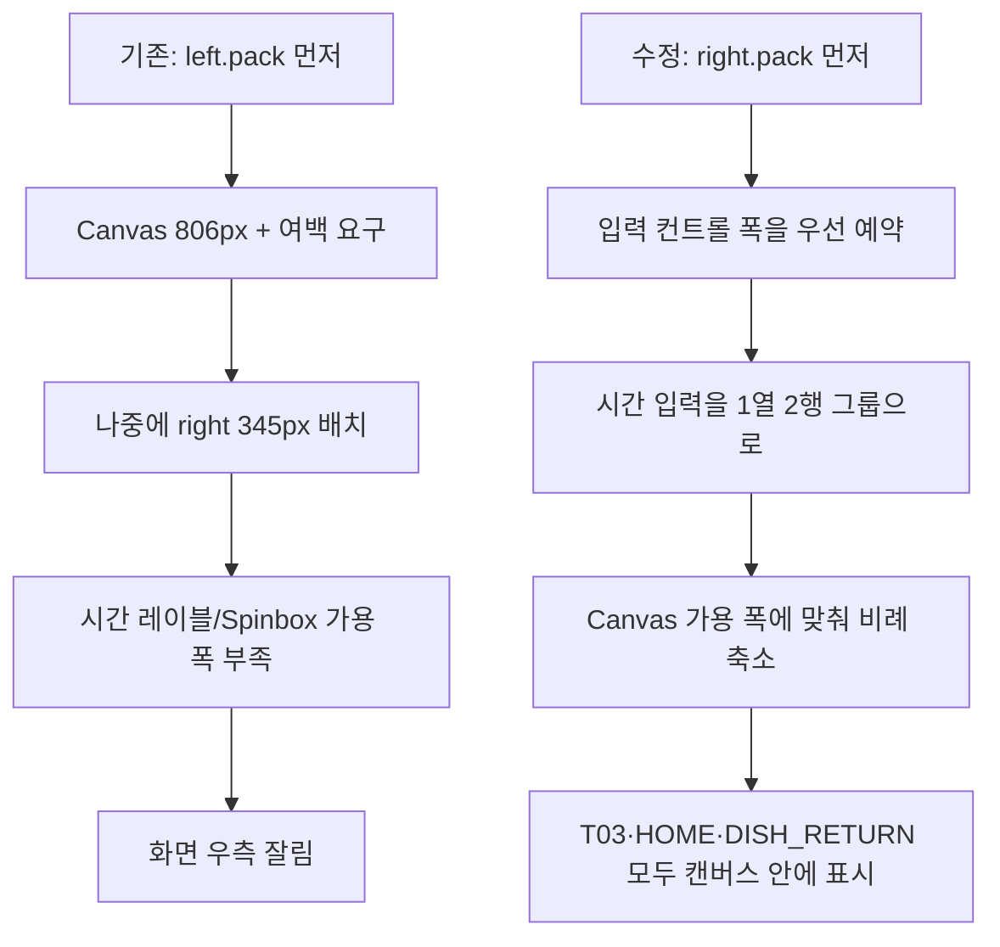

# SmartDish D07 UI-QA-001 — 입력란 잘림 현상 수정 및 교육용 디버깅 보고서

> 검수 기준: 사용자가 제출한 SmartDish Tkinter 실행 화면(1222×769px, 2026-11-23)  
> 작업 대상: `feat/smartdish-d-service` / Draft PR #38 / `main` 미병합  
> 수정 전 D SHA: `2824370f66ca3cd46be32e2ac8a32019ada87c95`  
> UI 수정 커밋: `355d12ab807daff986072355d9d733894c47cd09`  
> 코드·테스트: `src/smartdish_service/smartdish_service/ui_app.py`, `tests/test_smartdish_d_ui.py`

## 1. 증상과 증거: 최초 결함

사용자가 제출한 원본 화면은 Tkinter 창 `SmartDish — 테이블 선택형 식기 회수`의 IDLE 상태입니다.
- 오른쪽 `반납 대기 (1~60초)` 레이블이 `반납 대기 (1-` 수준에서 잘렸습니다.
- 두 번째 Spinbox 오른쪽 부분이 패널 끝으로 넘어가 입력 영역이 완전히 보이지 않았습니다.
- T03 활성 상태가 주변 비활성 T01/T02/T04~T06과 시각적으로 명확히 구분되지 않았습니다.
- 실제 캡처는 **정지 화면 1장**입니다. ROS 메시지 송수신, 버튼 작동, 동적 상태, 실제 Gazebo 주행 오류까지 확인한 것은 아닙니다.

## 2. 원인 분석과 가설 검증

기존 `_build()`에서 (a) 왼쪽 Frame+`Canvas(width=806)`를 먼저 `pack`하여 806픽셀+여백을 예약하고, (b) 오른쪽 345픽셀 패널을 나중에 배치했습니다. 창 본문은 창 너비에서 좌우 여백과 패널 간 간격을 뺀 공간뿐입니다. 동시에 `timing` Grid의 두 열에 한글 레이블·Spinbox를 나란히 배치했습니다. 두 열의 자연 요구 폭이 패널 내부 여유 폭을 초과하여 두 번째 열이 잘릴 수 있습니다.

**진단 근거:** 원본 화면의 시각적 잘림 위치와 정확히 대응하는 `ui_app.py`의 `left.pack` 순서, `Canvas(width=806)`, `timing` 2열 배치를 소스 코드에서 확인했습니다. DPI·폰트 메트릭은 실제 WSLg에서 차이를 증폭할 수 있는 요인이지만, 사용자의 시스템 배율을 측정한 것은 아닙니다.



## 3. 변경 전 → 변경 후: 최소 수정

| 경계 | 변경 전 | 변경 후 | 왜 수정하나 |
|---|---|---|---|
| Frame 배치 | `left.pack` 후 `right.pack` | `right.pack` 후 `left.pack` | 사용자 조작 영역 폭 우선 보장 |
| Canvas 요구 크기 | 806×460 고정 | 요청 크기 1×1 + `<Configure>` | 그림이 제어 패널을 밀어내지 않음 |
| 표시 좌표 | 항상 806×460 기반 | `floorplan_scale()` / `canvas.scale("all")` | 작은 창·확대 시 도형이 경계를 넘지 않음 |
| 시간 입력 | Label 2열 + Spinbox 2열 | Label과 Spinbox를 각각 1열에 세로 배치 | 한국어 문구·입력 상자 모두 표시 |
| T03 강조 | 연한 청록색 | 선택 전 주황 계열·`선택 가능` 명시 | 활성 여부를 시각적으로 안내 |
| 창 최소 크기 | 없음 | 1024×680 | 조작 가능한 최소 레이아웃 보장 |

코드는 GUI의 `table_id=T03`·`table_wait_s`·`dropoff_wait_s`·`request_id` 발행 계약을 유지합니다. `on_status`, `select_t03`, `confirm`, `MissionManager`, A의 `map Pose`, Nav2와 ROS 7개 토픽은 수정하지 않았습니다.

### 학생 코드 해설 — Canvas 비례식

```python
def floorplan_scale(width, height, design_width=806, design_height=460):
    if min(width, height, design_width, design_height) <= 0:
        raise ValueError("UI_CANVAS_DIMENSIONS_MUST_BE_POSITIVE")
    return min(1.10, width / design_width, height / design_height)
```

`width/design_width`와 `height/design_height` 중 더 작은 값을 선택해야 어느 한 축도 실제 Canvas 크기를 초과하지 않습니다. 1.10 상한은 큰 화면에서 원본 도면의 과도한 확대를 방지합니다.

Canvas `<Configure>` 이벤트마다 새 배율을 **이전 배율로 나눈 비율**을 사용합니다. 이전 도형에 새 절대 배율을 계속 곱하면 매번 축소·확대가 누적되는 오류가 발생하므로, `factor = new_scale / self._floorplan_scale`를 적용했습니다.

**주의:** Tkinter Canvas의 `scale("all")`은 도형·문자 위치를 조절하지만 텍스트 폰트 크기까지 자동으로 비례 확대하지는 않습니다. 높은 DPI에서 글자 겹침은 현장 육안 확인 대상입니다. `ui_pixels` 그림 좌표는 로봇 `map`의 x/y/yaw로 환산하지 않습니다.

## 4. 테스트와 기대 결과

| 테스트 ID | 입력·조건 | 기대 결과 | 구분 |
|---|---|---|---|
| UI-QA-01 | 806×460, 760×460, 610×420, 1100×730, 1450×860 | Canvas 도면 크기가 화면 영역을 넘지 않음 | L0 좌표 계약 |
| UI-QA-02 | 너비/높이 0 또는 음수 | 명확한 ValueError | L0 입력 방어 |
| UI-QA-03 | Source 정적 검사 | right가 먼저 pack되고 가변 Canvas가 Configure에 연결됨 | L0 코드 회귀 |
| UI-QA-04 | Source 정적 검사 | 두 Spinbox가 0열, 서로 다른 행에 배치됨 | L0 코드 회귀 |
| UI-QA-05 | Source 정적 검사 | T03·대기 시간·ROS polling·UI_READY 계약 유지 | L0 코드 회귀 |
| UI-QA-06 | 실제 1222×769, 1366×768, 1920×1080 WSLg 창 | 입력 레이블/오른쪽 컨트롤이 잘리지 않음 | 사용자 현장 **NOT_RUN** |
| UI-QA-07 | 글꼴 125%, 150%, 창 축소/복원 | 버튼 및 레이블 접근 가능 | 사용자 현장 **NOT_RUN** |
| UI-QA-08 | 대기/오류/직원확인 상태 수신 | 각 상태에서 UI가 정상 표시됨 | 사용자 현장 **NOT_RUN** |

실행 명령:
```bash
python3 -m pytest -q tests/test_smartdish_d_ui.py tests/test_smartdish_d_service.py
# GitHub Actions: D 전용 L0 전체 회귀 + 실제 Jazzy 패키지 빌드 L1
```

**검증 수준을 혼동하지 않습니다.** 정적·함수 L0 또는 colcon 빌드 L1 성공을 **실제 WSLg 화면 시각 PASS**로 승격하지 않습니다. 화면 사용자의 확인은 별도 절차이며 자동 CI 게이트가 아닙니다. GUI 배치만 수정했으므로 기존 Gazebo 실주행을 불필요하게 반복하지 않습니다.

## 5. 재현·인수 안내

일반 개발자 WSL2는 `~/samsung_AXI_d_service`를 사용하고 기존 `~/samsung_AXI`를 보존합니다. D05 원샷 실행기가 `REMOTE_HEAD_CHANGED`를 표시하면 변경된 GitHub HEAD를 확인하고 작업 트리가 깨끗할 때에만 수동 fast-forward합니다. 사용자 로컬 변경을 reset/clean하지 않습니다.

현장 확인 단계:
1. 수정 SHA를 출력하고 `--verify`로 패키지를 검증합니다.
2. `--run-ui`로 UI를 실행하고 화면 전체 캡처를 남깁니다.
3. IDLE에서 오른쪽 두 시간 입력의 레이블·스핀 버튼·필드 폭을 확인합니다.
4. T03을 선택해 주황 강조와 `선택 가능` 표시를 확인합니다.
5. 가능하면 창 크기를 조절해 주방, 테이블, HOME, DISH_RETURN이 가려지지 않는지 확인합니다.
6. A의 실주행 인수는 E 통합 전까지 별도입니다. 합성 Nav_Result를 이용한 테스트를 실제 주행 근거로 사용하지 않습니다.

## 6. 초심자 교육용 질문

1. 왜 동일한 창 크기에서도 위젯을 pack하는 순서가 바뀌면 결과가 달라지나요?
2. 부모 Frame의 폭과 자식 Grid의 **요구 폭 합계**는 어떤 관계인가요?
3. Canvas를 확대·축소해도 Nav2 목표 Pose를 바꾸지 않아야 하는 이유는 무엇인가요?
4. 지속적인 Configure 이벤트에서 `new_scale` 대신 `new_scale / old_scale`을 사용하는 이유는 무엇인가요?
5. L0 100% PASS와 WSLg 눈으로 확인한 레이아웃 PASS는 어떤 다른 증거인가요?

## 7. 개발 이력·잔여 리스크

- 코드 커밋: `355d12ab807daff986072355d9d733894c47cd09`
- 교육용 보고서: 본 문서(D07 UI-QA-001)
- 기존 Draft PR: https://github.com/silverbjin/samsung_AXI/pull/38
- 최초 UI 문제: 제출 화면에서 확인됨
- 화면 재검: **NOT_RUN**, 사용자 직접 확인
- Gazebo/AMCL/odom: D UI 변경 범위 밖이며 기존 A 인수 증거 보존
- 신규 CI 실행 URL/정확한 PASS 건수: Actions 결과 확인 후 PR 본문에 기록
