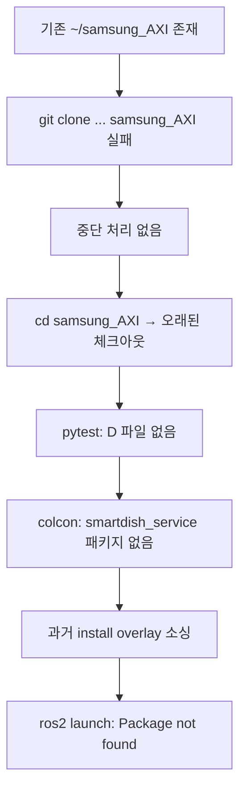

# SmartDish D-DBG-003 — 기존 Git 작업 디렉터리 충돌과 연쇄 실패 분석

- 작성일: 2026-11-23
- 유형: **사용자 WSL2 원본 터미널 로그로 확인한 실패**
- 기준선: S7 main `2dd7f968dd3d24e2afb48e0917ef8c9d054ac894`
- D05 코드/CI 기준: `ffa8cc8ee0750ed540534566a8c4176e6376c049` (본 보고서 앞선 코드 HEAD)
- 변경 파일: `scripts/smartdish_d_wsl2_one_shot.sh`, `src/smartdish_service/smartdish_service/ui_app.py`, `tests/test_smartdish_d_runner.py`, `.github/workflows/smartdish-d-ci.yml`
- GitHub Draft PR: https://github.com/silverbjin/samsung_AXI/pull/38

## 1. 실제로 어떤 오류가 발생했나요?

사용자는 이미 `~/samsung_AXI`가 있는 상태에서 같은 이름으로 다시 clone했습니다. 이후 셸은 중단 없이 `cd samsung_AXI`, pytest, colcon, ROS launch를 실행했습니다. 실제 핵심 로그:

```text
fatal: destination path 'samsung_AXI' already exists and is not an empty directory.
no tests ran in 0.00s
ERROR: file or directory not found: tests/test_smartdish_d_service.py
WARNING:colcon... ignoring unknown package 'smartdish_service'
Summary: 0 packages finished
Package 'smartdish_service' not found ... searching:
['/home/jinho/samsung_AXI/install/restaurant_bringup',
 '/home/jinho/samsung_AXI/install/turtlebot3_gazebo',
 '/home/jinho/samsung_AXI/install/restaurant_world',
 '/home/jinho/samsung_AXI/install/restaurant_delivery', '/opt/ros/jazzy']
```

**최초 원인:** 중복 clone 자체가 실패했습니다. 그다음 `cd samsung_AXI`는 이전 디렉터리에 진입했고, **이전 소스 체크아웃에는 D 신규 테스트/패키지가 없어서** 두 번째·세 번째 오류가 발생했습니다. 마지막 ROS search path는 기존 install overlay만 가리켜서 SmartDish 패키지를 찾지 못했습니다.

실제 사용자 WSL2 상태를 원격에서 직접 열어본 것은 아니므로 **로컬 git status/branch 검사는 현장 미실행**입니다. 위 원인 판단은 원본 터미널 출력과 GitHub의 S7 main/D 브랜치 트리 비교에 근거합니다.

## 2. 오류 전파 다이어그램



여기서 `colcon`의 `0 packages finished`는 정상 빌드가 아니라 **빌드 대상 자체가 없다는 증거**입니다. 또한 `source install/setup.bash` 성공 여부는 신규 패키지 존재를 보장하지 않습니다. 이전 ROS 패키지 경로가 남아 있으면 마치 빌드가 완료된 환경처럼 오해할 수 있습니다.

## 3. 변경 전/후 핵심 비교

| 변경 전 | 변경 후 |
|---|---|
| `git clone -b ...`를 동일 경로에 매번 실행 | D 전용 `~/samsung_AXI_d_service`가 없을 때만 clone |
| 실패한 뒤 다음 명령 계속 진행 | `set -Eeuo pipefail` 및 단계별 명시적 fail |
| 브랜치/원격/SHA 미검증 | origin 정규화, D 브랜치, HEAD=remote HEAD, clean worktree 확인 |
| 오래된 install 경로를 계속 탐색 | inherited overlay 경로 해제 + 독립 state/build/install |
| `colcon build`가 0 package로 끝나도 계속 실행 | `colcon list --base-paths ...`와 정확한 패키지명 검사 |
| GUI 시작 전 PASS 같은 표시 | UI는 Tk mainloop의 idle callback이 실행된 뒤에만 `SMARTDISH_D_UI_READY` 출력 |
| 실주행과 계약 확인 혼동 위험 | `_PASS_NO_GOAL`과 REAL NOT_RUN 구분 |

**왜 자동 git pull을 하지 않나요?** 이미 존재하는 전용 체크아웃이 원격과 다르면 무조건 중단하도록 했습니다. 자동 merge/rebase/reset이 기존 작업을 변경할 위험을 피하고, 작업자가 먼저 차이를 확인하도록 합니다. 로컬 변경은 보존합니다.

## 4. 재현 및 검증

CI 전용 fixture는 `tmp_path`에서 bare remote와 전용 worktree를 생성하고, fake `colcon/ros2` 명령으로 위험 없이 다음 조건을 재현합니다.

- CI-D-01/02: 최초 clone·기존 clone 재사용
- CI-D-03/04: 다른 origin·미커밋 파일 보존
- CI-D-05/06: 브랜치 없음·필수 테스트 파일 없음
- CI-D-07/08: 패키지 0개 발견·빌드 실패 차단
- CI-D-09/10: 정상 verify·동일 명령 재실행
- CI-D-11/12: 기존 `~/samsung_AXI` 보존·원격 SHA 변동 차단

**검증 구분:** fake CLI 기반 계약 시험은 실제 ROS 빌드 증거가 아닙니다. GitHub의 `ros:jazzy-ros-base-noble` L1 빌드와 게시 실행기 `--verify`를 별도로 점검합니다.

- 최초 fixture CI: https://github.com/silverbjin/samsung_AXI/actions/runs/45124460216
- 실제 Jazzy 원샷 L1 추가 검증: https://github.com/silverbjin/samsung_AXI/actions/runs/45124624797
- 해당 Jazzy 원샷 실제 빌드 검증은 **PASS**로 확인했습니다. 실제 WSLg GUI/Gazebo 인수는 아직 수행하지 않았습니다.

## 5. 최소 수정과 남은 미검증

- 독립 실행기는 기존 S7 소스, A/B/C 담당 파일 또는 Nav2/CM를 변경하지 않습니다.
- D UI의 `UI_READY`는 실제 GUI 시작 후 출력을 위한 보강입니다.
- 강사 WSL2의 `DISPLAY`·WSLg 실제 렌더링 및 A 3-leg 주행은 `NOT_RUN`입니다.
- A의 `DISH_RETURN` map Pose 확정까지 E 통합의 실제 3구간 완주도 `BLOCKED`입니다.

## 6. 학습자 실습·질문

1. `git clone` 실패와 `pytest` 실패 중 어떤 것이 최초 원인인지 원본 1~5줄로 분리하세요.
2. 왜 `git status --porcelain`가 충돌 방지에 필요한가요? 미커밋 파일을 보존하는 시험을 실행해 보세요.
3. `colcon list --names-only` 결과가 0개인데 `colcon build`가 0으로 끝났다면 무엇을 PASS로 평가하면 안 되나요?
4. `source`는 환경변수를 설정하지만 실제 소스 트리의 패키지를 만들어 주지 않는다는 점을 설명하세요.
5. 기존 팀원의 브랜치를 변경하는 방법과 별도 worktree로 격리하는 방법 중 어떤 것이 교육용 반복 인수에 안전한지 토론하세요.

### 추가 최소 수정: clone 이전 원격 브랜치 검사

처음 clone하는 단계에서도 원격 브랜치 유무를 사전에 검사해, Git clone 오류 하나로 원인 파악이 끝나지 않도록 `SMARTDISH_D_BLOCKED=REMOTE_BRANCH_NOT_FOUND`를 지정했습니다. 기존 저장소와 로컬 소스는 변경하지 않으며, 임시 Git fixture로 회귀검증합니다.

### 실제 검증 결과와 재검증 링크

- D05 수정 완료 SHA: `a82b3e229a330c2c38dc9857be26a232d21578da`.
- [최종 코드 GitHub CI #45124883730](https://github.com/silverbjin/samsung_AXI/actions/runs/45124883730): **L0 40 PASS, 실제 Jazzy L1 원샷 --verify PASS, NO_GOAL**.
- 실제 로봇 이동/WSLg GUI는 NOT_RUN이며 인수 증거를 꾸미지 않습니다.
