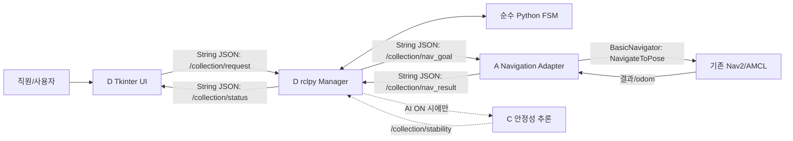
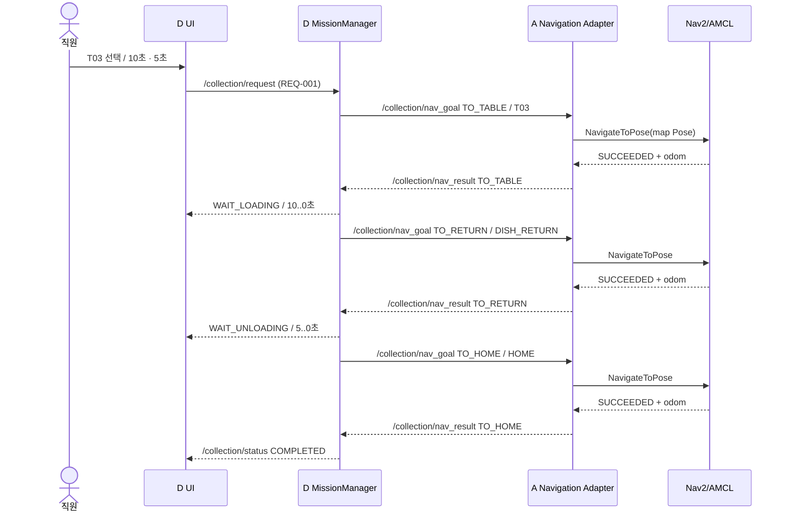

# SmartDish D — 중간 개발 보고서: 개발 도구·워크플로우·A 담당 ROS 2 인터페이스 (2026-11-23)

> **보고서 유형:** 4인 병렬개발 중 D 담당 UI·서비스 개발 교육용 중간 보고서 / E 통합 인계 근거  
> **저장소:** https://github.com/silverbjin/samsung_AXI  
> **D 브랜치:** `feat/smartdish-d-service` / Draft PR [#38](https://github.com/silverbjin/samsung_AXI/pull/38) / `main` 미병합  
> **기능+검증 기준 D SHA:** `4cc64bbc05f769c06d93ba055f03a12e75a601de`  
> **UI 수정 코드 SHA:** `355d12ab807daff986072355d9d733894c47cd09`  
> **A 최신 검토 브랜치 HEAD:** `7d110ece67096151daff7bf351420952b18a9a66` / A PR [#36](https://github.com/silverbjin/samsung_AXI/pull/36)  
> **원본 기능 기준 S7 main:** `2dd7f968dd3d24e2afb48e0917ef8c9d054ac894`  
> **작성 시점 검수:** 사용자 WSLg 정적 IDLE 화면 QA **PASS**; 실제 A+D AI OFF 운행 및 UI 동적 전이 **NOT_RUN**

## 1. 핵심 요약 — 이번 단계에서 무엇이 완성되었나?

D의 목표는 “테이블을 시각적으로 선택 → 로봇에 논리적 목적지를 요청 → 실제 이동 결과를 받아 대기·반납·복귀 상태 표시”입니다. ROS 2 Jazzy 기반의 ① 사용자 UI, ② 통신 브리지, ③ ROS에 의존하지 않는 MissionManager FSM을 분리해 구현했습니다. 현재 **T03 한 테이블만 활성**, 기본 대기시간은 **적재 10초/반납 5초**, 선택형 AI는 준비 전까지 OFF입니다.

- **코드·테스트:** Python L0 **51 PASS**, 실제 Jazzy L1 빌드·엔트리포인트·No-Goal 실행기 검증 **PASS**. [Push #45128345725](https://github.com/silverbjin/samsung_AXI/actions/runs/45128345725), [PR #45128351119](https://github.com/silverbjin/samsung_AXI/actions/runs/45128351119) — 둘 다 SUCCESS.
- **시각 검수:** 2026-11-23 사용자 업로드 `image(20261123-073249).png`, 실제 PNG **1219×769px**, SHA-256 `60a0cc670e1a7349cb4306c8f456cfd5dc6a75566674a58c03b22deefa933c08`. 사용자가 화면에서 잘림이 없다고 최종 승인했습니다. 이 보고서는 채팅에 첨부된 증거의 **파일명/해시를 기록**합니다. 원본 바이너리 PNG는 이 커밋에 추가하지 않았습니다.
- **검수 범위:** IDLE 화면의 라벨, 시간 입력·스핀 컨트롤, T03 강조, 평면도, 시작 버튼, AI OFF 및 하단 안내를 육안 확인. **회수 시작 클릭, 실제 메시지, 대기 중 카운트다운, 에러·직원 승인 팝업 등의 동적 화면은 이 정지 이미지로 검증하지 않았습니다.**
- **A와의 경계:** A의 Navigation Adapter는 실제 `map` Pose와 Nav2 Action, `/odom`을 책임집니다. A 단독 실제 WSL2 Gazebo 3구간 [A-09 보고서](../../tasks/2026-11-23_SMARTDISH-A-09_WSL2_GUI_L3_ACCEPTANCE_EDU_KO.md)는 **A_ROBOT_ONLY_WSL2_L3_PASS**, D 연결 완료를 의미하지 않습니다.

## 2. 사용한 개발 도구 — 실제 소스·CI로 확인된 것만 정리

| 도구·환경 | 실제 활용 위치 | 선택 이유와 역할 | 교육 포인트 |
|---|---|---|---|
| **Python 3 / Tkinter** | `ui_app.py` | 테이블 도면(Canvas), Spinbox, 버튼, 상태 Label 구성 | 추가 웹서버 없이 ROS 프로그램에 GUI 연동 |
| **PyYAML** | `config/ui_layout.yaml`, `read_layout()` | 테이블 도형 위치·활성 여부를 UI 코드와 분리 | 화면 픽셀 `ui_pixels`와 Nav2 `map` 좌표 혼동 금지 |
| **ROS 2 Jazzy / rclpy** | `manager_node.py`, `ui_app.py` | Publisher/Subscriber/Timer로 UI와 FSM 연결 | GUI 프로세스와 ROS 노드의 역할·QoS 이해 |
| **std_msgs/msg/String + JSON** | `/collection/*` 7토픽 | 4인 개발 계약 v1.0에 고정된 전달 포맷 | 필수 필드·`request_id`·`leg`·enum 검증 필요 |
| **Python 순수 FSM / time.monotonic** | `mission_manager.py` | 이동 완료에 따른 10초·5초 대기 및 오류 분기 | ROS 없이 빠르게 단위 테스트 작성 |
| **QoS RELIABLE/VOLATILE/KEEP_LAST(10)** | D UI·Manager, A Adapter | 7개 계약 토픽의 일관된 설정 | VOLATILE은 늦게 붙은 Subscriber에 과거 Goal 재전달 안 함 |
| **ament_python / colcon** | `package.xml`, `setup.py`, `setup.cfg`, `launch` | ROS 패키지 빌드·설치·2개 실행 엔트리포인트 | 설치/실행 가능 여부를 소스 코드 존재와 구분 |
| **pytest** | `tests/test_smartdish_d_*.py` | 성공뿐 아니라 실패/중복/입력 값/Canvas 크기 검사 | L0 모의 결과는 실제 Gazebo 이동 증거가 아님 |
| **Git / GitHub Draft PR** | D 전용 브랜치·PR #38 | 4인 코드 충돌 방지, 코드/보고서 이력 보존 | 커밋 SHA와 CI URL로 변경 추적 |
| **GitHub Actions** | `.github/workflows/smartdish-d-ci.yml` | Ubuntu L0와 `ros:jazzy-ros-base-noble` 컨테이너 L1 분리 | GREEN 시뮬레이션이 아니라 검사 범위를 명시 |
| **Bash / WSL2 원샷** | `scripts/smartdish_d_wsl2_one_shot.sh` | 독립 `~/samsung_AXI_d_service`, Fail-Fast, 실행 SHA 관리 | clone 충돌·stale overlay·0-package 실패 예방 |
| **WSLg UI 현장 검수** | 사용자 첨부 이미지 | 실제 화면의 레이블·컨트롤 잘림을 사람 눈으로 판정 | 자동 CI와 시각적 사용자 인수는 다른 증거 |

**사용했다고 단정하지 않는 도구:** VS Code, Figma, PyQt, 웹 브라우저 프론트엔드, 별도 DB는 이번 D 소스·CI에서 개발 도구로 확인되지 않았습니다. **Gazebo Harmonic/Nav2/AMCL/Collision Monitor는 A 담당 및 기존 S7에서 재사용**하며 D의 L0/L1 자체 검증 과정에서 Gazebo 실제 이동을 실행한 것은 아닙니다.

## 3. 코드 구조와 역할 분담

```text
src/smartdish_service/
  smartdish_service/
    ui_app.py            # D Tkinter GUI + ROS UI node
    manager_node.py       # rclpy JSON 전달 ↔ FSM
    mission_manager.py    # ROS 독립 이벤트·타이머·상태
  config/ui_layout.yaml   # 화면용 pixel 도형
  launch/smartdish_service.launch.py # UI+Manager (AI OFF 기본)
  package.xml, setup.py   # ament_python package
tests/test_smartdish_d_service.py    # FSM·계약 (모의 결과)
tests/test_smartdish_d_ui.py         # Canvas·입력·정적 UI 회귀
tests/test_smartdish_d_runner.py     # 임시 Git fixture 기반 13개
scripts/smartdish_d_wsl2_one_shot.sh # 독립 작업환경·Fail-Fast
```



**초심자 해설:** UI에서 받은 `T03`은 “로봇이 찾아갈 테이블의 이름”이며 실제 좌표가 아닙니다. Manager는 상태를 판단하고 목표 **이름**만 보냅니다. A Adapter가 그 이름을 운영 `table_poses.yaml`의 `map` Pose로 변환하고 Nav2에 의뢰합니다. 각 프로세스가 하나의 책임만 갖기 때문에 GUI의 색상이나 배치 변경이 로봇 주행 안전 코드를 건드리지 않습니다.

## 4. 실제 개발 워크플로우: 기획 → 구현 → 디버깅 → CI → 시각 검수

| 단계 | 코드/증거 | 왜 이 순서인가? | 교육용 배움 |
|---|---|---|---|
| **D01 FSM** | `mission_manager.py`, 테스트·보고서 | 실제 로봇 없이 주행 결과에 대한 서비스 로직 분리 | 상태 전이·BUSY·ID 불일치부터 검증 |
| **D02 ROS 브리지** | `manager_node.py`, 7-topic fixtures, Jazzy 패키지 | 동일 JSON 계약을 pub/sub에 연결 | rclpy 메시지와 순수 로직의 경계 |
| **D03 UI** | `ui_app.py`, `ui_layout.yaml` | T03 선택과 요청/상태 표시 구현 | Tk event loop와 ROS spin을 `after(60)`으로 공존 |
| **D-DBG-001** | A request_id 공백·AI 필수필드 검증 | 통합 이전에 입력 검증 차이를 발견 | 필드명이 같아도 계약 유효성 검사는 달라질 수 있음 |
| **D-DBG-002** | `ClockType.STEADY_TIME` timer | Gazebo 시뮬레이션 시계 대신 사람의 실제 대기시간 적용 | 계산 시계와 콜백 스케줄 시계를 둘 다 확인 |
| **D05 DevOps** | Bash 원샷·Git fixture·Actions | 기존 폴더에 clone 실패→구버전 소스 테스트 등 연쇄 오류 방지 | 첫 실패에서 중단·저장소 보존·SHA 검증 |
| **D-DBG-003/004** | CI 로그·교육 보고서 | Mutable branch, Git ownership, shallow checkout 등 CI 환경 오류 최소 수정 | 소스 버그와 CI 인프라 버그 분리 |
| **D07 UI 품질** | `355d12ab` 및 레이아웃 테스트 11개 | 실제 스크린샷의 두 번째 시간 필드 잘림 해결 | pack 순서·1열 배치·가변 Canvas |
| **사용자 실제 QA** | 2026-11-23 이미지 SHA-256 | 자동 테스트로 검출할 수 없는 한글/컨트롤 잘림 확인 | 인간 시각 검수 PASS와 기능 통합 PASS 구별 |

### D07 실제 버그 사례

**수정 전:** `Canvas(width=806)`과 왼쪽 Frame을 먼저 `pack`한 후 345px 오른쪽 패널을 배치해 폭 경쟁이 발생했습니다. 한글 레이블/Spinbox 2개가 같은 줄에 있어 두 번째 영역이 화면에서 잘렸습니다.

**수정 후:** 오른쪽 패널 먼저 배치 → 왼쪽 Canvas 요청 크기를 `1×1`로 시작 → `<Configure>`에서 `min(1.10, width/806, height/460)` 비례 축소 → 시간 입력을 세로 1열로 구성했습니다. T03은 선택 가능 표시로 구분했습니다.

최종 사용자 제출 화면은 두 입력 레이블과 Spinbox가 정상 표시되며, 사용자에게 **시각 검수 PASS**를 받았습니다. 이는 [D07 레이아웃 디버깅 보고서](D07_UI_LAYOUT_CLIP_DEBUG_EDU_KO.md)와 연결됩니다.

## 5. A 담당과 통합하는 ROS 2 인터페이스 — 정확한 데이터 계약

공통 인터페이스는 전부 `std_msgs/msg/String`의 **UTF-8 JSON 문자열**입니다. QoS는 `RELIABLE / VOLATILE / KEEP_LAST(10)`으로 일치시킵니다. 운영 토픽은 D 2노드와 A 1노드, 옵션 C 1노드가 분담합니다.

| # | ROS 2 토픽 | Publisher → Subscriber | JSON 핵심 필드 | 사용 목적 |
|---|---|---|---|---|
| 1 | `/collection/request` | **D UI → D Manager** | `request_id, table_id, table_wait_s, dropoff_wait_s, ai_enabled` | T03 임무 시작 |
| 2 | `/collection/nav_goal` | **D Manager → A Adapter** | `request_id, leg, destination_id` | A에게 목표 **이름** 전달 |
| 3 | `/collection/nav_result` | **A Adapter → D Manager** | `request_id, leg, result, reason` | 실제 Nav2 완료/실패 통보 |
| 4 | `/collection/status` | **D Manager → D UI** | `request_id, state, table_id, remaining_s, reason` | 현재 작업 상태 표시 |
| 5 | `/collection/ai_check_request` | **D Manager → C** | `request_id, capture_id` | AI ON 선택적 검사 요청 |
| 6 | `/collection/stability` | **C → D Manager** | `request_id, capture_id, status, confidence, model_version` | STABLE/UNKNOWN/UNSTABLE 결과 |
| 7 | `/collection/staff_confirm` | **D UI → D Manager** | `request_id, action` | 직원 APPROVE_CONTINUE/ABORT |

위 내용은 [실제 D 계약 fixture](../../../integration/smartdish_d_contract_fixtures_v1.json)와 [A 계약 파서](https://github.com/silverbjin/samsung_AXI/blob/feat/smartdish-a-robot/src/smartdish_robot/smartdish_robot/contract.py)에 근거합니다.

### 5.1 A에게 발행하는 Goal의 실제 예시

```json
{"request_id":"REQ-001","leg":"TO_TABLE","destination_id":"T03"}
```

허용 조합은 아래 세 개뿐입니다.

| `leg` | `destination_id` | A 실제 map (x, y, yaw) |
|---|---|---|
| `TO_TABLE` | `T03` | (5.25, 0.38, -1.57079632679) |
| `TO_RETURN` | `DISH_RETURN` | (-1.15, 1.60, -1.57079632679) |
| `TO_HOME` | `HOME` | (0.0, 0.0, 0.0) |

이 좌표는 D 도면 YAML에서 나온 것이 아니라 **A의** [검증된 `table_poses.yaml`](https://github.com/silverbjin/samsung_AXI/blob/feat/smartdish-a-robot/src/smartdish_robot/config/table_poses.yaml)에서 가져옵니다. A는 `parse_goal()`로 `leg/destination_id`를 확인하고 `resolve_pose()`로 map Pose를 찾은 뒤 공식 `BasicNavigator.goToPose()`를 호출합니다. 실제 주행 명령 `/cmd_vel`이나 `NavigateToPose` Action은 **D가 발행하지 않습니다.**

### 5.2 A의 실제 결과가 D로 돌아오는 모습

```json
{"request_id":"REQ-001","leg":"TO_TABLE","result":"SUCCEEDED","reason":""}
```

A는 공식 Nav2 결과 외에 해당 구간의 odom 샘플과 최소 0.05m 이상의 시작점 대비 변위를 검사한 후 `SUCCEEDED`를 전송합니다. D는 `request_id`와 진행 중 `leg`가 **둘 다 일치할 때만** 결과를 받아 상태를 바꿉니다. 값이 다르거나 `FAILED/CANCELED`이면 다음 구간을 자동 성공으로 넘기지 않습니다.

### 5.3 AI OFF 기본 회수 시퀀스



D의 `MissionManager.tick()`은 `time.monotonic()` 기한을 사용하고 ROS Manager timer도 `STEADY_TIME`으로 동작합니다. 따라서 **Nav2 완료 이후부터** 적재·반납 대기를 계산하며 Gazebo 시뮬레이션 속도와 구분됩니다.

### 5.4 AI ON 분기는 어디에 추가되나요?

적재 대기 완료 후 `ai_enabled=true`인 경우 `AI_CHECK` → `/collection/ai_check_request` → C의 `/collection/stability` 순서가 추가됩니다. STABLE은 유효한 `capture_id`·신뢰도·모델 버전 확인 후 반납 구간으로 전이합니다. UNSTABLE/UNKNOWN/타임아웃은 `NEEDS_CONFIRMATION`으로 정지해 직원 명시 승인 또는 중단을 기다립니다. **C의 실제 모델·카메라가 검증될 때만 옵션을 ON**으로 합니다.

## 6. 통합 전에 A와 D가 반드시 맞춰야 하는 준비 상태

| 검사 | A 책임 | D 책임 | 검증 기준 |
|---|---|---|---|
| 실행 환경 | 기존 World/Map/Nav2/AMCL, `/scan`·`/odom` 준비 | Jazzy 패키지·UI/Manager 실행 | 같은 ROS_DOMAIN_ID, 토픽 타입 일치 |
| 실제 주행 승인 | 사용자 TTY에 `YES-SMARTDISH-A-GOALS` 입력 | 승인 우회하지 않음 | A `SMARTDISH_A_READY` 로그 확인 |
| Publisher/Subscriber | A는 승인 후 `/collection/nav_goal` 구독 생성 | D는 구독자 없으면 `ADAPTER_NOT_READY_NO_GOAL` | `ros2 topic info -v` |
| 맵 좌표 | A `table_poses.yaml` 보유 | D `ui_layout.yaml`만 보유 | frame `map` vs `ui_pixels` 구분 |
| 임무 식별 | 같은 `request_id`/`leg` 결과 전송 | 활성 요청 ID/구간 일치 검증 | 오염된/늦은 결과 무시 |
| 실패 판정 | FAILED/CANCELED/ODOM 증거 부족 통보 | ERROR/CANCELED 및 추가 Goal 차단 | 성공 임의 생성 금지 |
| 시연 증거 | Nav2 3건 + `/odom` / AMCL | 10초·5초·UI COMPLETED | **E 통합에서 한 요청 ID로 함께 입증** |

**중요한 실행 분리:** A의 `smartdish_a_wsl2_one_shot.sh`는 **A 단독 3구간 검증 실행기**입니다. D의 `smartdish_d_wsl2_one_shot.sh --run-ui`는 D Manager·UI용입니다. 두 독립 단독 시연을 각각 PASS했다고 해서 A+D 상호 연결을 완료했다고 판단하면 안 됩니다. E에서는 **기존 Nav2 준비 → A Adapter 목표 수신용 TTY 승인/READY → D Manager/UI 실행 → 사용자가 T03 클릭** 순서로 실제 메시지 흐름을 확보해야 합니다. A의 별도 단독 데모가 실행 중이라면 외부 D Goal을 동시에 송신해서는 안 됩니다.

E 담당의 읽기 전용 확인 명령(실주행 명령 아님):

```bash
git rev-parse HEAD
ros2 topic list -t | grep /collection/
ros2 topic info -v /collection/nav_goal
ros2 topic info -v /collection/nav_result
ros2 topic info -v /collection/status
ros2 topic echo /collection/status std_msgs/msg/String
ros2 action info /navigate_to_pose
```

`ros2 topic info -v`에서 publisher/subscriber 이름과 QoS를 확인합니다. **AI OFF 실제 인수에는** 같은 요청의 3개 A 실제 결과, 3구간 odom 근거, D의 10/5초 시간 기록, UI COMPLETED가 필요합니다. **여기까지는 아직 A+D 합동으로 실행되지 않았습니다.**

## 7. 검증 수준과 현재 판정: 성공 증거를 과장하지 않기

| 분류 | 실행 근거 | 현재 판정 |
|---|---|---|
| D 순수 Python 계약·UI 레이아웃 회귀 | [Actions #45128345725](https://github.com/silverbjin/samsung_AXI/actions/runs/45128345725) 51 PASS | **L0 PASS / MOCK_ONLY** |
| D ROS Jazzy 패키지, 실제 colcon/런처 등록/원샷 | 위 Actions L1 SUCCESS | **L1 PASS / NO_GOAL** |
| D Tk IDLE 레이아웃 실제 WSLg 시각 | 1219×769 PNG, 사용자 직접 확인 | **USER_VISUAL_QA_PASS (IDLE 화면)** |
| D 실시간 상태 변화·버튼 이벤트의 현장 검증 | 추가 동적 캡처 없음 | **NOT_RUN** |
| A 독립 실제 Gazebo/WSL2 3-leg | [A-09 현장 인수 보고서](../../tasks/2026-11-23_SMARTDISH-A-09_WSL2_GUI_L3_ACCEPTANCE_EDU_KO.md) | **A_ROBOT_ONLY_WSL2_L3_PASS** |
| A+D AI OFF 실제 전체 서비스 | Nav2·odom·시간·D UI 통합 단일 원본 없음 | **NOT_RUN** |
| C AI 실제 추론·A+C+D 선택 모드 | 트레이 카메라/실모델 통합 근거 없음 | **OPTIONAL / NOT_RUN** |

## 8. E 통합 직전 다음 권고와 교육 체크리스트

1. **D06** ROS 별도 프로세스 간 pub/sub 계약 시험: A Stub으로 `/collection/nav_goal`/`nav_result` 순서를 확인합니다. 이 단계는 *Mock ROS IPC*이며 Gazebo 이동 인수가 아닙니다.
2. **D07 UI** 사용자 IDLE 시각 PASS를 보존합니다. 상태 변화의 동적 UI는 서비스 통합에서 확인합니다. 이미 해결된 두 입력란 잘림 문제를 재개발하지 않습니다.
3. **E AI OFF** A Adapter 운영 `table_poses.yaml`를 사용해 한 번의 실제 T03→RETURN→HOME 서비스 실행을 검수합니다. A의 TTY 승인·Nav2 sensor readiness를 우회하지 않습니다.
4. **D 장애 경계**는 최초 연결 후 필요할 때만 수정합니다. A가 시작 전에 연결되지 않거나 중간에 종료되는 경우를 `request_id/leg` 로그로 분리합니다. 새 Safety Supervisor·Planner·웹서버는 추가하지 않습니다.
5. 보고서·로그·SHA 관리는 `RED → 원인 분리 → 최소 수정 → L0/L1 → 사용자 QA → E 인수` 순서로 유지합니다.

학생에게 설명할 대표 사례:
- 왜 Tkinter의 테이블 픽셀 (x=585,y=110)이 로봇의 지도 위치 (x=5.25,y=0.38)가 될 수 없나요?
- `/collection/nav_result`에 문자열 `SUCCEEDED`를 임의로 넣으면 실제 주행 PASS라고 할 수 없는 이유는?
- GUI 창의 두 필드가 잘릴 때, 왜 Nav2를 수정하는 것보다 `Frame.pack`과 `Canvas`를 먼저 점검해야 하나요?
- 왜 `VOLATILE` QoS에서 A Subscriber가 준비되기 전에 Goal을 발행하지 않아야 하나요?
- A L3 PASS와 D 사용자 UI 시각 PASS를 합쳐도 **A+D 통합 PASS는 아닌 이유**는?

## 9. 개발 이력과 보고서 연결

| 보고서/증거 | 학습 포인트 |
|---|---|
| [D01 FSM](D01_MISSION_FSM_EDU_KO.md) | 상태·타이머·중복·실패 |
| [D02 ROS Transport](D02_ROS_TRANSPORT_EDU_KO.md) | JSON 주제 7개·QoS·rclpy |
| [D03 평면도](D03_UI_FLOORPLAN_EDU_KO.md) | Tkinter·픽셀 YAML |
| [D-DBG-001](D_DBG_001_CONTRACT_MISMATCH_EDU_KO.md), [D-DBG-002](D_DBG_002_STEADY_TIMER_EDU_KO.md) | 계약 검증과 실제 시간 |
| [D05 실행기](D05_WSL2_FAIL_FAST_RUNNER_EDU_KO.md), [D-DBG-003](D_DBG_003_GIT_WORKSPACE_COLLISION_EDU_KO.md), [D-DBG-004](D_DBG_004_CI_REMOTE_HEAD_RACE_EDU_KO.md) | Git 충돌·Fail-Fast·CI race |
| [D07 UI QA](D07_UI_LAYOUT_CLIP_DEBUG_EDU_KO.md) | 시각 오류 수정·11개 회귀·사용자 실제 QA |
| [A-09 WSL2 인수](../../tasks/2026-11-23_SMARTDISH-A-09_WSL2_GUI_L3_ACCEPTANCE_EDU_KO.md) | A만 실제 로봇 단독 3구간 검증 |
| [E 핸드오프](../../../handoff/D_HANDOFF.md) | 실제 A+D 연결 시 확인할 실행 SHA·로그·증거 |

**변경 범위:** 이번 중간보고서 작성 자체는 문서·인계 상태만 수정합니다. D 서비스·A 로봇·Nav2·Gazebo 코드를 변경하지 않으며, 기존 성공 CI/실제 주행 증거를 보존합니다. 수정 후 새 Docs-only 커밋의 CI는 별도 확인하여 경계가 바뀌지 않았는지만 점검합니다.
