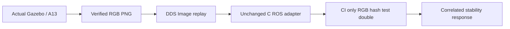

# E-R3a — 실제 Gazebo RGB와 C DDS 사이의 연결 검증 (주니어 교육용)

## 정책 및 현재 상태
2026-11-27 사용자 지시: 최종 WSL2 인수 전까지 신규 개발과 검수는 CI에서 수행한다. 개발 단위별 코드·테스트·교육용 MD를 함께 커밋한다. 기존 AI OFF L3, C20 독립 연구, Test4 봉인, C17 기본 deny, 직원 승인 계약을 보존한다. R1 Owner PASS는 기존 기록을 재사용한다.

R2 Owner 제공 로그: PIN 316639a0a5c47121f3026c76e180efde3cea12d4, 기존 C venv 재사용, C+D 2패키지 빌드, C_MODEL_LOADED version=resnet18-6afdcfe526e6 scope=OWNER_GAZEBO_INTEGRATION_ONLY, UI READY, NAV_SUBSCRIBERS=0. 실제 로딩 PASS. 별도 설치 모듈 바이트 진단과 종료 코드/로그 sidecar 미제출이므로 해당 증거는 NOT_RUN/미확인. 실제 C v1 추론은 아직 미인수. 성능 면제는 내부 통합에만 적용.

## 문제와 설계
모델 로딩과 센서-추론 연결은 다른 검증이다. private checkpoint를 CI로 복사하거나 모델 승인을 위조하지 않는다. 기존 A13 single headless 실행기를 그대로 사용해 실제 Gazebo에서 저장한 RGB 한 장을 해시 검증하고 격리 DDS domain 189에서 C에 재발행한다. A가 생성한 PNG를 재생하는 것이므로 실시간 센서 동시 추론이 아니다. C production ROS adapter와 InferenceCore는 그대로 사용하고 별도 CI 프로세스에서만 SHA 검사용 결정론적 predictor test double을 주입한다. 이 double은 모델 성능/실제 안정성의 근거가 아니며 제품 승인 SHA를 수정하지 않는다.

## 검수 설계
- source SHA, A13 single verdict, ST-01 물리 관측, 원본 PNG SHA 일치
- 실제 ROS Image 전달 및 predictor 입력 RGB bytes SHA 일치
- 영상 없음/이미 사용한 영상/2초 초과 영상 UNKNOWN, 동일 요청 중복 응답 금지
- STABLE confidence 0.75 fixture에서 threshold 0.65 통과 / 0.90 보류
- C에서 nav_goal/cmd_vel publisher 없음; A adapter/Nav2 미실행
- CI 전용 marker, 모델 버전 CI_ONLY_TEST_DOUBLE. 실제 모델 성능 및 live inference PASS 금지.
- 원본 CI result JSON, C 로그, A summary/PNG를 artifact로 보존한다.

## 검증 상태
코드와 CI 정의 작성, 실행 결과는 이 커밋의 실제 Actions 완료 후 별도 결과 원장에 기록한다. 현재 신규 CI 결과 PENDING; 이전 146 L0/L1은 기존 SHA 증거다. R3b 실시간 camera와 C 연결, R4 실제 Nav2/직원 승인 통합, 최종 Owner 실제 모델 추론/3구간 인수는 별도 gate. 이 단계는 R3 전체 성공이 아니다.

## 학습 포인트
파일 해시가 정상인 것과 학습 모델의 물리 정확도는 다르다. replay는 재현성 높은 통합 경계 시험이며 실제 동시 실행의 QoS/시간/성능 문제는 추가 시험이 필요하다. test double과 실제 모델을 구분하는 version/scope를 출력하고 실패를 UNKNOWN으로 처리해야 한다.
