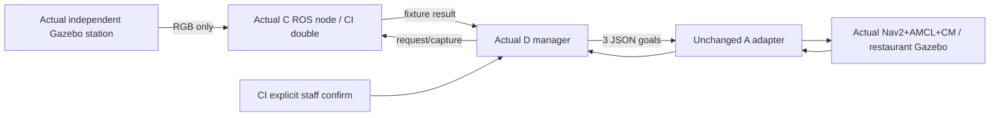

# E-R4 — 실제 Nav2와 독립 실제 Tray station 통합 (CI 교육용)
## 목적 / 책임 경계
A의 S7 map, ROBOTIS Waffle, RGBD 2Hz, Nav2/CM, A adapter TTY를 변경하지 않는다. A13 트레이는 독립 World이며 A11 robot overlay는 물리 트레이 장착/시야 미검증이다. 이 단계는 두 실제 Gazebo partition의 software integration이다. 기존 A world에서 ST-01 scene 생성, 별도 partition에 실제 5Hz camera, 기존 bridge config에서 Image만 선택하여 같은 DDS domain으로 전달. /clock과 Pose/TF를 두 번째 bridge에서 보내지 않는다. 독립 station과 실제 이동 로봇 트레이는 구분한다. 물리 로봇 장착/주행 중 식기 안정성은 미검증이며 제품 AI ON 승인 아님.
## Architecture

## 검수
- exact source, official upstream, released map, clock/scan/odom/map/AMCL/TF/action readiness, CM active, existing A controlling TTY prompt and CI-only explicit approval after 10s.
- separate Gazebo partitions, same DDS domain, unique /clock and RGB publisher. actual C cache bytes SHA witness; CI-only deterministic predictor with distinct fixture model version and D process-local test identity. Product pins remain None.
- 10/5 waits, actual D request and C stability correlation, STABLE does not emit next Goal before staff confirm. Actual A/Nav2 3 leg odom displacement >0.25m, >=3 scan/odom samples, AMCL error <=0.8m, unique 3 action UUID terminal SUCCEEDED. CM active at end and sole cmd_vel publisher. No mocked navigation.
- no private model, actual UI click or owner auto-approval. Actual final WSL2 uses explicit human UI and private v1; robot-mounted tray contract must be separately confirmed by A before claiming physical equivalence.
- artifact contains event timestamps, actual nav UUID, odom summary, live frame witness, logs, scene/config, process cleanup. CI fails closed with bounded waits.
## 결과
구현/CI 정의 커밋. 새 실제 CI 완료 전 NOT_RUN. 기존 R3b/R3c PASS는 별도 SHA 증거. final owner runner/acceptance not issued.
