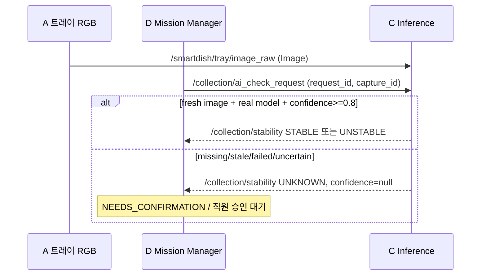

# C02 — ROS 2 선택형 AI ON 추론 노드 개발·계약 검증 보고

- 날짜: 2026-11-23 / 판정: **L0 CONTRACT PASS; ROS LIVE NOT_RUN**
- 기준 소스: `main@2dd7f968dd3d24e2afb48e0917ef8c9d054ac894`; 변경 소스는 C 작업 브랜치 `feat/smartdish-c-stability`의 이 파일과 동일 커밋에서 확인.
- 관련 계약: 공통 인터페이스 v1.0; S7 기존 `s6_vision_ai.py`, `s7_negative_contract.py`는 **수정하지 않았음**.

## 1. 배선과 단일 책임



- `src/smartdish_ai/smartdish_ai/inference_core.py`: ROS 없는 순수 함수 수준 계약 엔진. 요청 `(request_id,capture_id)` 중복 발행 금지, 한 프레임을 다른 캡처에서 재사용 금지, max age 2초.
- `model_runtime.py`: weights/라벨/전처리 검증 및 실제 모델 inference 연결. 잘못된 경로는 로드 실패, 예외는 UNKNOWN.
- `stability_inference_node.py`: `/collection/ai_check_request` 수신, `/collection/stability` JSON 응답. `rgb8`와 `bgr8`, 행 padding, `sensor_data` QoS를 처리. JSON QoS는 RELIABLE/VOLATILE/KEEP_LAST(10).
- `config/model.yaml`: 모델 경로 기본 공란. 이 상태에서 모든 유효 요청은 `UNKNOWN`. C에는 `/cmd_vel`, `NavigateToPose` 발행 코드가 없음.

## 2. 왜 이렇게 설계했습니까?

ROS 설치가 없는 CI에서도 요청 중복·stale·불확실성 실패 처리를 검증하기 위해 계산 코어와 ROS 어댑터를 분리했습니다. 실시간 서비스 연결은 rclpy 한 노드로 충분하므로 새 메시지/서버/추가 Goal 제어를 만들지 않았습니다. 카메라가 트레이를 보는지 검증하기 전에는 S7 전방 RGB를 대신 물리지 않으며 모델 부재는 안전하게 UNKNOWN으로 수렴합니다.

## 3. 테스트 추적성

| 테스트 경계 | 입력 | 예상 | 실제 로컬 결과 |
|---|---|---|---|
| 1개 요청 → 1개 응답 | 유효 pair 1회 + 중복 | STABLE 1회, 중복 None | PASS |
| 새로운 capture_id / 동일 프레임 | fresh image 재사용 요청 | UNKNOWN | PASS |
| 모델 미설치 | predictor=None | UNKNOWN/null/none | PASS |
| confidence <0.80, nan/inf, 추론 예외 | mock predictor | UNKNOWN/null | PASS |
| 이미지 오래됨/미래 수신 시각 | 2.1초 초과/역행 | UNKNOWN | PASS |
| ROS header stamp 역행/중복 | 123→123/122 | 오래된 frame 거절 | PASS |
| rgb8/bgr8/padded step | 16×16 bytes | RGB 정확 변환 | PASS |
| ROS2 DDS publish/subscribe | 실제 rclpy 실행 | 계약 JSON 관찰 | **NOT_RUN** |
| Gazebo tray image / AI ON D FSM | 실제 Gazebo/트레이 카메라 | 직원 확인 전이 | **NOT_RUN** |

## 4. 실행 재현과 범위

```bash
python3 -m pytest -q tests/test_c_stability.py
python3 -m compileall -q ai src/smartdish_ai tests/test_c_stability.py
# 실제 ROS는 ROS 2 Jazzy WSL2에서만 실행/인수:
# ros2 run smartdish_ai stability_inference_node --ros-args --params-file src/smartdish_ai/config/model.yaml
```

로컬 테스트: `20 passed in 0.15s`. 여기서 20건은 C01+C02 전체 계약 테스트이고 DDS 연결 성공이 아닙니다. **실제 ROS 구동 미실행**이므로 로그 `C_STABILITY_READY`가 관측되었다고 주장하지 않습니다. 본 노드는 AI OFF 기본 임무에 의존성을 추가하지 않습니다.

## 5. 남은 결합 단계

B 데이터 확보, A 카메라 live image 1장, C 실제 weight 로딩, D `NEEDS_CONFIRMATION` 분기. D/C가 서로 다른 request_id/capture_id를 내보내면 동작이 잘못되므로 통합 시 trace로 연결합니다.

### 주니어 토론

- 유효 요청 1건에 `UNKNOWN` 1건을 반환하는 방식이 예외를 삼켜 무응답하는 방식보다 무엇이 좋습니까?
- 왜 오래된 이미지를 다른 capture_id 요청에 재사용하면 안 될까요?
- ROS2 이미지 QoS와 JSON QoS를 서로 다르게 지정한 이유를 설명하십시오.
