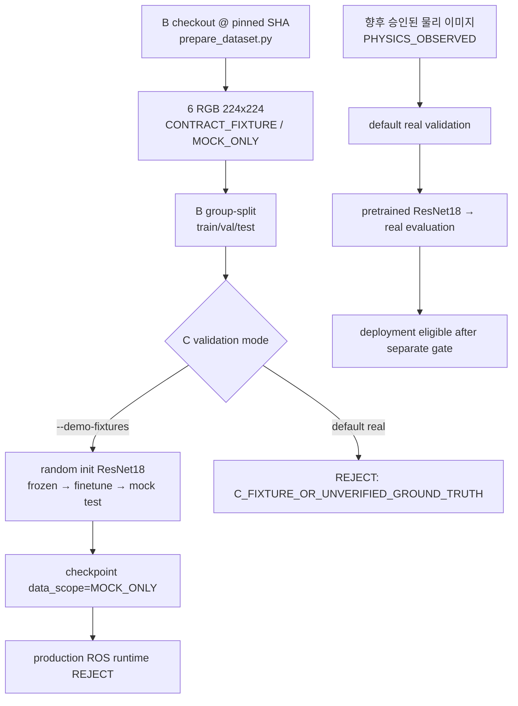

# C04 — B 계약용 더미 데이터로 학습·평가 경로 개방 (교육용 개발 보고서)

- 날짜: 2026-11-23 / 저장소 `silverbjin/samsung_AXI` / 작업 브랜치 `feat/smartdish-c-stability`
- 이전 C 기준선: `c9100de136c44d2711eb642a09c75cc0a2258a23`, S7 원본 main `2dd7f968dd3d24e2afb48e0917ef8c9d054ac894`
- 선행 B: Draft PR #37, `feat/smartdish-b-dataset@4c63d8a88297b7418efccb6e933c25275d9807ce`
- 이 문서와 동일 커밋의 변경: `ai/evaluation/dataset_contract.py`, `stability_model.py`, `ai/train/train_classifier.py`, `evaluate.py`, `demo_fixture_pipeline.py`, `tests/test_c_mock_pipeline.py`.
- 상태: **오프라인 계약 테스트 PASS, dummy 학습 파이프라인 PASS(실제 배포/안정성 NOT_RUN)**.

## 1. 원인과 개발 목표

B의 `split_manifest.csv`는 11열 헤더만 있고, 실제 승인된 트레이 이미지·물리적 라벨은 0건입니다. 기존 C의 `read_verified_split()`은 모든 `MOCK_ONLY`를 차단하므로 모델 학습과 평가의 실행 경로를 미리 테스트할 수 없었습니다. 사용자는 더미 데이터로 구현을 이어가고, 나중에 실제 물리 검증 데이터로 바꾸는 흐름을 요청했습니다.

## 2. 설계 결정 — real과 demo를 *명시적으로* 분리



더미는 모델 구조·데이터 로더·학습 루프·가중치 로드·평가지표 계산·request_id/capture_id 상관관계가 **작동하는지** 테스트하는 용도입니다. 더미의 색상이 라벨에 대응하더라도 식기의 접촉·낙하 여부를 뜻하지 않습니다. `--demo-fixtures` 없는 실행은 이전처럼 실패합니다. 운영 ROS 런타임은 `data_scope=MOCK_ONLY`를 거부하므로 수동 실수로 더미 체크포인트가 `STABLE`을 발행하는 것을 방지합니다.

## 3. 재현 가능한 명령

```bash
# C checkout에서 실행. B는 별도 읽기 전용 checkout이며 C에 복제·커밋 금지
cd samsung_AXI
git switch feat/smartdish-c-stability
git clone --quiet https://github.com/silverbjin/samsung_AXI.git /tmp/smartdish-b-readonly
git -C /tmp/smartdish-b-readonly checkout --detach \
  4c63d8a88297b7418efccb6e933c25275d9807ce
python3 -m pip install pytest pillow numpy torch torchvision
python3 -m pytest -q tests/test_c_stability.py tests/test_c_mock_pipeline.py
OMP_NUM_THREADS=2 python3 -m ai.train.demo_fixture_pipeline \
  --b-script /tmp/smartdish-b-readonly/ai/scripts/prepare_dataset.py \
  --b-ref 4c63d8a88297b7418efccb6e933c25275d9807ce \
  --output /tmp/smartdish-c-mock-only --epochs 1
```

실행 전 B의 실제 브랜치 소스 SHA를 비교하고, 결과 JSON에 B source SHA, `split_manifest.csv` SHA, 모델 체크포인트 SHA를 남깁니다. B 이미지를 C 브랜치에 저장하지 않습니다.

## 4. 검증 범위와 교육용 QA

| 테스트/관측 | 근거 | 판정 |
|---|---|---|
| C 기존+신규 pytest | `27 passed in 0.18s` (로컬) | PASS: ROS 없는 L0 계약 |
| B 스키마를 재현한 로컬 shim으로 6이미지 생성 | `MOCK_ONLY`, 분할 각 클래스 train/val/test 1장 | PASS: 로컬 shim, **B 원본 CI #45124546580 PASS** |
| ResNet18 random init/frozen, layer4+fc finetune | 로컬 PyTorch CPU / 1 epoch | PASS: 코드 경로 실행에 한정 |
| 분리 test 결과 | 총 2장; `MOCK_ONLY_SANITY_CHECK` | 성능 결과로 **사용 불가** |
| 운영 모델 로더 mock checkpoint 거부 | `C_MODEL_CONTRACT_MISMATCH`, `production_runtime_mock_rejected=true` | PASS: 오프라인 fail-closed |
| 실제 B 물리 이미지, Gazebo RGB, ROS 메시지 | 아직 공급·실행되지 않음 | NOT_RUN |

> 로컬은 B 소스를 내려받지 못해 동일 생성 규격의 **검사용 shim**을 사용했습니다. `C_B_MOCK_ONLY_PIPELINE_PASS`가 곧 B의 실제 코드로 실행되었다는 뜻은 아닙니다. GitHub Actions가 별도 B checkout을 받아 `--contract-only`로 원본 생성·분할 계약을 확인하도록 CI를 변경합니다.

## 5. 왜 이렇게 했습니까?

실제 물리 데이터를 기다리느라 학습 파이프라인 자체를 미검증 상태로 두는 것보다, **가짜 결과를 외부로 내보내지 못하도록 경계를 분리**하는 접근이 안전합니다. 공통 validator/학습 루프는 재사용하고 모드·메타데이터·배포 게이트만 다르게 했습니다. 무리하게 DACON 모델 가중치를 재해석하거나 `STACKED → STABLE`을 맵핑하는 우회는 하지 않았습니다.

### 학생 토론

1. 더미 test Accuracy 100%와 실제 물리 안전 성능의 차이는 무엇입니까?
2. 왜 체크포인트에 `data_scope`를 기록하고 운영 ROS에서 다시 검사합니까?
3. `--demo-fixtures` 플래그를 real 학습에 기본값으로 두면 무엇이 위험합니까?
4. B 브랜치 소스 SHA와 데이터 split SHA를 각각 기록해야 하는 이유는 무엇입니까?

### 후속

C05 문서·B 원본 CI 확인, B 물리 데이터의 승인 후 실학습. `main` merge 금지; C Draft PR #39 유지.

## CI 후속 증거 (실제 B 소스 검증 완료)

- 정확한 B `4c63d8a88297b7418efccb6e933c25275d9807ce` checkout 확인: https://github.com/silverbjin/samsung_AXI/actions/runs/45124546580
- B 원본 `B_MOCK_ONLY_FIXTURES_CREATED`, `B_DATASET_CONTRACT_PASS`, C `C_B_MOCK_ONLY_PIPELINE_PASS`, `27 passed in 0.26s`, `SMARTDISH_C_L0_AND_B_MOCK_CONTRACT_PASS_ONLY`: **PASS**.
- CI는 `--contract-only`이므로 PyTorch 학습, ROS/Gazebo는 실행하지 않았습니다. 로컬 CPU dummy end-to-end와 GitHub B 원본 계약 CI는 별도 증거입니다.
