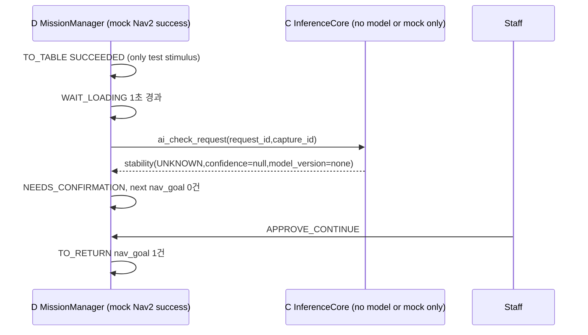

# C07 — C 추론 ↔ D Mission Manager 실제 소스 교차 계약 검증

- 날짜 2026-11-23 / C 시작 HEAD `a1f2488d40e7d683664a3734b7be9f1f5c361cb8` / B `1bfc19eabe07f2a0ea8c5c8ba3509491c9dd217d` / D `195a8ee0758e7734bb6be627ab16461893355be9`.
- 범위: **ROS 없이** C `InferenceCore`의 결과 JSON을 D 소유 `MissionManager`의 Python 로직에 전달해 안정성 분기와 직원 승인 경계를 확인합니다.
- 변경: `tests/test_c_d_cross_branch.py`, `.github/workflows/smartdish-c-contract-ci.yml`, `ai/train/demo_fixture_pipeline.py` B pin 보강, Model Card·실습 가이드·인계 업데이트 및 본 보고서.
- 상태: C07 **로컬 D 코드 미존재로 SKIP**; 실제 D 고정 SHA를 checkout하는 GitHub CI 확인 전에는 교차계약 PASS라고 주장하지 않습니다. C 기존 L0 34 PASS.

## 1. 실제 배선과 관찰 포인트



검사할 다른 경우: `UNSTABLE` → 직원 확인/ABORT; 낮은 confidence/시간 지난 프레임 → UNKNOWN; `capture_id` 불일치 결과 무시; D 대기 timeout → 직원 확인; AI OFF는 C 노드 없이 TO_RETURN으로 진행. 고신뢰 `STABLE`을 반환하는 더미 predictor 테스트도 **JSON 배선 확인만을 위한 MOCK_ONLY**이며 실제 ResNet18 또는 물리 안전 인증이 아닙니다.

## 2. 왜 D 소스를 복제하지 않았나요?

다른 팀이 책임진 FSM을 C 브랜치에 직접 수정하거나 복제하면 서로 다른 사본이 조용히 분기될 수 있습니다. 따라서 GitHub Actions에서 D 브랜치 SHA를 **읽기 전용 checkout**하고 C 테스트가 그 디렉터리를 import하도록 했습니다. B 코드도 최신 SHA를 읽기 전용으로 checkout합니다. ROS 이동·GUI·Nav2는 새로운 필수 게이트로 확장하지 않습니다.

## 3. 검증 계획 및 실제 범위

```bash
# CI가 자동으로 d-read-only/ 를 D SHA에서 checkout
SMARTDISH_D_READONLY=d-read-only python -m pytest -q \
  tests/test_c_stability.py tests/test_c_mock_pipeline.py \
  tests/test_c_real_readiness.py tests/test_c_d_cross_branch.py
```

- 로컬에 D checkout 없음: `34 passed, 1 skipped` (모듈 단위). SKIP는 성공 아님.
- GitHub Actions: `test -f d-read-only/src/smartdish_service/smartdish_service/mission_manager.py`로 D 소스 없으면 FAIL. 구동 후 테스트 결과/코드 SHA·실행 URL을 같은 보고서에 추가합니다.
- B 데이터 readiness는 실물 0건이므로 `BLOCKED` 종료 코드 2가 기대 상태이며, 이를 해당 케이스에서만 확인합니다. 모델 학습·Gazebo·WSL2는 계속 NOT_RUN.

### 주니어 토론 질문

1. JSON 스키마와 D 실제 상태 전이가 맞는지를 한 테스트에서 확인해야 하는 이유는 무엇일까요?
2. **합성 Nav2 SUCCEEDED**를 넣은 테스트가 있어도 실제 로봇 이동을 PASS라고 표시할 수 없는 이유는 무엇일까요?
3. `UNKNOWN`/timeout에서 `nav_goal` 발행 건수를 0으로 검사하는 이유는 무엇일까요?

**결론:** D 자체 코드는 변경하지 않고, C와 D 사이 실패 시 이동 보류 계약을 원래 코드에 대해 회귀 검증합니다. GitHub 원격 테스트 결과 확인 후 최종 검증 판정을 기록합니다.
