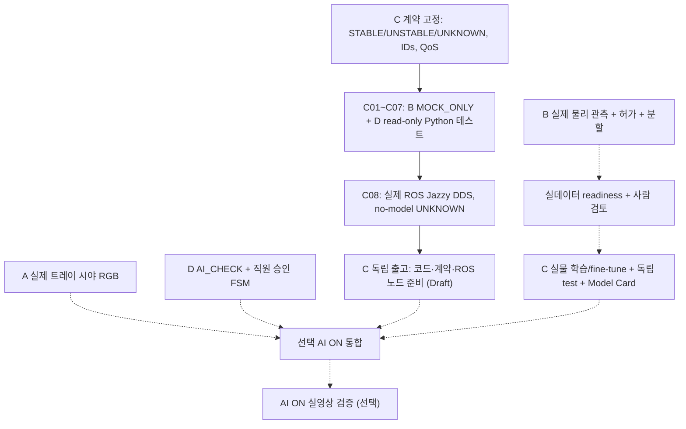

# C08 — B 실물 데이터 지연 상황의 C 독립 검증 및 통합 계획

- 날짜: 2026-11-23 / 소유: C Vision AI / 기준 C `55ae46a36c637c352d8c851614ee4a650f6c2939` / PR #39 Draft
- 읽기 전용 외부 계약: B `c9c528072f76b8b2dbc1119ead770d23308ffda0` (B-08), D `2824370f66ca3cd46be32e2ac8a32019ada87c95` (최신 D CI/문서 수정)
- 목적: B 이미지·라벨 0건으로 인해 C 노드·전처리·데이터 정책·DDS 연결 개발까지 함께 멈추지 않게 범위를 분리합니다.
- 주의: C07의 40 PASS는 **Python L0**이지 ROS 2 Jazzy DDS 통신이나 실제 물리 안정성 모델의 성능 검증이 아닙니다.

## 1. 기존 근거에 대한 전체 리뷰

| 작업 | 관측된 근거 | 무엇을 입증하지 못하는가? |
|---|---|---|
| C01 | ResNet18 baseline/finetune/evaluate 소스, 분리된 test split 구조 | 실제 학습 성공/일반화 정확도 |
| C02 | `InferenceCore`, `stability_inference_node`, JSON/QoS 구현 | 실제 DDS 송수신 및 Gazebo 이미지 |
| C03 | GitHub C L0 테스트/교육 보고서 | 물리 안정성 |
| C04-C05 | B fixture 6장, 로컬 학습·평가·더미 checkpoint 운영 차단 | 실데이터 모델 성능 |
| C06 | 물리 근거 파일 크기/SHA256/읽기 전용 readiness, 34 local PASS | 사람이 확인한 실물 라벨·허가 |
| C07 | 실제 D `MissionManager` checkout, GitHub `40 passed in 0.27s`, CI #45125976380 | ROS 네트워크/실 Nav2 Goal |
| C08 | Jazzy ROS 패키지 build + DDS smoke 신규 CI | checkpoint 추론, 실제 Gazebo 카메라, 실물 안전 |

기준 C GitHub 검증: https://github.com/silverbjin/samsung_AXI/actions/runs/45125976380 (C07 40 PASS). C08 L1 실제 실행 결과는 GitHub 해당 SHA의 Actions 확인 전에는 **NOT_RUN**으로 남깁니다.

## 2. C08 독립 개발에서 추가한 것과 이유

- 신규 `tests/c_ros2_transport_smoke.py`: 패딩된 `bgr8` `sensor_msgs/Image` 1장을 DDS로 전송하고 `/collection/ai_check_request`에 대해 `UNKNOWN, confidence:null, model_version:none` JSON을 수신합니다. 같은 `(request_id,capture_id)` 중복 요청은 재발행하지 않고, 새로운 `capture_id`는 별도 응답해야 합니다.
- `.github/workflows/smartdish-c-contract-ci.yml`: 기존 `c-l0-contract`를 보존하고, **분리된 15분 제한** `c-l1-ros-transport` job을 추가합니다. 공식 `ros:jazzy-ros-base-noble`, `colcon build --packages-select smartdish_ai`, 실제 ROS `rclpy` DDS 통신만 검사합니다. Gazebo/goal/PyTorch 학습/가짜 STABLE은 실행하지 않습니다.
- B와 D의 소스를 C 브랜치에 복제하지 않고 **커밋 SHA 읽기 전용 checkout**만 갱신합니다. B 최신 B-07/08은 검증된 물리 파일 재감사·원자적 ingest에 관한 변경이고, D 최신 변경은 CI 실행기 및 보고서 보강입니다.

### 실행 및 예상 결과

```bash
# CI의 공식 Jazzy 컨테이너 또는 ROS 2 Jazzy 설치 환경
set +u; source /opt/ros/jazzy/setup.bash
colcon build --packages-select smartdish_ai
set +u; source install/setup.bash
python3 tests/c_ros2_transport_smoke.py
# 예상: C08_REAL_ROS2_JAZZY_NO_MODEL_UNKNOWN_TRANSPORT_PASS
```

실행 성공이라 해도 **C_ROS_TRANSPORT_ONLY**로 기록하며 `AI_ON_OPTIONAL_PASS`로 승격하지 않습니다. ROS가 없는 일반 로컬 Python 환경에서 이 명령은 `NOT_RUN`입니다.

## 3. B 실제 물리 데이터와 무관하게 완료할 수 있는 범위



**독립 완료(코드 인수)와 기능 완료(실물 모델 성능·실영상 통합)는 별도 상태**입니다. B 지연 시 C는 독립 코드 완료로 유지하고 AI ON은 `UNKNOWN`/직원 확인 경로까지만 통합 가능, 자동 `STABLE` 경로를 실제 인수로 인정하지 않습니다.

## 4. 실제 통합 순서와 게이트 (MVP 최소화)

1. **통합자 E**는 먼저 A+D의 AI OFF `HOME→T03→DISH_RETURN→HOME` 실 Nav2 3-leg, `/odom`, UI `COMPLETED`를 인수합니다. C/B 결함이 이 경로를 차단하면 안 됩니다.
2. E는 B의 데이터 **코드/스키마**를 먼저 검토·통합하되 빈 `split_manifest.csv`를 실제 데이터로 오인하지 않습니다. 이후 C의 PR #39를 계약·테스트 완료 범위로 검토합니다. S7 원본 및 D FSM을 C 브랜치에서 수정하지 않습니다.
3. C+D는 `UNKNOWN`/timeout/`UNSTABLE`에서 `NEEDS_CONFIRMATION`, 승인 전 다음 Goal 0건을 확인합니다. 지금까지는 Python 계약 PASS, DDS만 C08 대상입니다.
4. B 실제 `PHYSICS_OBSERVED` 이미지와 전후 증거가 출고되면 **더미 체크포인트는 폐기**하고 `check_real_data_readiness` → 운영자 라벨/라이선스 승인 → ResNet18 실학습(frozen, fine-tune) → 독립 test Accuracy/F1/Confusion Matrix → 체크포인트 SHA/버전 검증 순서로 진행합니다.
5. A의 `/smartdish/tray/image_raw` 실제 이미지가 오면 `capture_id` 요청-결과 연결과 STABLE/UNSTABLE/UNKNOWN을 실제 D FSM으로 검증합니다. 그전에는 `AI_ON_OPTIONAL_PASS=NOT_RUN`으로 남기고 발표는 AI OFF를 사용합니다.

## 5. 4인에게 전달할 인터페이스/차단 조건

| 담당 | C가 받는 것 | 아직 없는 것 | C 대응 |
|---|---|---|---|
| B | `split_manifest.csv` 11열, `label_map STABLE=0/UNSTABLE=1`, 물리 파일 hash·size 계약 | 물리검증 이미지 0건 | 더미 계약으로 코드 검증, real readiness BLOCKED |
| A | `/smartdish/tray/image_raw` 계약, rgb8/bgr8 | 실 Gazebo 트레이 영상 | 가짜 STABLE 금지, UNKNOWN |
| D | `AI_CHECK_REQUEST`, `NEEDS_CONFIRMATION`, 직원 승인 | 실제 C DDS 검증(이번 C08에서 확인) | request/capture id 교차 L0 PASS, ROS L1 별도 |
| E | 각 SHA/PR/보고서 | 승인된 integration branch | B→C 계약 순서·A+D AI OFF 우선 인수 |

## 6. 보류 이슈 및 교육 토론

- **실물 샘플 없음:** 현재 B `manifest.csv`/`split_manifest.csv`는 헤더만 있으므로 `TRAINING_NOT_RUN`; 데이터의 물리적 진실은 파일 SHA로 증명할 수 없습니다.
- **모델 품질:** 합성 fixture에서 높은 accuracy가 나오더라도 범용 성능이 아닙니다. Softmax confidence 0.80은 MVP의 임시 운영 임계값이며 실제 검증/보정 전 safety 인증이 아닙니다.
- **실 ROS와 실제 로봇:** C08의 `Image`는 테스트용 DDS 메시지이지 Gazebo 촬영 영상이 아닙니다. `request_id`/`capture_id`는 결과 상관 ID이고 `Image` 자체에 capture_id가 없으므로 시각적 원본 프레임 ID와 동일하다고 주장하지 않습니다.
- **왜 이 구조가 좋은가:** B 데이터 완료를 기다리지 않고 C의 소스·ROS 배포 품질과 실패 안전성을 먼저 고정할 수 있습니다. 동시에 실제 이미지가 없는 상태를 성공처럼 처리하지 않아 통합자가 AI OFF 필수 MVP를 위험에 노출시키지 않습니다.

**상태:** C01~C07 L0 확인, C08 로컬 Python 구문검사 PASS/실 ROS GitHub L1 결과는 Actions 확인 후 보강. PR #39 Draft 유지, main 병합 금지.

## 7. 2026-11-23 원격 GitHub C08 실제 결과 (코드 SHA 6c4c10f)

- **L0 GitHub Actions #45126686463:** `40 passed in 0.26s`, B 최신 SHA `c9c528072f76b8b2dbc1119ead770d23308ffda0`의 헤더-only 실제 split로 `C_TRAINING_NOT_RUN_NO_REAL_DATA`·`BLOCKED`가 확인됐습니다. B 더미 fixture 6건은 `B_DATASET_CONTRACT_PASS`, C 계약은 `C_B_MOCK_ONLY_PIPELINE_PASS`로 기록되며, 실제 학습은 수행하지 않았습니다.
- **L1 동일 Actions #45126686463:** 공식 ROS 2 Jazzy 컨테이너에서 `Finished <<< smartdish_ai`와 `Summary: 1 package finished` 확인. 로그 `C08_REAL_ROS2_JAZZY_NO_MODEL_UNKNOWN_TRANSPORT_PASS responses=2 duplicates=0 protocol=RELIABLE_VOLATILE_KEEP_LAST_10 real_gazebo=NOT_RUN model_training=NOT_RUN` 및 `SMARTDISH_C_L1_ROS_TRANSPORT_PASS_ONLY` 확인.
- 근거: [C08 GitHub CI Run](https://github.com/silverbjin/samsung_AXI/actions/runs/45126686463) / source SHA `6c4c10f3e4e5d0f4da2f70d85ff139edc865ef6d`.
- **최종 판정:** C 독립 **L0 Python + L1 ROS 통신 검증 PASS**. 아직 `AI_ON_OPTIONAL_PASS`가 아니며 실제 학습, 독립 실물 test 및 A 카메라/Gazebo/WSL2는 `NOT_RUN`. 문서만 보강하고 같은 검증을 불필요하게 재실행하지 않습니다.
