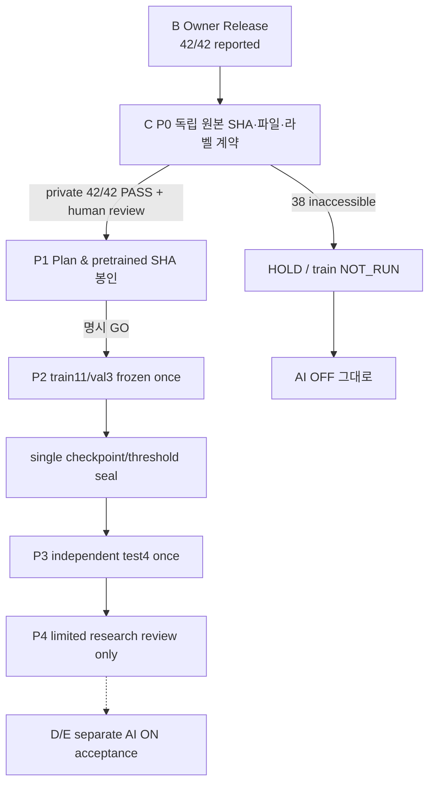

# C Dataset v1 — 교육용 실제 인수·HOLD 재현·사전 계획·CI·E 인계 보고서

- 일자 2026-11-26 / 담당 C / 개발 브랜치 `feat/smartdish-c-dataset-v1-pilot` / 기존 C01~C08 보존.
- P0 **Owner 업로드 증거 직접 확인**: outer SHA `411d092f4ab9e65ad044c9b1ae73b2f84456cef1730fef35dcff04c6b393b949` 정확히 일치, 내부 manifest 15/15 SHA PASS, 중첩 진단 6/6 SHA PASS. archive 내 release `dataset_release.json`/`manifest.csv`/`split_manifest.csv`/`DATASET_CARD_KO.md` 및 제외 CSV 직접 해시 대조. 해당 archive에는 **전체 42개 중 등록된 파일 4개**만 직접 포함, 이미지18/근거18/승인·정책 원본 등 미포함 38은 사용자 WSL2 private root. B 기록 `owner_release_verification.json`의 42/42는 **과거 B Owner 실행의 주장**이고, 이번 C 독립 42/42 결과가 아닙니다.
- 정확한 B pin: delivery `f05e663ac0aaf843c544c905ddcc2a0791f741ac` vs 실제 실행 `f9ddc56979626d4a78decb04e7b4ca28c3824b09`; A18 producer `f1bf400f9b9ef6f554f90b92d92e1e63aeffb049`, A 최종 `adcf695fafacae8cf33238971570d812463e0ed1`; main `63e147289e307e0b9900ca365e9c4557c5921804`.

## 교육 목적: 신뢰 경계 4개



1. **B Owner 증거가 진짜인지?** 바이트 SHA·출처·release 검증 영수증은 일치했습니다. 하지만 원본 38개에 대한 C 직접 재검은 사용자 WSL2 전용입니다.
2. **모델 학습에 쓸 수 있는가?** 승인18/제외2, 5 family, 13S/5U, frozen split train11/val3/test4 메타데이터 일치. 실제 private 42개 image/evidence 해시/형식 및 인간 검토 전에는 GO 금지.
3. **모델 성능을 증명하는가?** 전혀 아닙니다. 예비 통계·Data Freeze 승인과 독립 Test가 다릅니다. Val U=1, Test U=1은 신뢰구간/다른 외란에 대한 일반화 근거로 매우 약합니다. majority test3/4도 학습 기준 아님.
4. **로봇 주행 안전에 사용 가능한가?** 아닙니다. 고정방향 명령 토크(측정 wrench 아님)·정적 실린더 트레이 조건부 결과일 뿐. Production Contact HOLD, A15/A16 historical cleanup FAIL12, AI OFF 보호 유지합니다.

## RED → GREEN → REVIEW 테스트

- RED 방어: 경로 탐색 `../...`, symbolic link, family assignment 변조, split 재분할, MOCK_ONLY/외부 rights, 중복 stack, evidence hash drift, 제외 layout 재도입, production contact 임의 PASS 등 전부 `C_V1_*` 오류로 거부합니다.
- GREEN 실행: `PYTHONPATH=. python -m pytest -q tests/test_c_dataset_v1_gate.py` (public fixture only), `python3 -m ai.train.dataset_v1_gate --dataset-root <private> --report <private/report.json>`.
- 실제 제공 TAR에서 `C_V1_P0 ... HOLD_PRIVATE_42_RECHECK` / **exit 2**를 재현. 이 실패는 예방적 차단으로, B release 자체의 실패나 모델 품질 실패가 아닙니다.
- REVIEW: GitHub CI는 *fixture-only* 검사이며 private 데이터로 Owner 인수를 대체하지 않습니다. 기존 C train/evaluate/ROS 코드는 삭제하지 않습니다. B audit/release 재실행/실제 이미지 업로드/데이터 수집/모델 훈련 **모두 하지 않았습니다**.

## WSL2 담당자 실습 체크

```bash
# P0 전용. 정확한 새 C 커밋 PIN을 GitHub PR에서 확인한 뒤 실행하십시오.
PIN=<C의_완전한_40자리_Immutable_SHA>
export SMARTDISH_C_PIN="$PIN"
curl -fsSLo "$HOME/smartdish_c_dataset_v1_owner_once.sh" \
  "https://raw.githubusercontent.com/silverbjin/samsung_AXI/$PIN/scripts/smartdish_c_dataset_v1_owner_once.sh"
bash "$HOME/smartdish_c_dataset_v1_owner_once.sh"
```

- 원샷은 clean detached checkout·private root 42/42 검사를 수행하고 P0 report, 최소 진단 TAR, SHA sidecar를 생성합니다. **성공해도 자동으로 train하지 않습니다.**
- C 인계 요청은 **비공개 P0 보고서·아카이브 SHA·exit**의 검토이며, 모델 학습 허가를 위한 실험 계획·pretrained weight SHA/라이선스·Test lock 승인은 별개입니다.
- WSL2 private root 기본값: `/home/jinho/smartdish_qa06_owner_release_026xvc/release/dataset_v1`; 데이터 복사/비공개 파일의 GitHub Push를 금지합니다.

## P1 사전 봉인(이번 변경으로 검증 준비, GO 아님)

- `ai/docs/C_V1_EXPERIMENT_LOCK.json`: frozen head ResNet18 V1, CPU seed42 deterministic, epochs3, batch4, lr1e-4, no augment, val cross entropy로 best epoch, threshold0.80, test 1회, fine-tune 불승인.
- **미확인:** torchvision ImageNet1K V1 pretrained weight full SHA, 캐시·사용권, 실제 WSL2 torch/torchvision 버전, C Owner 42/42, 사람 C pilot approval. 이 값들이 확정되기 전 실제 학습 `NOT_RUN`.

## 이력/완료 판정

| 단계 | 현재 상태 | 반증 기준 |
|---|---|---|
| P0 Owner archive pin/4 rows | PASS | wrong SHA면 HOLD |
| P0 C private 42/42 | NOT_RUN / HOLD | 누락·변조·symlink 또는 18 image/evidence 문제 |
| P1 사전 plan 기술 작성 | READY_FOR_APPROVAL | full pretrained SHA/라이선스 미확정 |
| P2 train11/val3 | TRAINING_NOT_RUN | 자동 실행 금지 |
| P3 test4 once | TEST_NOT_OPENED | Test 선택/재튜닝 금지 |
| P4 모델 artifact | NO_CHECKPOINT | AI ON 제품 반입 금지 |
| P5 공개 fixture CI | GitHub 실행 후 원본 URL 기록 | CI PASS는 C Owner 증거 아님 |
| P6 D/E 코드·계약 인계 | 준비 / 모델 인계 HOLD | E AI ON별도 인수 |

**디버깅 교훈:** 정상적인 `exit2`/HOLD는 품질을 속이지 않고 학습 경계를 지킨 결과입니다. 데이터를 만들거나 B의 기존 승인 결과를 다시 실행해서 상태를 녹색으로 만들지 않습니다.
