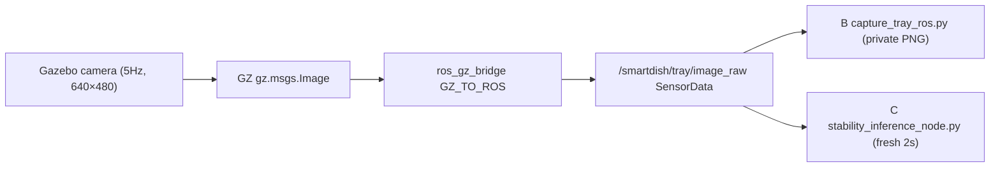

# A-11 — 선택형 트레이 RGB 카메라와 ROS 2 영상 계약 (주니어 개발 보고서)

## Why / 업무 배경

S7의 전방 RGB-D `restaurant/rgbd`는 주행/식기 존재 시야이고, B/C의 **트레이 자체 안정성 영상**이라고 주장할 수 없습니다. 독립 A-11 센서는 기존 `sensor_msgs/Image` 소비자를 수정하지 않고 추가합니다. 기존 공식 Waffle 및 원본 S7 경로를 건드리지 않습니다.

## A-11 소스와 공식 도구

- `scripts/smartdish_tray_camera.py`: SDF ElementTree로 센서 XML 생성/검증, 고유 센서 `smartdish_tray_rgb`, frame `smartdish_tray_optical`, 640×480 `R8G8B8`, 5Hz.
- `config/smartdish_tray_bridge.yaml`: 공식 `ros_gz_bridge parameter_bridge`에서 Gazebo→ROS 단방향 Image/CameraInfo/TFMessage(/dynamic_pose/info)/Clock. /cmd_vel 전송 **없음**.
- 시험 world의 카메라는 정적 overhead 거치대(물리 식기와 분리), 실제 dish가 프레임에 들어오는지 **A-12/A-13 L2 + 사용자 L3 시각 확인**을 기다립니다.
- 기존 공식 Waffle Pi에 독립 센서만 append하는 `--robot-sdf ... --out ...`는 **opt-in prototype**: collision/inertia 변경 0건을 L0에서 확인하지만 실제 로봇 트레이의 존재/설치 위치/시야 동등성은 **NOT_RUN**. AI OFF는 이 카메라를 활성화하지 않습니다.

## 계약 / 검사 이유

`/smartdish/tray/image_raw`는 C/B 모두 `qos_profile_sensor_data`를 구독합니다. encoding은 실제 ros_gz_bridge 메시지가 `rgb8` 또는 `bgr8`인지를 **L2 원본 메시지에서 확인**해야 합니다. 픽셀 224×224는 B/C 후처리 단계이므로 센서 원본 640×480을 변경하지 않습니다.

테스트: `python3 -m pytest -q tests/test_smartdish_tray_camera.py`; 단위 SDF/중복/공식 원본 불변/bridge와 소비자 호환 정적 검사. **L0 GREEN ≠ 실제 Gazebo 영상 PASS**.

외부 자료: [Gazebo Harmonic Sensors](https://gazebosim.org/docs/harmonic/sensors/), [ROS2 Integration](https://gazebosim.org/docs/harmonic/ros2_integration/).

## 완료 경계

- 코드 및 정적 계약: 신규 A-11 기능 커밋에서 구현.
- 실제 Camera Gazebo Transport→ROS 2 bridge frame과 B 파일 저장: **L2 검증 전 NOT_RUN**.
- 사람 시각에서 트레이+식기 관측: **사용자 L3 확인 전 NOT_RUN**, 자동 이미지 내용 통과 판정 금지.
