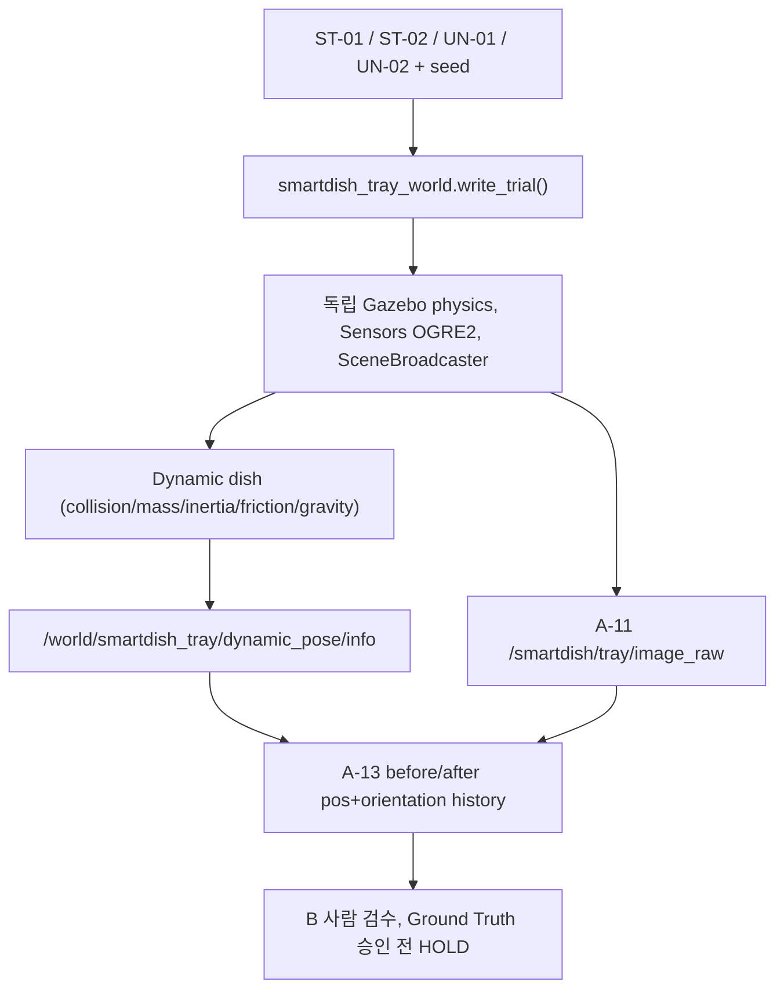

# A-12 — Gazebo Harmonic 독립 식기 물리 시험 World (교육용 개발 보고)

## 개발 배경

S7 `s6_stacked_dishes`는 `static=true` 시각 fixture이므로 낙하/전도 물리 결과를 낼 수 없습니다. 독립 `smartdish_tray` world를 시험마다 새로 생성해 인공 결과를 만들지 않고 실제 중력·접촉·마찰을 관측하도록 설계했습니다. 레스토랑 지도/경로 주행을 다시 시작하지 않습니다.

## 소스와 핵심 함수

- `scripts/smartdish_tray_world.py`: `build_world()`, `plate_model()`, `inertial()`, `write_trial()`, `validate_world()`.
- 동적 식기는 `static=false`, 표준 cylindrical visual/collision, `mass=0.22kg` 실험값, 마찰 `mu=0.65` 실험값, 실린더 관성식 `Ixy=m(3r²+h²)/12, Iz=m*r²/2`로 생성. 고정 joint 없음.
- 시나리오 `ST-01` 중앙 정렬 2장, `ST-02` 크기 다른 세 장, `UN-01` tray 지지면 밖 2장, `UN-02` 틸트/편심 2장.
- 고정 seed로 최초 위치 jitter 재현, `scenario.json`에 scene_id/stack_id/trial_id/world SHA/모델 초깃값/재질·관성/10초 관측 시간 기록.
- 예상 시나리오 명칭만으로 자동 `STABLE`/`UNSTABLE` 라벨 생성하지 않음; `REVIEW_REQUIRED` 고정.

## 테스트와 경계

`python3 -m pytest -q tests/test_smartdish_tray_world.py`

L0 확인: SDF ElementTree, 중력 시스템, 식기 동적·충돌·관성 존재, 재현 가능 seed, 중복 파일 차단, Ground Truth 자동 출고 금지.

**실제 물리 결과는 Gazebo가 sensor+pose를 발행한 다음 A-13 L2 물리 계측이 확보돼야 PASS.** 수집 전은 PHYSICS_NOT_VERIFIED입니다. 정지 10초 안정 관측은 이동하는 로봇의 긴급 제동/실물 안전 인증과 다릅니다.

## B 담당 인계

SDF의 초기 배치/마찰/질량은 실제 실험값이며, B가 시행 결과를 독립적으로 검수해 라벨 승인해야 합니다. 같은 stack_id 연속 프레임을 서로 다른 split에 분리하지 마십시오. 이미 낙하한 후의 프레임만 학습 이미지로 사용하지 않도록 A-13 캡처 시각 계약을 확인합니다.
