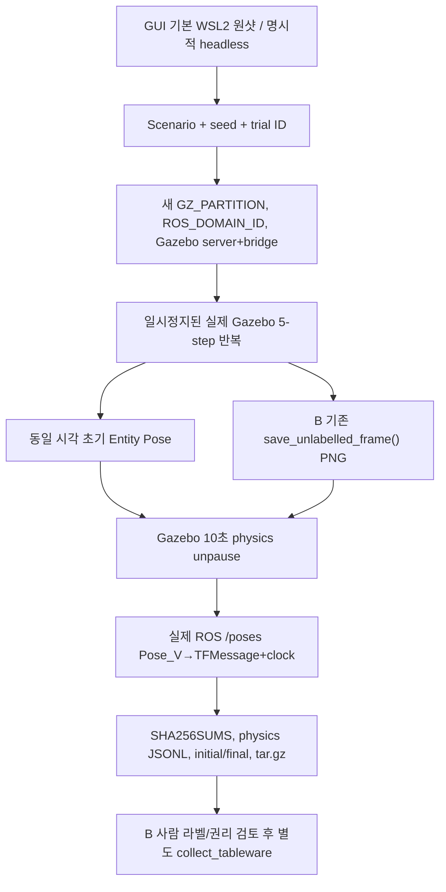

# A-13 — Gazebo/ROS 트레이 RGB+물리 관측 원샷·해시 출고기 (개발 교육 보고)

## 목적

4개 SDF 시나리오를 손으로 구성하거나 `gz`·ROS·B 수집기를 3~4개 터미널에서 실행하지 않고 `demo|single|batch` 하나의 진입점으로 통합합니다. AI OFF/Nav2를 켜지 않고 **독립 물리 시험**에만 사용합니다.

## 실행 구조 및 안전 조건

- `scripts/smartdish_a_tray_bootstrap.sh`: 고정 SHA 확인, WSL2 ext4+전용 `~/samsung_AXI_A_TRAY`, 원격·브랜치·로컬 수정 확인 후 ff-only 갱신.
- `scripts/smartdish_a_tray_one_shot.sh`: GUI 기본, ROS 2 Jazzy/ros_gz_bridge/Pillow 점검, A package colcon build(Goal 없음).
- `scripts/smartdish_a_tray_live.py`: 실제 `gz sim -s`와 `ros_gz_bridge` 프로세스만 생성, Gaussian/가짜 주행결과 없음. 시험마다 새로운 GZ_PARTITION/ROS_DOMAIN_ID, 관측 후 자기 PID 그룹만 정리.
- `scripts/smartdish_tray_evidence.py`: 실제 이미지 SHA·별도 Pose JSONL SHA/크기, 시뮬레이션 시계(t1 이미지 ≤ t2 physics 시작), 유효한 식기 Pose, 3개 이상의 신규 영상 stamp, 관측 9초 이상. 손상되면 fail-closed.
- 원본 영상은 **B 기존 `ai/scripts/capture_tray_ros.py`의 `save_unlabelled_frame`**으로 `ai/data/private/A13_*.png`에 라벨 없이 저장하고, 시험 디렉터리로 복사합니다. 승인 전 B manifest를 수정하지 않습니다.

## 시험-관측 원리

1. World를 paused로 올리고 짧은 실제 Gazebo physics step을 수행하여, **초기 RGB+Gazebo dish pose가 먼저 있는지** 확인.
2. 초기 프레임의 sim timestamp가 0.2초 이내가 아니면 `A13_PRE_EVENT_CAMERA_TOO_LATE` 차단(이미 낙하한 뒤의 RGB가 학습 X로 들어오는 문제 방지).
3. 그 뒤 실제 Gazebo world를 unpause하고 **10 simulation seconds** 동안 자세/위치를 측정합니다. 위치 Z 하강·tray 이탈·기울기를 관찰값으로 기록합니다.
4. `HELD_OBSERVED`, `FALL_OBSERVED`, `INDETERMINATE`는 자동 **관측 후보**이며 `STABLE/UNSTABLE` 학습 라벨과 다릅니다. B 담당이 실제 물리 로그와 이미지·사용권을 검토한 뒤에만 기존 `collect_tableware.py` 등록.

## 모드

| 옵션 | 의미 | 전체 4개 물리 시나리오 L3 게이트 |
|---|---|---|
| `batch` (기본) | ST-01, ST-02, UN-01, UN-02 각각 독립 실행 | 예 |
| `demo` | ST-01, UN-01로 시연, 인수 아님 | 아니오 |
| `single --scene ...` | 단일 설정 디버깅 | 아니오 |
| `--gui` (기본) | 실제 Gazebo 시각 확인 | GUI 품질은 사용자 직접 |
| `--headless` | renderer는 유지하고 GUI만 비활성 | L2 CI 우선 |

## 인계와 미검증

- 출력: `generated/smartdish_tray/run_<UTC>_<pid>/` 아래 PNG, physics_observations.jsonl, scenario.sdf, pose 상태/메타데이터, SHA256SUMS와 `smartdish_a_tray_evidence.tar.gz`.
- B: `physics_observations.jsonl`는 이미지와 독립 파일, 사람 승인 전 labeling 금지. 승인 예시 CLI는 별도 B/C 인계 가이드.
- C: 기존 `/smartdish/tray/image_raw` 구독은 수정하지 않으며 모델 없을 때 UNKNOWN 정상.
- 실제 L2는 CI에서 Gazebo/OGRE2 실수신 결과가 나올 때만 PASS. GUI L3는 사용자의 현장 증거 전까지 **NOT_RUN**.

## 2026-11-24 — 실제 Gazebo L2 전체 검증(최종 관측 사실)

- [GitHub Actions #45325486957](https://github.com/silverbjin/samsung_AXI/actions/runs/45325486957), 실주행 코드 SHA `05779ae191ff41c922e067ec7cc5c2356dcffeaa`.
- L0 **26 PASS**, ROS Jazzy L1 **PASS**, 독립 Gazebo L2 **4/4 PASS**.
- `/smartdish/tray/image_raw` ROS Image 실제 도착 및 B `save_unlabelled_frame()` PNG 실저장 4건, 모든 첫 캡처 timestamp `200000000ns`. 센서 포맷은 런타임 validator에서 `rgb8` 또는 `bgr8`을 허용했으며 각 trial JSON에 원본 encoding/step 포함 여부를 인수에서 확인하십시오. 이미지에 트레이·식기가 모두 적절히 보이는지의 시각 검수는 **사용자 L3**입니다.
- CI console에서 `SMARTDISH_A_TRAY_REAL_GAZEBO_L2_EVIDENCE_VERIFIED` 관측. 각 PNG와 별도 동적 Pose JSONL은 SHA256/size/시간정렬 검증기 통과.

| Scene | 실제 Image→PNG | 10초 동적 Pose 관측 | 원본 관측 판정 |
|---|---|---|---|
| ST-01 | PASS / 0.200s stamp | PASS | `HELD_OBSERVED` |
| ST-02 | PASS / 0.200s stamp | PASS | `HELD_OBSERVED` |
| UN-01 | PASS / 0.200s stamp | PASS | `FALL_OBSERVED` |
| UN-02 | PASS / 0.200s stamp | PASS | `FALL_OBSERVED` |

**원본 시나리오 명칭을 정답 라벨로 사용하지 않습니다.** 모든 trial의 `label=REVIEW_REQUIRED`, `ground_truth=NOT_OPERATOR_APPROVED` 계약은 유지합니다.

- 기존 운영 AI OFF Nav2·D UI·Map/CM 수정 없음. 독립 물리 World의 화면/배치가 실제 로봇 트레이 설치 환경과 동일하다는 검증은 아직 **NOT_RUN**.
- B 담당 최종 안정성 라벨 승인 및 C 실모델 추론은 **NOT_RUN**, A 코드가 승격하지 않습니다.

### 데이터 출고 원본 보존 개선

후속 CI에서는 각 4건의 `tray_rgb.png`와 `physics_observations.jsonl`, Scenario/입출력 메타데이터 및 해시가 들어간 `smartdish_a_tray_evidence.tar.gz`를 GitHub Actions Artifact에 함께 게시하여 로그만으로 물리 성공을 주장하지 않고 원본 파일을 추적할 수 있도록 합니다. 최종 artifact_id는 새 CI 실행 후에만 기록합니다.
