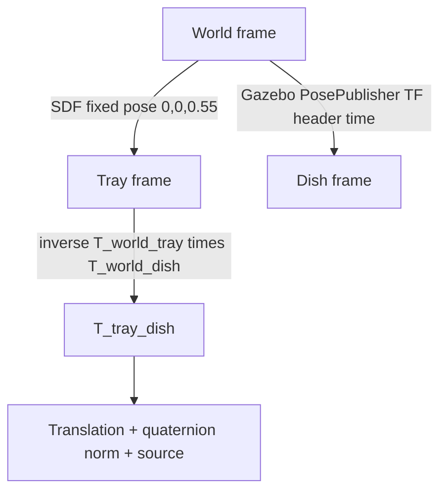

# A14-01/A14-03 — 초심자용 좌표계·시간동기화 교육 보고서

## 완성된 계산을 먼저 보세요

```math
T_{tray,dish}(t) = T_{world,tray}(t)^{-1} \cdot T_{world,dish}(t)
```

트레이가 월드에서 Z축으로 0.55m 올라가 있고 식기 중심이 월드 0.65m이면, 트레이 중심에 대한 식기 Z값은 0.10m입니다. 단순히 WORLD 좌표를 "tray relative"라고 바꿔 적는 것은 금지합니다. 회전된 트레이면 역쿼터니언으로 translation도 회전해야 합니다.



## 동작별 필드

`world_frame_id=world`, `tray_frame_id=tray_platform/body`, `dish_frame_id=dish_XX`.
동적 Pose는 `ROS_TF_HEADER_STAMP` 증거를 사용해야 합니다. A13의 `ROS_BRIDGED_GAZEBO_DYNAMIC_POSE` 추적은 원래 ROS callback 때 최신 /clock을 읽은 값이므로 정확한 같은 Gazebo 시간이라고 선언하지 않습니다. header stamp가 0이면 `ROS_CALLBACK_CLOCK_APPROX_NOT_GT`로 기록하고 품질을 HOLD 합니다.

트레이는 고정 세계의 SDF `model=tray_platform` / `static=true` / `pose=0 0 0.55 0 0 0`을 직접 읽습니다. 따라서 정적 transform의 임의 t 재사용은 근거가 있는 `STATIC_TRAY`입니다. `ROBOT_MOTION`에서 동일 방법을 쓰면 안 되며 실제 움직이는 트레이 PosePublisher/TF가 필요합니다.

## 실습: 왜 Quaternion 검수가 필요할까요?

쿼터니언 `qx,qy,qz,qw` 네 성분의 제곱합이 1인지 검사합니다. 예시 `(0,0,0,0)`은 회전이 아니므로 사용 금지입니다. ±2% 이상의 정규화 오차나 NaN은 FAIL입니다. 90° yaw 트레이 옆에 있는 식기는 tray X 방향에 놓일 수도 있으므로 단순 XYZ 뺄셈과 회전 변환을 비교해 보십시오.

## 시간 계약

- 모든 t는 **Gazebo simulation nanoseconds**. 운영자가 누른 시계나 wall-clock 수와 혼동하지 마십시오.
- RGB `t0`는 0.6s, 최근접 Pose는 0.55s였다는 기존 A13 증거를 보존합니다. 250ms를 넘는 t0-Pose 차이는 품질 HOLD.
- ROS Image의 양수·증가 헤더 timestamp가 실제 수신되었는지 먼저 검사합니다.
- 일반 물리 추적은 대략 20Hz 목표이지만 이전 실제 간격이 0.23~0.29s까지 관측되었습니다. 따라서 신규 후보 **최대 0.35s**로 시작하고 모든 실측 gap을 보관합니다. 확정 제품 임계치는 아닙니다.
- 시각 역행·샘플 중복·관측 종료 전에 끊긴 추적·t0 이후 생성된 뒤늦은 이미지는 HOLD.
- 물리 관측 10 sim seconds와 wall elapsed는 서로 다른 지표로 저장합니다.

## 완성 프롬프트

> 실제 헤더 stamp의 ROS TF, 정적 tray SDF SHA와 RGB(t0)를 읽고 각 시각 T_tray_dish를 계산하라. quaternion norm과 sim time gap을 검증하고, ROS callback clock 추정값이 사용되면 정확한 Gazebo 시각이라고 표현하지 말라. Pose 연산 오류 또는 부족 증거면 후보를 UNKNOWN으로 처리하라.

**검토 포인트:** 좌표계/단위/시간 출처, 역변환 구현, 누락 구간의 무효화가 중요합니다.