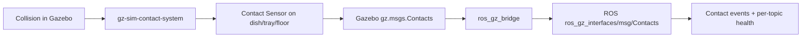

# A14-02 — Velocity·Contact Sensor 구현 교육 보고서

## 1. Velocity는 무엇을 측정한 것입니까?

Gazebo 실측 Twist가 없으면 별도 `DERIVED_POSE_FINITE_DIFFERENCE`로 표기합니다.
`v(t) = [p(t)-p(t-1)]/dt`의 단위는 m/s입니다. 회전은 `q(t-1)^-1 × q(t)`의 axis-angle을 dt로 나눈 rad/s입니다. 첫 샘플은 이전 값이 없으므로 `UNAVAILABLE_FIRST_SAMPLE`입니다. 측정 실제 Twist라고 표시하지 않습니다.

주행 로봇의 tray angular/linear velocity는 반드시 동적 트레이 Pose/Twist를 수신해야 하며 이번 STATIC_GRAVITY 물리 증거로 대체하지 않습니다.

## 2. Gazebo Harmonic Contact System 구조

설치환경에서 `ros2 interface show ros_gz_interfaces/msg/Contacts`와 `Contact`를 확인하고, 실제 Contact System 플러그인 .so를 조회해야 합니다. Gazebo Classic의 `libcontact.so` 사용법을 Harmonic에 붙여넣지 않습니다. Contact와 Contacts는 다른 ROS 메시지형입니다.

새로운 세계 파일에서 `tray_platform`·`tray_test_floor`와 식기별 `dish_XX` collision에 SDF Contact Sensor를 opt-in 배치합니다. 원본 주행 월드나 기존 A13 세계 생성 함수를 변경하지 않습니다.

접촉 이벤트에는 collision1/2의 entity 이름, sim_time_ns, sensor topic, contact category `TRAY_DISH`, `DISH_DISH`, `FLOOR_DISH` 및 출처를 보존합니다.

## 3. 절대 혼동하지 않을 네 상태

| 상태 | 성립 근거 | 데이터 판단 |
|---|---|---|
| `CONTACT_OBSERVED` | 실제 헤더와 collision 쌍이 있는 콜백 수신 | 관측한 pair만 증거 |
| `NO_CONTACT_OBSERVED` | 유효 센서 heartbeat가 해당 구간을 덮고 실제 event 0 | 미접촉 관측으로 표기 가능 |
| `CONTACT_SENSOR_UNAVAILABLE` | 센서 데이터 자체 없음 | NO_CONTACT로 위조 금지 |
| `CONTACT_DATA_INCOMPLETE` | 일부 timestamp/토픽/Collision 식별자 누락 | UNKNOWN/HOLD |

Contact 메시지 수신이 없다고 미접촉이라고 선언하는 코드는 오류입니다. Contact System이 지원해도 현장 토픽이 실제 수신되는지는 별도 L2 증거가 필요합니다.

## 4. 지원 상실과 사후 라벨의 경계

접촉이 한 시점에 나타났다는 사실이 지속된 지지를 증명하지 않습니다. 지지 상실은 tray-dish 접촉 종료와 이후 floor 접촉을 실제 time-line으로 대조할 때만 후보로 표기합니다. 자동 승인 레저는 생성하지 않습니다.

## 완성 프롬프트

> Gazebo Contact System이 실제 발행한 gz.msgs.Contacts를 Jazzy bridge로 수신하고 source timestamp, collision1·collision2, 메시지 수와 topic discovery를 분리해 기록하라. 모든 센서가 조용한 상황과 publisher 미동작을 구분할 수 없으면 CONTACT_DATA_INCOMPLETE로 처리하라. Twist가 없다면 DERIVED로 속도를 표기하고 물리 직접측정이라고 주장하지 말라.

**평가:** 센서 미수신을 NO_CONTACT로 처리하는 답은 0점입니다.