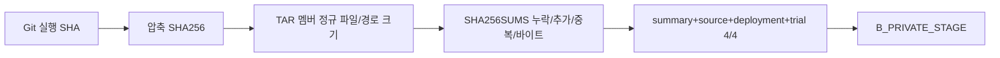

# B-10 교육 보고 — A-13 증거 파일 인수와 해시의 세 층

- 기준 main: `63e147289e307e0b9900ca365e9c4557c5921804`; A 실행: `6cb5b6bfc69687ded0b565b1a3ed6b0cf34b36df`.
- 개발 코드: `ai/scripts/import_a13_evidence.py`; 단위검증: `tests/test_b_a13_real_data.py`.
- 최초 개발 시 원본 미확보였으나 2026-11-25 사용자 TAR 추가 업로드 후 **직접 Archive SHA 및 내부 88/88 PASS**. 계약 fixture CI와 분리합니다.

## 문제·설계 판단

A 인수 보고서에서 확인한 실행 SHA / 아카이브 SHA / 내부 파일 SHA는 서로 다릅니다. 코드를 출고한 저장소 커밋이 같아도 복사된 TAR가 훼손될 수 있고 TAR 해시가 같더라도 압축 안에 트래버설·링크가 있으면 비검증 추출이 위험합니다. 따라서 `tarfile.extractall()` 대신 **헤더 거부→정해진 크기의 청크 읽기→ SHA256SUMS 파일 집합 비교→ JSON 출처 검증→ 비공개 결과 폴더 승격** 순서를 채택했습니다.



## 어떤 오류를 막았나요?

- 압축 변경 `B10_ARCHIVE_SHA_MISMATCH`; 경로 이탈 `B10_ARCHIVE_UNSAFE_PATH`; symbolic/hard link `B10_ARCHIVE_LINK_OR_SPECIAL_FORBIDDEN`; 중복 이름·누락/추가 `B10_INTERNAL_FILE_SET_MISMATCH`.
- `summary.json`의 `batch/gui/전체 PASS`, 각 trial의 `source_sha`, 센서/GUI PASS 및 인위 라벨 미승인 계약 확인.
- PNG 640×480 RGB·실제 파일 SHA, physics SHA/bytes, image/pose/timestamp, 4개의 trial을 각각 확인.
- 합성 fixture는 88건을 요구하지 않는 **테스트 전용** 코드 호출로 검사하고, 실제 one-shot 기본은 88건을 요구.

## 재현

```bash
python3 -m pytest -q tests/test_b_a13_real_data.py
# 실제 검증된 A 인수 원본을 보존한 상태에서 자동 탐색 및 review 진행
bash scripts/smartdish_b_real_data_one_shot.sh \
  --sha "$(git rev-parse HEAD)" --mode review
```

원본 경로를 자동 검색한 뒤 SHA가 일치하지 않으면 `B10_ARCHIVE_SHA_MISMATCH`, 파일이 없다면 `B_A13_ORIGINAL_ARCHIVE_NOT_FOUND`로 차단합니다. **B 이번 직접 실증은 TAR 88/88 PASS, 실제 후보 4장 PASS**이며, 운영자 승인 0건은 별도로 유지합니다.

**주니어 질문:** 파일 내부 88개가 해시 검증되더라도 시뮬레이션의 `FALL_OBSERVED`가 인간 승인된 `UNSTABLE`이 아닌 이유는 무엇일까요?


## 2026-11-25 사용자 TAR 업로드 후 직접 재검

- 원본: `smartdish_a_tray_evidence.tar(6).gz` (SHA256 `bfc346...f8e6e`, A 원본 `(5)`와 같은 바이트).
- 기존 인수기 RED: 선택형 진단 stdout 로그 8개가 0바이트인데 `size<=0` 검사로 B10_ARCHIVE_MEMBER_SIZE_INVALID.
- 최소 수정: `logs/trial_000[1-4]_(gz_image_probe|post_spawn_gz_probe).log` 패턴만 선택적으로 0 허용. 모든 파일 SHA256SUMS/압축 해제 제한/위험 경로 차단 유지.
- 실제 TAR: 안전 재인수 PASS, 내부 SHA **88/88**, `summary.json` batch 4/4 PASS, 원본 읽기 전용. 이는 코드 계약 CI fixture가 아니라 실제 파일 바이트 직접 확인임.
- 운영자 라벨 승인 **0**, 후속 B-11 후보 추출 전과 후 모두 학습 manifest 자동 갱신 없음.
- [B10 DBG-04](../issues/SMARTDISH_B10_DBG_04_REAL_ARCHIVE_EMPTY_DIAGNOSTIC_LOGS_KO.md) 참조.
