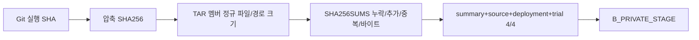

# B-10 교육 보고 — A-13 증거 파일 인수와 해시의 세 층

- 기준 main: `63e147289e307e0b9900ca365e9c4557c5921804`; A 실행: `6cb5b6bfc69687ded0b565b1a3ed6b0cf34b36df`.
- 개발 코드: `ai/scripts/import_a13_evidence.py`; 단위검증: `tests/test_b_a13_real_data.py`.
- 실제 A TAR 직접 검증: **NOT_RUN / 원본 바이트 없음**. 계약 fixture 성공은 별도.

## 문제·설계 판단

A 인수 보고서에서 확인한 실행 SHA / 아카이브 SHA / 내부 파일 SHA는 서로 다릅니다. 코드를 출고한 저장소 커밋이 같아도 복사된 TAR가 훼손될 수 있고 TAR 해시가 같더라도 압축 안에 트래버설·링크가 있으면 비검증 추출이 위험합니다. 따라서 `tarfile.extractall()` 대신 **헤더 거부→정해진 크기의 청크 읽기→ SHA256SUMS 파일 집합 비교→ JSON 출처 검증→ 비공개 결과 폴더 승격** 순서를 채택했습니다.



## 어떤 오류를 막았나요?

- 압축 변경 `B10_ARCHIVE_SHA_MISMATCH`; 경로 이탈 `B10_ARCHIVE_UNSAFE_PATH`; symbolic/hard link `B10_ARCHIVE_LINK_OR_SPECIAL_FORBIDDEN`; 중복 이름·누락/추가 `B10_INTERNAL_FILE_SET_MISMATCH`.
- `summary.json`의 `batch/gui/전체 PASS`, 각 trial의 `source_sha`, 센서/GUI PASS 및 인위 라벨 미승인 계약 확인.
- PNG 640×480 RGB·실제 파일 SHA, physics SHA/bytes, image/pose/timestamp, 4개의 trial을 각각 확인.
- 합성 fixture는 88건을 요구하지 않는 **테스트 전용** 코드 호출로 검사하고, 실제 one-shot 기본은 88건을 요구.

## 재현

```bash
python3 -m pytest -q tests/test_b_a13_real_data.py
python3 ai/scripts/import_a13_evidence.py \
  --archive '/path/to/smartdish_a_tray_evidence.tar(5).gz' \
  --output ai/data/private/b_a13_review/raw
```

실제 파일이 없으면 `A13_ARCHIVE_BYTES_NOT_AVAILABLE` / `B_EVIDENCE_IMPORT_BLOCKED`로 실패하는 것이 정상입니다. 원본 A 인수 보고의 88/88 PASS를 이번 B 재검의 실제 결과라고 적지 않습니다.

**주니어 질문:** 파일 내부 88개가 해시 검증되더라도 시뮬레이션의 `FALL_OBSERVED`가 인간 승인된 `UNSTABLE`이 아닌 이유는 무엇일까요?
