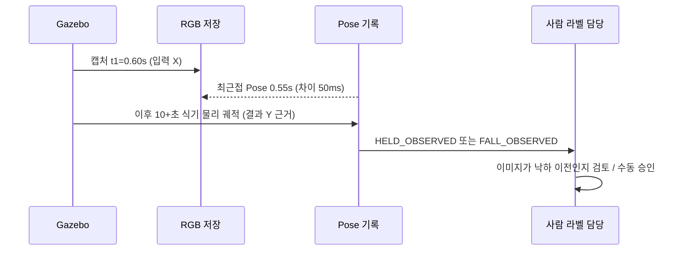

# B-11 교육 보고 — RGB 입력 시점과 10초 뒤 물리 결과를 나누는 이유

- 코드: `ai/scripts/extract_a13_candidates.py`; 입력은 B-10이 모든 체크를 통과한 비공개 `/raw` 디렉터리.
- 실제 원본 없음: A 보고서에 기재된 ST01/02 HELD·UN01/02 FALL과 50ms는 **기존 A 관측**이며 B 실측 아님.

## 왜 시간 축이 중요한가?

RGB 한 프레임은 접촉력/무게중심을 직접 관측하지 못합니다. 프레임 이후의 물리 결과로 **라벨을 제안**하지만 미래 정보를 C 이미지 입력 feature에 추가하면 정답 유출입니다.

## 코드와 결과

- `trace_audit`: JSONL 각 `sim_ns/entity/pose` 읽기, Entity 시간 역행·누락·NaN/Inf·비정규 Quaternion·관측 구간 외 데이터 거부.
- `group_key`: 초기 식기들의 위치·크기·자세를 0.01 단위로 정규화해 seed나 trial_id만 다른 사실상 동일 배치의 누수를 피함. 이것은 자동 독립성 **보장**이 아니라 근접 중복 사람 리뷰용 보수적 그룹입니다.
- `audit_trial`: 캡처/관측 시간, capture-vs-initial 낙하 여부, 초기/최종/trace 데이터의 구별, 계산한 낙하량/XY 이동량 (`derived`) 저장.
- `make_svg`: 실제 JSONL만 받아 z(m)·tilt(deg)·XY 경로 그래프 작성, RGB/physics 관측 시작·끝 표시.
- `review.html`: 원본 PNG와 세 그래프, 식기별 계산값, 출처/검토 대기 상태를 한 화면에서 표시.

## 제한과 테스트

신규 계약 fixture에서 4개 후보 및 그래프 12개를 생성할 수 있는지 검증합니다. PNG/JSONL 데이터는 **교육용 합성물**로 실제 결과라고 발표하지 않습니다. 원본 TAR를 받기 전 `B_REAL_CANDIDATES_VERIFIED`를 선언하지 않습니다.

A `verify_timing`이 허용하는 최대 이미지-Pose 250ms와 실제 인수 보고의 50ms를 구분합니다. A에서 9초를 허용해도 B 학습 검토는 10초 미만 시 `TEMPORAL_REVIEW_REQUIRED`로 차단합니다.
