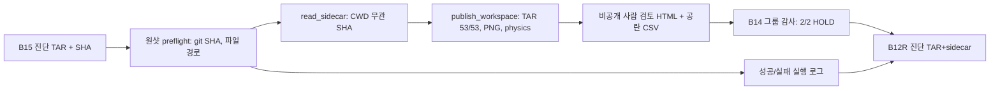

# B12R-CLI-01 — WSL2 원샷 사전검수 교육 보고서

## 역할과 목표

Python 기반 실증 데이터 인수의 무결성 검사와 운영자 Bash 배포 명령을 하나의 **변경 불가 SHA 기반 진입점**으로 묶습니다. 기존 B-12R 수신기·B-14R 독립성 감사기를 재사용하고 A-13 물리 재실험은 하지 않습니다.

## 데이터 흐름

**진단 ZIP/TAR와 실제 B-15 원본은 다릅니다.** 원샷이 생성하는 것은 리뷰용 추적 자료이지 학습 승인 데이터셋이 아닙니다.

## 구현 파일

- `scripts/smartdish_b12r_one_shot.sh`: POSIX 경로 탐색, 독립 `bash` 진입점, `python3` 실행. 직접 `source`하지 않습니다.
- `ai/scripts/smartdish_b12r_cli.py`: 옵션·고정 SHA·입력 자동 탐색·기존 Python SHA 인수기 호출·B14 그룹 감사·성공/실패 진단 자동 패키징.
- `ai/scripts/receive_b15_diagnostics.py`: 기존 검증 유지, 파일 부재 코드를 명시적으로 추가.
- `tests/test_b12r_release_cli.py`: 다양한 CWD/공백/괄호/외부 SHA·안전 경로·SHA 불일치/내부 오류/검토 HTML 자산/터미널 생존/승인 금지 E2E.
- `.github/workflows/smartdish-b-dataset-ci.yml`: 기존 테스트 유지 + 새 쉘 syntax + pytest 등록.

## 테스트 경계

- 기존 B12R+B14R **21 PASS** 유지.
- 추가 CLI 계약·오류 주입 **24 PASS** (2026-11-25 로컬).
- 위 45개는 B 관련 일부 계약입니다. GitHub에서 기존 전체 95 테스트 및 새로운 24 테스트를 같은 SHA로 완료해야 전체 배포 게이트 PASS입니다.
- 실제 업로드 B15 진단 TAR로 `RUN_SUCCESS/53`과 후보 PNG 4개, REVIEW_REQUIRED, B14 그룹 2/2 HOLD, 신규 진단 TAR+sidecar 생성까지 로컬 검수했습니다. 해당 실행의 로컬 SHA는 임시 fixture checkout이며 **향후 GitHub 최종 SHA와 동일하지 않으므로 WSL2 Owner 최종 PASS로 오인하지 않습니다**.

## 오류가 발생했을 때 학생이 확인할 항목

1. 첫 `B12R_ONE_SHOT_BLOCKED ...` 메시지를 찾습니다.
2. `B12R_DIAGNOSTIC_ARCHIVE_CREATED path=...`를 복사합니다.
3. `.sha256`와 진단 TAR의 외부 SHA가 일치하는지 검사합니다.
4. 진단 TAR의 `execution.log`, `diagnostic_status.json`, `SHA256SUMS`를 차례로 확인합니다.
5. 수정을 하더라도 운영자 승인 ledger를 자동 생성하지 않습니다.
6. `main`, Gazebo, C 모델 학습을 건드리지 않습니다.

## 배포 원칙

외부 다운로드·A-13 반복 인수·`exit 1` 최상위 명령·사용자 수동 `sha256sum -c`·고정된 임시 파일 경로를 사용자 원샷에 포함하지 않습니다. CI PASS와 WSL2 Owner PASS를 분리합니다.
