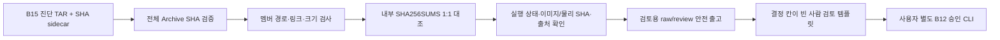

# SmartDish B-12R — 진단 아카이브로 재현 가능한 사람 검토 워크스페이스 구성

## 1. 필요성

WSL2 B-15 인수에서 4개 후보와 사람 검토 HTML은 PASS이지만, 이전에는 검토용 폴더를 로컬 사용자 작업공간에 묶어서만 다룰 수 있었습니다. 전달받은 B15 진단 TAR.GZ를 다른 안전한 디렉터리에 검증·복원해야 승인 담당자가 이미지와 물리 시계열을 명시적으로 확인할 수 있습니다.

## 2. 순서 및 안전 이유



- `tar.extractall()` 금지: 멤버 이름·타입·크기를 검증하고 내용은 `xb`로 새 파일에만 기록합니다.
- 원본 전체 A-13 TAR가 아닌 **B-15 부분 진단 묶음**만 다시 확인했으므로 `source_a13_full_archive_reverified=false`를 receipt에 기록합니다.
- 원본 image/physics SHA·크기를 후보 CSV와 재비교하고 PNG RGB 640×480을 검사합니다.
- 리뷰 자료는 비공개 폴더로만 출고합니다. 원본 PNG/Physics 파일은 0444로 보존합니다.
- 자동 승인 또는 미리 채워진 운영자 ID, 승인 라벨, 이용권 상태는 금지합니다.

## 3. 실행 예시

```bash
cd ~/samsung_AXI_B_REAL
PIN="$(git rev-parse HEAD)"
ARCHIVE='/absolute/path/to/smartdish_b_a13_20261125T055624Z_6624_diagnostics.tar.gz'
OUT="$PWD/ai/data/private/b12_review_${PIN:0:8}"
python3 ai/scripts/receive_b15_diagnostics.py --archive "$ARCHIVE" \
  --sha256-file "$ARCHIVE.sha256" --output "$OUT"
cat "$OUT/B12_REVIEW_RECEIPT.json"
```

동일 경로에 이미 데이터가 있으면 `B12R_OUTPUT_EXISTS_NO_OVERWRITE`로 실패하며, 무단 덮어쓰기하지 않습니다.

## 4. 직접 확보한 결과

- 사용자 실제 진단 SHA256: `912bfbc759e3fde3f48e70316638bc86dd30c52461ecd19410281bd7edf1f515`.
- 내부 53/53 SHA PASS, 원본 후보 4건, 제안 STABLE 2/UNSTABLE 2.
- B-12R 실제 진단으로 생성한 `B12_REVIEW_RECEIPT.json`에서 `operator_approvals=0`, `training_executed=false` 검증.
- 합성 악성/파손 fixture: SHA drift, sidecar 누락, 경로 이탈, 링크, 미등록 멤버, 위조 승인 상태, 이미지 손상, 덮어쓰기 차단 등 12종 테스트 PASS.

## 5. 주니어 학습 포인트

1. 아카이브 전체 SHA가 맞아도 내부 파일 집합과 경로는 왜 검증할까요?
2. B15 내부 53개와 A13 원본 88개 SHA 검사는 왜 별개일까요?
3. `review_decisions_template.csv`의 승인 칸을 공란으로 두는 이유는 무엇일까요?
4. 이미 `HELD_OBSERVED`여도 사람이 RGB 프레임 시점과 물리 근거를 확인해야 하는 이유는 무엇일까요?

**결론:** 검토 워크스페이스 구현·계약 테스트와 실제 진단 TAR 복원 PASS. **사람 승인 0** / 학습 데이터셋 미출고.
