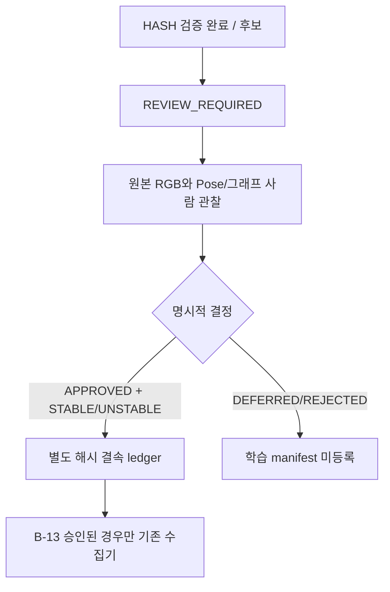

# B-12 교육 보고 — 물리 관측 후보와 실제 학습 정답은 왜 다른가?

- 소스: `ai/scripts/review_a13_labels.py`.
- 실제 권한 있는 검토자가 입력한 승인: **0건 / B_LABEL_APPROVAL_PENDING**.

## 원본 A 필드 보존

A `trial_summary.json`은 `motion.observation=HELD_OBSERVED|FALL_OBSERVED|INDETERMINATE`, `label=REVIEW_REQUIRED`, `ground_truth=NOT_OPERATOR_APPROVED`로 유지됩니다. `capture_metadata.json`의 `NOT_OBSERVED` 역시 변경하지 않습니다.



## 승인 원장

`approval_ledger.jsonl`은 후보·아카이브·원본 PNG·Physics의 SHA, 승인자 식별자, UTC 시각, 판단 사유, 사용권, 선택 라벨을 기록합니다. 전체 레코드는 `record_sha256`으로 검증하며 원본에 기록을 덮어쓰지 않습니다. SHA는 위·변조 탐지용이지 승인자 전자서명/자격 검증이 아닙니다. 인물/사용권의 진정성은 운영 책임자가 확인합니다.

```bash
python3 ai/scripts/review_a13_labels.py \
  --review-dir /path/to/work/review --raw-dir /path/to/work/raw \
  --candidate-id B13-... --reviewer-id '실제 운영자 식별자' \
  --decision DEFERRED --reason '원본 추가 확인 필요' --license-status UNVERIFIED
# 승인 시에만 --decision APPROVED --approved-label STABLE/UNSTABLE --license-status OWNED/AUTHORIZED
```

`--approve-all` 기능은 없으며 미승인 후보는 `manifest.csv`에 등록되지 않습니다. 시간 관계가 불확실하거나 `INDETERMINATE`이면 자동으로 승인 불가 상태입니다. 테스트에서 사용한 `human-test-only` 문자열은 **가짜 fixture 계약 검증**이며 실제 승인 수로 계산하지 않습니다.
