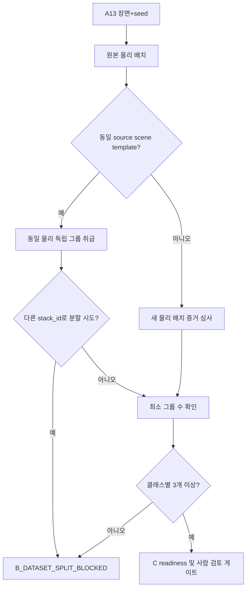

# SmartDish B-14R — Seed 반복을 독립 적재 배치로 오인하는 데이터 누수 방어

## 1. 원인 확인

실제 `scripts/smartdish_tray_world.py`의 `placements(scene_id, seed)`는 A-13에서 **4개 고정 적재 레이아웃**(`ST-01`, `ST-02`, `UN-01`, `UN-02`)을 사용합니다. `seed`에 따른 위치 변화는 `jitter=(random()-0.5)*0.002`이므로 개별 x/y 방향으로 약 ±0.001m에 불과합니다. seed가 다르다는 사실만으로 새로운 물리적 적재 구성이 생성되는 것은 아닙니다.

B-11 레거시 `group_key`는 좌표를 소수점 둘째 자리로 반올림한 문자열 SHA로 그룹화하므로, 특정 0.005m 경계 주변에서는 작은 seed jitter만으로 다른 `stack_id`가 나올 위험이 있습니다. 그 상태에서 C train/test를 분할하면 거의 같은 배치의 샘플이 독립 시험 표본으로 오인될 수 있습니다.

## 2. 최소 해결책

- 신규 읽기 전용 `ai/scripts/audit_a13_independent_groups.py`는 **A-13 해당 고정 source SHA**에 한하여 `source_scene_id`별 물리 template 그룹을 보수적으로 계산합니다.
- 기존 B-11 단일 파일럿 후보와 승인 이력의 식별자·SHA는 변경하지 않습니다.
- B-13 `register_a13_approved.py`의 split 작성 직전에 `approved_row_template_guard(rows)`를 삽입하여 동일 source template이 서로 다른 stack_id로 나타나거나 동일 template에서 라벨 충돌하면 **`B_DATASET_SPLIT_BLOCKED`로 Fail-Closed**합니다.
- 다른 데이터 출처의 기존 B·C 계약에는 이 A-13 특수 보호를 자동 적용하지 않습니다.
- **새로운 A 물리 레이아웃 및 source SHA가 도입되면**, B의 독립성 기준을 A의 구체적 geometry/physical_layout_id를 바탕으로 재검증해야 합니다. 확장 소스를 임의로 현재 4 template에 편입하지 않습니다.

## 3. 데이터 흐름

## 4. 이번 파일럿 실측

| 관측 결과 | 물리 template 수 | 평가 |
|---|---:|---|
| HELD_OBSERVED / STABLE 추천 | 2 (`ST-01`, `ST-02`) | 그룹 부족 |
| FALL_OBSERVED / UNSTABLE 추천 | 2 (`UN-01`, `UN-02`) | 그룹 부족 |
| 실제 사람 승인 | 0 | 계속 HOLD |

독립 배치 50개 목표는 **seed 50회 반복**으로 달성되지 않습니다. A 담당에게 실제 위치·식기 조합·초기 기울기·높이·반지름 등의 변화와 `physical_layout_id`를 관리하는 수집 인터페이스를 요청해야 합니다.

## 5. 검증

- 본 모듈 7개 합성 테스트: 동일 A template의 다른 seed·다른 stack_id 차단, 승인 라벨 충돌 차단, 다른 데이터 출처 기존 동작 유지, capture_config 손상 검사.
- 실제 사용자 B15 진단의 candidate CSV로 감사: STABLE 추천 2 / UNSTABLE 추천 2, split BLOCKED.
- 실제 C 모델 학습·운영자 승인·신규 Gazebo 생산 **NOT_RUN**.
