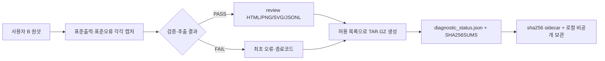

# SmartDish B-15 — 인수 결과·최초 실패를 자동 진단 TAR로 봉인하기

**범위:** B-10~B-14의 변경 없는 read-only 원본 인수 및 리뷰 파이프라인 / **목표:** 사용자 WSL2 원샷 실행 1회로 PASS/FAIL의 재검증 가능한 비공개 자료를 생성합니다. **A/ROS2/Gazebo/Nav2/C/D/S7 코드 변경 없음.**

## 1. 실제 문제

사용자 WSL2 실행 로그에서 원본 TAR 자동 검색, archive SHA PASS, 내부 `SHA256SUMS` **88/88 PASS**, ST-01/ST-02/UN-01/UN-02 후보 **4/4**, 물리 시계열 검증 PASS가 확인됐습니다. `review.html`은 추출됐지만 파일 자체만 복사하면 상대경로 `../raw/trial_*/tray_rgb.png`, `plots/*.svg`가 함께 전달되지 않으므로 별도 컴퓨터에서 그림이 깨집니다. 기존 실행기에는 오류 시 수집할 수 있는 진단 아카이브가 없었습니다.

해결 목표는 **재시뮬레이션 없이 동일한 사용자 로그를 재검증**하는 것입니다. 원본 A TAR는 이미 SHA 검증된 것으로 보존하고 B는 읽기만 합니다. 사람 승인 0건은 여전히 HOLD입니다.

## 2. 설계 흐름



`ai/scripts/package_a13_diagnostics.py`는 성공/실패와 관계없이 실행 종료 후 호출됩니다. 출력을 FIFO 두 개와 `tee`로 받아 **실시간 표시와 stderr 종료 계약을 동시에 유지**하고, 두 스트림이 flush된 후 결합 로그를 작성합니다. 작업 폴더 밖 파일, symlink, 원본 통째 TAR, 내부 승인 원장은 수집하지 않습니다.

허용 파일: `execution.log`, `diagnostic_status.json`, SHA256SUMS, 원본 출처·summary·trial별 이미지·Pose/물리 JSONL, 후보 CSV·리뷰 HTML·SVG 12개 중 실제 존재하는 파일. 원본 전체 TAR는 **경로와 승인 archive SHA만 메타데이터로 기록**합니다. 메타데이터의 `human_approved_labels: null`은 운영자 승인 0건을 인증하는 값이 아니라 자동 승인이 전혀 수행되지 않았다는 경계입니다.

## 3. 자동 배포 파일과 사용법

- 실행기: `scripts/smartdish_b_real_data_one_shot.sh`
- 진단 압축기: `ai/scripts/package_a13_diagnostics.py`
- 회귀: `tests/test_b_a13_diagnostic_archive.py`, 기존 `tests/test_b_a13_runner.py`와 계약 fixture 테스트.

```bash
cd ~/samsung_AXI_B_REAL
git fetch origin feat/smartdish-b-real-dataset
git merge --ff-only origin/feat/smartdish-b-real-dataset
bash scripts/smartdish_b_real_data_one_shot.sh --sha "$(git rev-parse HEAD)" --mode review
```

완료된 뒤 자동 출력되는 메시지에서 `SMARTDISH_B_DIAGNOSTIC_ARCHIVE_CREATED path=... sha256=... status=RUN_SUCCESS` 또는 `RUN_FAILED`을 확인합니다. 둘 모두 **데이터 라벨 승인 상태가 아닙니다.** 아카이브는 저장소 `ai/data/private/b_a13_diagnostics/smartdish_b_a13_<UTC>_<PID>_diagnostics.tar.gz`에 생성되며, `.sha256` 사이드카 파일도 생성됩니다. 공용 GitHub에 올리지 마십시오.

```bash
cd ~/samsung_AXI_B_REAL
DIAG="$(find ai/data/private/b_a13_diagnostics -maxdepth 1 -type f -name '*_diagnostics.tar.gz' -printf '%T@ %p\n' | sort -nr | head -1 | cut -d' ' -f2-)"
[[ -n "$DIAG" && -f "$DIAG" ]] || { echo B_NO_DIAGNOSTIC_ARCHIVE; exit 2; }
(cd "$(dirname "$DIAG")" && sha256sum -c "$(basename "$DIAG").sha256")
tar -tzf "$DIAG" | head -40
tar -xOzf "$DIAG" diagnostic_status.json
```

사용자에게 분석을 요청할 때는 진단 TAR.GZ 한 개와 사이드카 SHA 파일을 첨부하십시오. 파일 내부에 사용자 로컬 경로·시뮬레이션 메타데이터가 있으므로 공개 전 민감정보를 확인합니다.

## 4. 검증 및 결함 처리

1. 사용자 A-13 TAR 직접 검증(기존): archive SHA와 내부 88/88, 후보 4개 PASS.
2. 최초 진단 구현 RED: 과거 테스트 5개가 `private` 자체 생성 금지/기존 stderr 출력 위치를 가정했습니다. 새 정책은 실패 로그 보존을 위한 **진단 전용 private 디렉터리**를 생성하고, 미검증 `raw/review` 디렉터리는 절대 만들지 않습니다.
3. GREEN: stdout/stderr 스트림 별도 유지, 진단 TAR 성공/실패 동일 루틴, SHA 검증, 실제 리뷰 경로 보존.
4. 로컬 회귀: 기존 A13 테스트와 신규 5개 진단 테스트 **41 PASS, 3 SKIP**. SKIP은 로컬 테스트 환경에 원래 B collector가 없기 때문이며 원격 GitHub 체크아웃에서는 실행됩니다.
5. 진짜 A13 업로드 TAR를 입력으로 한 스모크: A 원본 88/88 PASS, PNG 4개, SVG 12개, `RUN_SUCCESS`, 아카이브 SHA sidecar 검증, 원본 TAR 미포함.
6. 원격 GitHub에서 동일 SHA B 전용 CI의 종결 상태와 테스트 총수를 별도 확인합니다. 여기 문서에 CI PASS를 미리 적지 않습니다.

## 5. 안전 경계와 후속 개발

- `--mode review`만 허용하며 자동 `APPROVED` 또는 `PHYSICS_OBSERVED` 등록은 하지 않습니다.
- `ST-01/02 HELD_OBSERVED`, `UN-01/02 FALL_OBSERVED`는 라벨 **추천 후보**일 뿐입니다.
- C readiness는 사람 승인 0, 그룹 수 부족(예비 클래스별 2그룹)으로 계속 BLOCKED.
- 실패 코드 유지: 예시 경로(3), SHA mismatch(2), 가져오기 단계 첫 오류코드, 패키징 자체 실패(4)를 구별합니다.
- 아카이브는 향후 분석 자료이지 A의 물리 증거 원본을 대체하지 않습니다. 판정하려면 `diagnostic_status.json`과 SHA 및 사용자가 제공한 실제 원본 TAR의 출처를 함께 대조합니다.
