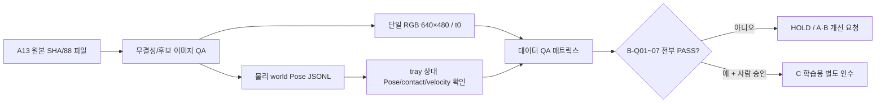

# B-DATA-QA-01 — DACON 기준 기반 데이터 품질 감사 개발·교육 보고서

## 문제와 학습 목표

DACON 236686 기준선 v1.0은 Train 1,000/Dev 100/Test 1,000개의 장면, RGB 384×384 두 시점(front/top)과 일부 10초 영상 표본을 기록합니다. 그러나 기준선 자체에서 **Dev 100장면과 Test 100장면의 front/top 완전 중복** 및 외형만으로 GT를 확정할 수 없음을 지적합니다. 원본 ZIP의 출처·영상 전체 좌표·누적 1.5cm 정량 판정은 본 QA에서 직접 확인되지 않았습니다.

SmartDish는 실제 A13 트레이 카메라 **단일 RGB 640×480** 및 이후 물리 관측입니다. 학생은 **입력 이미지(t0), 미래 물리 증거(label only), 사람 승인**이 서로 다른 계약임을 배웁니다. DACON 384×384 및 0.015m 기준을 무심코 SmartDish 제품 임계치로 복사해서는 안 됩니다.

## 설계 및 코드 파일

- `ai/scripts/audit_b_dacon_qa01.py`: 원본 A13 TAR streaming SHA/내부 전체 파일 SHA(추출 금지), PNG/픽셀 해시/밝기/aHash, SDF 카메라 포즈, pose 누적 거리(월드 한정), GT 승인 ledger 무결성, 클래스×장면×환경 커버리지, 분할 교차 누수/미검토 근접 중복, 7개 Gate PASS/HOLD를 기록합니다.
- `ai/scripts/smartdish_b_dacon_qa01_cli.py`, `scripts/smartdish_b_dacon_qa01_one_shot.sh`: Git HEAD SHA 고정, 기존 B12R 폴더 자동 검색, 실제 A13 TAR SHA 기반 자동 검색, 저장 위치와 CWD 독립 처리, 성공/실패 모두 private 진단 TAR/SHA 저장.
- `tests/test_b_dacon_qa01.py`: 합성 CSV/PNG/trace로 25개의 품질·보안·CLI 회귀 테스트. 실제 데이터값을 합성 테스트 결과로 속이지 않습니다.
- `docs/quality/SMARTDISH_B_DACON_DATA_QUALITY_BASELINE_20261125_KO.md`: 사용자 기준선을 변경하지 않고 보존합니다.

## 프롬프트·코드 설계의 이유

1. **`--source-archive` 선택적 확인**: B12R 진단 TAR는 원본 A13의 일부만 담습니다. 진단 TAR를 갖고 88/88을 *직접 재확인한 척* 하지 않도록 B-Q01은 원본 TAR를 다시 읽은 경우만 PASS입니다.
2. **중력/주행/좌표계 분리**: 식기 월드 좌표 `p_world`의 누적 변위는 트레이 상대 `p_tray`의 누적 변위가 아닙니다. 트레이 상대 기록과 contact·velocity가 없으면 B-Q03을 HOLD합니다.
3. **`ground_truth_approved=false` 유지**: `ST-01` 같은 시나리오 힌트와 자동 `FALL_OBSERVED`를 사람 승인 레이블에 승격하지 않습니다. 승인 ledger가 있더라도 독립 규칙 미검증이면 Q04 HOLD입니다.
4. **유사 이미지 ≠ 중복 확정**: 8×8 aHash 해밍 5 이하 후보는 확인 큐에만 기록합니다. 파일 SHA/픽셀 SHA 정확 일치와 구분합니다.
5. **Dacon Dev/Test 중복 교훈**: exact file+pixel hash, scene/stack 교차 분할을 별도로 검사하며 split이 없어 PASS할 수 없습니다. near-duplicate 검토 서명이 없어도 HOLD입니다.
6. **기준선 숫자 해석**: 60 장면/6 family, 0.015m, 384×384는 *제안*입니다. 제품 수집 프로파일과 GT 정책 승인 전에는 하드코딩한 학습 자동 허가 규칙으로 사용하지 않습니다.

## 테스트 및 수동 인수 경계

- 이 작업이 생성하는 출력은 `qa_report.json`, `sample_manifest_qa.csv`, `image_stats.csv`, `physics_trace_metrics.csv`, `camera_metadata.csv`, `duplicate_summary.csv`, `class_geometry_environment_coverage.csv`, `split_overlap.csv`, RGB 4장 대표 시트, SHA256SUMS입니다.
- private 진단 TAR.GZ, 외부 `.sha256`는 성공뿐 아니라 오류 종료 시에도 생성합니다(프로세스 강제 SIGKILL은 보장 불가).
- 산출물은 QA 감사용이며 C 학습 모델·승인 manifest·원본 증거 자체를 수정하지 않습니다.
- CI의 합성 25개 테스트는 MOCK_ONLY 데이터로 데이터 품질 로직을 검증합니다. 전체 저장소 CI 통과와 Owner WSL2 사용자 인수는 구분합니다.

## 교육 회고

기존 A13의 시연 성공은 **기능 인수**이고, B10의 원본 SHA 검증은 **원본 증거의 무결성**입니다. B-DATA-QA-01은 추가로 **샘플의 입력/정답 적합성, 다양성과 분할 품질**을 검사합니다. 서로 다른 레벨의 PASS를 합쳐서 `C 모델 학습 가능`이라고 결론 내리지 않는 것이 데이터 엔지니어링의 핵심입니다.
